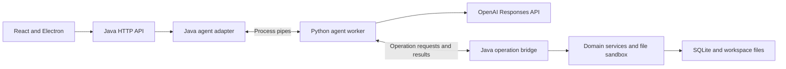

# Java to Python agent migration

[Developer guide](DEVELOPMENT.md) | [Backend standards](BACKEND_STANDARDS.md) | [Protocol contract](AGENT_PROTOCOL.md)

This tracker covers moving agent orchestration, OpenAI communication, and tool adapters from Java to Python while retaining Java's HTTP API, domain services, and persistence. It records the roadmap, completed changes, verification, and remaining decisions so work can resume one step at a time.

**Direction:** Java to Python, confirmed on 2026-10-16.

**Current state (refreshed 2026-10-16):** Reviewed committed HEAD is `4ee8cbe71c53a9991c4a8437dbfc83a992f2f2f5` on `python-agenticfeature`. It includes the merged architecture from `92290ae` and the committed `AgentServiceTest` correction. Steps 2 and 3 are complete; the application still runs the Java agent, with no Python worker or communication bridge. Continue Steps 4–6 from `4ee8cbe`; no separate test patch needs to be applied. Earlier checkout and local test observations are historical execution evidence.

## Current implementation baseline

| Area | Verified current state and source |
|---|---|
| Food validation | [FoodService](../src/main/java/org/tyler/service/food/FoodService.java) invokes the injected `IValidator<Food>` implemented by [FoodValidator](../src/main/java/org/tyler/validation/FoodValidator.java) before DAO insertion. Required fields, real calendar dates, and nonnegative amounts/nutrition are shared domain rules. [RecordFoodTool](../src/main/java/org/tyler/tool/foodRecordTool/RecordFoodTool.java) deserializes arguments, delegates to `IFoodService`, and serializes the food-only result. |
| Workout and plan validation | [WorkoutValidator](../src/main/java/org/tyler/validation/WorkoutValidator.java) enforces workout rules through the workout service. [WorkoutPlanService](../src/main/java/org/tyler/service/workout/WorkoutPlanService.java) owns plan date/goal/equipment validation, including the seven-representable-days guard. [GenerateWorkoutPlanTool](../src/main/java/org/tyler/tool/workoutPlanTool/GenerateWorkoutPlanTool.java) checks JSON shape and passes missing/null text fields to the service. |
| HTTP validation | [GenericExceptionHandler](../src/main/java/org/tyler/exceptionHandler/GenericExceptionHandler.java) explicitly maps missing required parameters and argument type mismatches to HTTP 400. [DomainValidationContractTest](../src/test/java/org/tyler/service/DomainValidationContractTest.java) exercises real shared services behind HTTP and tool adapters. |
| Frontend checks | [package.json](../frontend/package.json) includes `typecheck`, `test:ui`, `test:startup`, and `test:version`. Tests/helpers live under [frontend/tests](../frontend/tests); [Vitest configuration](../frontend/vitest.config.ts) selects `tests/**/*.test.{ts,tsx}`. These changes are already merged. |
| CI | [CI workflow](../.github/workflows/ci.yml) runs Java 26 `mvn --batch-mode clean verify`, then Node 22 `npm ci`, supporting tests, production build, type checking, and UI tests. [Run 38950225490](https://github.com/phanmi/tyler_agent/actions/runs/38950225490) passed all **261 backend tests** for `4ee8cbe`, as reported in the review. This supersedes the earlier reported 256-case CI baseline. |
| Earlier local backend verification | **261 tests passed**, zero failures/errors/skips, at 14:46:19 EDT on 2026-10-16 against `92290ae` plus the correction subsequently committed in `4ee8cbe`. That run included 35 agent cases and 14 client-factory cases. The correction replaced three outdated argument cases with eight shape/shared-service cases, accounting for the five-case increase from 256. This is separate evidence from the later CI run. |

The working tree was clean before this documentation refresh. The agent-test correction is committed in `4ee8cbe`; there is no outstanding correction to preserve or locate. This refresh changes documentation only. Frontend suite presence and CI wiring were inspected during the earlier refresh, but frontend checks were not rerun locally. Step 1 remains partial until its remaining inventory and frontend verification evidence gates are satisfied.

## Progress

| Step | Work | Status | Completion evidence or remaining gate |
|---|---|---|---|
| 1 | Establish the migration baseline | Partially complete | Committed HEAD `4ee8cbe`, included test correction, shared validation, and frontend/CI configuration reconciled above. Finish the contract/startup inventory and frontend verification evidence. |
| 2 | Characterize the Java agent | Complete | CI run 38950225490 passes 261 backend tests on `4ee8cbe`. Earlier local verification includes 35 agent and 14 factory cases; historical results remain dated below. |
| 3 | Define the Java and Python protocol | Complete | Version 1 specification/schema; 90 message fixtures, 24 framing fixtures, and 30 sequence scenarios. Static verification is recorded below; runtime conformance belongs to Step 4. |
| 4 | Create and package the Python worker skeleton | Not started | Contract fixtures pass in both languages; a reproducible environment and packaged Windows worker complete a credential-free handshake. |
| 5 | Implement Java worker lifecycle and adapter | Not started | Fake-worker tests prove request routing, callbacks, failures, and process cleanup. |
| 6 | Expose Java service operations | Not started | Allowlisted handlers preserve service validation, result formats, and storage guarantees. |
| 7 | Port the agent loop and tool adapters | Not started | Python passes the behavior baseline with a fake model provider. |
| 8 | Verify the complete persistence path | Not started | Real subprocess and temporary-database tests cover success, rollback, and interrupted writes. |
| 9 | Integrate desktop packaging and CI | Not started | Clean-machine Windows smoke tests and required CI checks pass. |
| 10 | Roll out Python and retire the Java agent | Not started | Default switched, rollback window completed, obsolete code and references removed. |

The roadmap describes future work. A planned configuration, component, or test below must not be treated as already available.

Each step's definition of done is its acceptance checklist. Check an item only when the execution record identifies the supporting change or verification. A step is complete only when every item passes; deferred items keep it partial. Use the current implementation baseline for new work and the dated execution records for past results; test totals always identify the tested revision and local changes.

## Target architecture and boundaries

Java will own the Python child process and communicate over private standard input/output pipes. Python will have no additional listening port. Electron and the development launcher will continue starting Java.



| Responsibility | Target owner |
|---|---|
| Provider client, model requests, response chaining, and reply extraction | Python |
| Tool definitions, model-argument parsing, and tool orchestration | Python |
| Public chat and history HTTP contracts | Java |
| API-key storage, profile storage, and history persistence | Java |
| Shared domain validation, food/workout operations, and plan templates | Java services |
| Database transactions, DAOs, SQL resources, and sandbox restrictions | Java |
| Python startup, readiness, shutdown, and request correlation | Java process adapter, with worker cooperation |

Migration constraints:

- Preserve HTTP routes, JSON fields, status mappings, tool names, argument schemas, and tool result formats unless an explicit contract change is approved.
- Keep Python tools behind the shared Java service boundary. Do not give Python direct SQLite access or duplicate domain rules there.
- Preserve stable record IDs, existing data, plan duplicate policy, and non-overwriting behavior. Sequential repeat behavior does not imply concurrent deduplication.
- Keep each atomic service operation in its existing Java transaction. A conversation containing several tools is not one database transaction.
- Do not replay a conversation or write operation automatically after an uncertain result, or silently fall back to Java after tools may have run.
- Keep credentials out of process arguments and logs. Transfer the credential snapshot through the private pipe and refresh it for later requests after a key change.
- Use the existing global release-version source. A protocol compatibility version is a separate concept.
- All agent functionality must be implemented in Python under the [backend standards](BACKEND_STANDARDS.md#agent-implementation-language). Existing Java agent code is temporary migration/rollback code; the retained Java process adapter and operation bridge implement infrastructure and service access, not agent decisions.

## Executable roadmap

### Step 1 Establish the migration baseline

1. Use the recorded merged HEAD as the current reference; reconcile any subsequent merges and local changes before implementation.
2. Continue on the existing `python-agenticfeature` migration branch. Record a new branch/base if that changes.
3. Inventory current HTTP/tool contracts, validation, history behavior, and process startup.
4. Run backend and frontend baseline checks and record their results. Use temporary workspaces and databases for tests.

**Definition of done**

- [x] Record the intended source branch, base commit, migration branch, and disposition of existing working-tree changes. See the current implementation baseline and dated merged-HEAD refresh below.
- [ ] Inventory the public chat/history HTTP contracts and all six tool names, schemas, outputs, validation, and side effects, with source references.
- [ ] Record startup ownership, readiness, storage paths, release-version handling, and the target Java/Python responsibility split.
- [x] Reconcile earlier pending frontend work with the chosen baseline. `typecheck`, `test:ui`, and the dedicated `frontend/tests/` directory are included in the merged HEAD and wired into CI.
- [ ] Run the selected baseline's backend and frontend checks successfully and record commands, runtime versions, and results. Step 2's backend run can be reused only if the tested code still matches the selected baseline.

### Step 2 Characterize the Java agent

1. Exercise the real `AgentService` with deterministic provider responses and real SDK message objects.
2. Cover plain replies, tool rounds, ordered calls, function-call IDs, response chaining, and the five-round boundary.
3. Cover text, refusals, empty replies, unknown tools, invalid arguments, authentication, provider, tool/storage, and history failures.
4. Verify history is appended once after successful completion and that failures do not cause application-level replay.
5. Verify client caching, key rotation/removal, and current-client lookup for subsequent requests.
6. Record edge cases as current behavior; do not silently change them during characterization.

**Definition of done**

- [x] Deterministic tests execute the real Java agent with mocked provider responses and real SDK messages, without live requests or credentials.
- [x] Tests verify initial history/message/model inputs, complete tool definitions, ordered calls, unchanged arguments/results, call IDs, and response chaining.
- [x] Tests cover plain text, refusals, empty output, and both successful completion and unresolved calls at the five-round limit.
- [x] Tests assert exact exception behavior for unknown tools, malformed arguments, authentication/provider failures, tool validation/storage failures, and history failures, retaining causes or exception identity as applicable.
- [x] Tests verify one successful exchange append, no exchange on earlier failures, no application-level replay, and fresh client/history lookup on later requests.
- [x] Factory tests verify deferred key lookup, unchanged-key reuse, changed-key replacement, missing/removed keys, and key-read failures.
- [x] Focused and full backend suites pass; preserved edge cases and verification limitations are recorded below. Production behavior is unchanged.

### Step 3 Define the communication contract

1. Specify versioned UTF-8 newline-delimited JSON messages: `ready`, `run`, `operation_request`, `operation_result`, `completed`, `failed`, `cancel`, and `shutdown`.
2. Define request IDs, operation-call IDs, payload schemas, size limits, timeouts, and handling of unknown/stale messages.
3. Distinguish validation, authentication, provider, storage, and worker failures while preserving existing HTTP error behavior.
4. Define decimal/date/null serialization without losing precision or narrowing previously accepted values.
5. Reserve stdout for protocol messages and stderr for logs. Add shared valid and invalid message fixtures.

**Definition of done**

- [x] A versioned contract defines every message type, required/optional fields, direction, valid sequencing, and terminal outcomes.
- [x] Framing, encoding, message-size limits, request/operation correlation, and handling of unknown, duplicate, stale, and incompatible messages are specified.
- [x] Every failure category has a documented Java/HTTP mapping; cancellation, timeout, and lost-result behavior explicitly prohibit automatic write replay.
- [x] Decimal, date, null, escaping, and tool-result representations preserve the baseline contracts without precision loss or narrower accepted inputs.
- [x] Shared valid/invalid fixtures state the expected accepted value or rejection reason, including multiline/Unicode content and incompatible protocol versions.
- [x] Credential transfer, stdout/stderr separation, and redaction rules are specified. The contract identifies the executable fixture checks to be completed in Step 4 before lifecycle integration.

Step 3 defines the contract and fixture expectations in [agent protocol version 1](AGENT_PROTOCOL.md). Its completed checks are recorded in [the Step 3 execution entry](#2026-10-16-step-3-completed). Step 4 establishes the Python environment and proves both languages implement them, avoiding a dependency on a worker that does not exist yet.

### Step 4 Create the Python project and packaging prototype

1. Add `agent-python/` with `pyproject.toml`, application code under `src/tyler_agent/`, and all tests/helpers/fixtures under `tests/`.
2. Select and pin the Python runtime, the official OpenAI SDK, development tools, and a reproducible dependency lock.
3. Configure formatting, linting, type checking, and unit tests.
4. Implement a minimal worker that exchanges protocol messages without contacting a model provider.
5. Prove the worker can be packaged for Windows and started without a separately installed Python environment.

**Definition of done**

- [ ] A fresh checkout can create the documented Python environment from pinned runtime/dependency specifications and the committed lock.
- [ ] Python source lives under `agent-python/src/tyler_agent/`; tests, helpers, mocks, and fixtures live under `agent-python/tests/`.
- [ ] Documented formatter, lint, type-check, and unit-test commands pass; no live credentials or paid provider calls are required.
- [ ] Java and Python codec/validation tests pass the Step 3 fixtures, including rejection of malformed and incompatible messages.
- [ ] Development and packaged worker prototypes complete the versioned readiness handshake without an API key or provider access, with protocol-only stdout.
- [ ] The packaged worker launches on Windows without a separately installed Python runtime or startup dependency downloads; the build command and smoke-test environment are recorded.

### Step 5 Implement the Java adapter and process lifecycle

1. Add `PythonAgentService` behind the existing `IAgentService` interface. Keep Java responsible for loading credentials/history and appending the completed exchange.
2. Introduce explicit `agent.implementation=java|python` selection during migration; exactly one implementation serves requests.
3. Give Java sole ownership of worker startup and shutdown. Process callbacks independently while the original HTTP request waits, avoiding a deadlock.
4. Define a bounded request queue and correlation for the single persisted conversation so histories and tool results cannot mix.
5. Preserve the existing backend readiness nonce/port protocol; announce readiness after worker compatibility is confirmed, without requiring an API key.
6. Cover timeouts, cancellation, worker crash, normal shutdown, pipe closure, and Java termination. Verify Python exits even during a pending model request on Windows.

**Definition of done**

- [ ] Configuration selects exactly one `IAgentService` implementation; the existing HTTP chat/history response contracts remain compatible and selection is tested.
- [ ] Java is the sole worker process owner. Readiness preserves the existing nonce/port handshake and waits for worker compatibility without requiring a valid API key.
- [ ] Tests prove operation callbacks are processed while the chat request waits, with no deadlock or cross-request result/history mixing.
- [ ] Queue limits, request deadlines, and cancellation behavior are documented and tested, including rejection of late responses and prevention of further tool calls after cancellation.
- [ ] Each request receives the current credential snapshot; missing/changed keys and provider/storage/worker errors retain the documented behavior without leaking credentials.
- [ ] Fake-worker tests cover startup failure, protocol mismatch, crash, timeout, and lost results without conversation replay or silent fallback.
- [ ] Normal shutdown, startup cancellation, pipe closure, and forceful Java exit terminate the worker on Windows, including during pending provider work; evidence includes process-exit checks.

### Step 6 Expose Java operations through an allowlisted bridge

1. Map the six existing tools to narrow handlers: `recordFood`, `generateWorkoutPlan`, `GetUserInfo`, `readFile`, `writeFile`, and `getCurrentTime`.
2. Delegate to existing services or sandbox abstractions. Do not expose arbitrary Java method calls, SQL execution, or unrestricted paths.
3. Preserve the existing service validation boundary when bypassing Java tools: `FoodService` invokes `FoodValidator`; workout and plan services enforce their domain rules. Inventory adapter parsing/coercion and output formatting separately. Do not relocate or duplicate shared domain rules in Python or bridge handlers.
4. Preserve tool-name capitalization, result formatting, date semantics, file restrictions, and exception distinctions.

**Definition of done**

- [ ] Every existing tool has an explicit allowlisted operation mapping and service/sandbox destination; the bridge cannot invoke arbitrary methods, SQL, or paths.
- [ ] Dependency/wiring checks prove handlers call the shared services or sandbox abstractions, without DAO/DAL access from agent adapters.
- [ ] Existing adapter shape/parsing rules are inventoried and preserved when bypassing the legacy adapter. Bridge handlers call the existing services, including their shared validators; tests cover missing fields, malformed dates, negative values, and plan date bounds without duplicating those rules in Python.
- [ ] Contract tests preserve tool-name capitalization, argument/result formats, decimal/date semantics, record IDs, and exception distinctions.
- [ ] Tests reject malformed/unsupported operations before side effects and retain sandbox path restrictions and persistence safeguards.
- [ ] Service tests still verify preview without writes, transactional plan saving, sequential duplicate handling, and preservation of pre-existing edits. No concurrent deduplication guarantee is added.

### Step 7 Port the agent loop and tool adapters

1. Build the initial model request from the supplied configuration, history, and message.
2. Execute returned calls in their existing order and route business operations through Java.
3. Submit outputs with their original call IDs and continue using the previous response ID, within the characterized round limit.
4. Preserve model selection, schemas, descriptions, text/refusal extraction, and failure behavior.
5. Configure SDK timeout/retry behavior explicitly. Avoid conversation/write replay after an uncertain outcome.

**Definition of done**

- [ ] Model calls, context assembly, tool definitions/parsing/dispatch, response chaining, and reply extraction execute in Python; the Java bridge contains no agent decision logic.
- [ ] A parity matrix maps each Step 2 behavior to an equivalent Python test or an explicitly documented contract change; all mapped tests pass with a fake provider.
- [ ] All six tool adapters preserve their names, descriptions, complete schemas, argument handling, and result formats while calling Java operations for domain/storage work.
- [ ] Tests prove ordered calls, original call-ID linkage, the round-limit behavior, text/refusal extraction, and correct success/failure completion messages.
- [ ] Timeout/retry settings are explicit; failure after a completed operation does not replay tools, the conversation, or a fallback implementation.
- [ ] Python keeps history and credential persistence in Java and does not open application databases or bypass the file sandbox.
- [ ] Required Python checks and affected Java tests pass. Any side-effect comparisons use separate temporary data stores rather than user data.

### Step 8 Verify the complete persistence path

1. Exercise HTTP to Java to a real Python subprocess to Java services, using a fake model provider and temporary databases.
2. Check food append semantics and identity, plan repeat behavior, preserved user edits, and actual transaction rollback after an insert failure.
3. Check invalid inputs, provider/storage failures, and history completion behavior through the full boundary.
4. Simulate worker failure before a write and after a write but before its result returns; assert persisted state and no replay.
5. Cover cancellation, concurrent incoming requests, and shutdown during active work.

**Definition of done**

- [ ] Integration tests execute the real HTTP/Java/Python/Java-service path with a real subprocess and temporary SQLite databases, mocking only the external model provider where needed.
- [ ] Food insertion preserves older records and stable IDs; independently saved equal entries remain addressable through existing read/delete paths.
- [ ] Successful and sequential repeated plan saves preserve the existing duplicate policy, IDs, and manual edits; preview remains read-only.
- [ ] An injected failure after one or more plan inserts leaves no partial plan and preserves pre-existing workouts, verified by database queries after rollback.
- [ ] Validation, authentication, provider, storage, and history failures retain their documented response/completion behavior; successful history exchanges are saved once.
- [ ] Worker failure before a write and after a committed write but before its result returns produces the expected database state with no automatic replay.
- [ ] Cancellation, concurrent incoming requests, late results, and shutdown tests show no cross-request contamination, subsequent cancelled tool execution, or orphan worker.
- [ ] Integration commands, environments, outcomes, and remaining limitations are recorded; mocked delete/cleanup assertions are not accepted as rollback evidence.

### Step 9 Integrate desktop packaging and CI

1. Bundle the worker outside ASAR alongside the Java runtime and JAR. Java remains the worker's process owner.
2. Derive release metadata from `.mvn/maven.config`; install dependencies during development/build, never application startup.
3. Add Python static checks/tests and Java/Python integration checks while retaining backend/frontend verification.
4. Add a Windows packaged-app smoke gate. Test paths with spaces/non-ASCII characters, missing/incompatible workers, startup failure, active-request quit, and forceful Java exit.

**Definition of done**

- [ ] Reproducible packaging includes the worker outside ASAR with the Java runtime/JAR, and release metadata derives from the existing global version source.
- [ ] Required CI checks include locked dependency installation, Python formatting/lint/type checks/tests, Java verification, cross-process integration tests, and the selected frontend checks/build.
- [ ] A Windows packaged-app smoke check runs successfully and is a required release/startup-change gate, with the tested artifact and environment recorded.
- [ ] A clean Windows environment runs the artifact without separately installed Java/Python or runtime dependency downloads; Java still owns worker lifecycle.
- [ ] Smoke tests cover spaces/non-ASCII paths, missing/corrupt/incompatible workers, startup timeout/failure, normal quit, quit during startup or an active request, and forceful Java exit.
- [ ] Shutdown/failed-start checks verify no worker remains. Protocol output, credentials, and logs respect the documented boundaries.
- [ ] Developer setup, build, troubleshooting, and release instructions match the commands and artifacts verified by CI/smoke tests.

### Step 10 Switch defaults and retire the legacy agent

1. Enable Python in development, then switch the default only after the preceding gates pass.
2. Retain Java as a configuration-and-restart rollback option for one validated release. Do not replay in-flight requests during rollback.
3. After the rollback window, remove obsolete Java orchestration/tools and the OpenAI Java dependency, following a caller inventory.
4. Update architecture checks to cover the bridge and Python persistence boundary. Remove obsolete references from tests and documentation.
5. Update installation, development, testing, logging, lifecycle, packaging, and recovery documentation and applicable standards.

**Definition of done**

- [ ] Steps 1-9 have passed their acceptance criteria, and the release/commit selected for rollout is recorded.
- [ ] Python is the tested default in development and packaged runs, preserving HTTP/tool contracts and existing persisted data.
- [ ] During one validated release, switching configuration and restarting restores the legacy implementation without replaying in-flight requests; the rollback exercise and release are recorded.
- [ ] After that window, a caller inventory precedes removal of obsolete Java agent/tool code, Java provider dependencies, and the temporary implementation selector. Remaining Java adapters implement infrastructure/service access only.
- [ ] Production code, tests, configuration, and active documentation contain no obsolete legacy-type references; dated historical records may retain them as history.
- [ ] Architecture checks enforce Python agent ownership and the shared service boundary; the full required test/build/package suite passes after removal.
- [ ] Standards, setup, operation, testing, and recovery documentation match the final architecture. The replacement recovery procedure uses a previously validated release after the legacy implementation is removed.

## Execution record

### 2026-10-16 Step 2 completed

Historical source: `f18aa42`, with characterization changes then uncommitted. This checkout preceded the merge recorded in the current baseline; it lacked the later frontend `typecheck`/`test:ui` suites and dedicated testing directory. At that time, required/nonnegative food checks were in the tool, the food service required only a nonblank date, and the plan service lacked the upper-date guard. These observations must not guide new bridge implementation. Migration work was subsequently committed in `b8355ac` and merged with `main` in `92290ae`.

The then-existing Java implementation was characterized before any migration of production code:

- Expanded [AgentServiceTest](../src/test/java/org/tyler/service/agent/AgentServiceTest.java) from 2 to 30 executed cases.
- Expanded [OpenAIClientFactoryTest](../src/test/java/org/tyler/service/agent/OpenAIClientFactoryTest.java) from 3 to 14 executed cases. Constructed SDK clients use synthetic keys and are closed during test cleanup.
- Added assertions for full overridden tool schemas using the real plan-tool adapter, alongside default no-argument schemas.
- Verified real plan-tool parsing failures without invoking its application service.
- Added exact exception-type and retained-cause/identity assertions, ordered call/output checks, history checks, and checks that completed tools are not replayed.
- Added a developer-guide entry for the baseline. The detailed record now lives in this tracker.

Tests use mocked provider and history boundaries. They establish agent orchestration behavior, not real database rollback, SDK transport retries, live model behavior, Python interoperability, or packaged lifecycle behavior. Those checks belong to later steps. Frontend checks were not run for this backend-test change.

### Preserved edge cases

These are observations from the Step 2 run above. Use the current merged characterization suite to verify parity; historical observations do not override later shared-service rules.

| Case | Behavior observed in that run |
|---|---|
| Five tool rounds complete but the last response requests another tool | That extra call is not executed. Text/refusals from the last response are returned and saved; a tool-only response produces an empty reply. There is no round-limit exception. |
| Empty response or message | An empty reply is returned and appended to history. |
| Multiple text/refusal parts | Final-response parts are concatenated in order without added separators. Intermediate response text is not included. |
| Provider authentication/permission failure | `OpenAIKeyException` retains the provider exception as its cause. Other provider failures propagate unchanged. |
| Tool/provider failure after an earlier tool completed | Processing stops without a history exchange or application-level retry. The agent performs no rollback of completed tool effects. |
| History saving fails after a reply | The failure propagates; provider requests and completed tools are not replayed. |
| Key changes or is removed | The next request re-reads the key. A changed key creates a replacement client; a missing key blocks chat despite a cached client. |

### Verification record

| Run on 2026-10-16 | Result | Follow-up |
|---|---|---|
| Initial focused run with Mockito self-attachment | Interrupted before a completed test result; local Windows JVM attachment failed to open its pipe. | Load Mockito explicitly through the test JVM's `-javaagent` option. |
| Focused run with explicit Mockito agent | 41 cases reported, 0 assertion failures, 1 fixture error. The SDK `InternalServerException` builder required a status code. | Corrected the test fixture to specify HTTP 500. |
| Final focused run | 44 tests passed: 30 agent and 14 factory cases; no failures/errors/skips. | Successful baseline at 14:04:05 EDT. |
| Full backend suite | 153 tests passed; no failures/errors/skips; `BUILD SUCCESS`. | Completed at 14:04:30 EDT. |
| Diff whitespace check | `git diff --check` passed. | No whitespace errors. |

The runs used Java 26, OpenAI Java SDK 4.54.0, and Mockito 5.23.0. The full-suite output was saved locally at `target/agent-baseline-full-test.log`; Surefire reports are under `target/surefire-reports/`. These generated files are not durable tracked evidence and can be replaced by a later build; this dated summary records their verified results.

Standard commands from the repository root:

```powershell
mvn "-Dtest=AgentServiceTest,OpenAIClientFactoryTest" test
mvn test
git diff --check
```

The successful local runs used offline Maven, the existing local dependency cache, forked compilation, and explicit Mockito agent loading. The following reproduces those options using paths derived from the local user profile:

```powershell
$testRepository = Join-Path $env:USERPROFILE '.m2/repository'
$mockitoAgent = Join-Path $testRepository 'org/mockito/mockito-core/5.23.0/mockito-core-5.23.0.jar'
$testJvmOptions = '-javaagent:"' + $mockitoAgent + '"'
$env:MAVEN_OPTS = '-Duser.home="' + $env:USERPROFILE + '"'

mvn -o "-Dmaven.repo.local=$testRepository" '-Dmaven.compiler.fork=true' "-DargLine=$testJvmOptions" '-Dtest=AgentServiceTest,OpenAIClientFactoryTest' test
mvn -o "-Dmaven.repo.local=$testRepository" '-Dmaven.compiler.fork=true' "-DargLine=$testJvmOptions" test
```

Offline execution requires dependencies to be cached already. The Mockito path reflects the tested dependency version; update it if that dependency changes. These runner options were supplied locally and did not change the project build configuration.

### 2026-10-16 Migration tracker established

Created this tracker and linked it from the developer guide. Moved the detailed baseline observations here to keep the roadmap and execution history together. Verified relative file links, the linked execution-record heading, PowerShell example syntax, and diff whitespace. The command examples were parsed without execution; the backend results above are from the completed Step 2 runs.

### 2026-10-16 Acceptance criteria and language ownership clarified

Added a definition-of-done checklist to every roadmap step, retaining Step 2's verified completion status and leaving future criteria unchecked. Separated protocol specification/fixtures in Step 3 from executable Java/Python conformance checks in Step 4. Updated the backend standards to require Python for agent functionality while preserving Java's HTTP, infrastructure, domain-service, and persistence responsibilities. This documentation change does not implement the Python worker or rerun the Step 2 suites.

Documentation verification passed: all ten steps have acceptance checklists, checked items match the recorded completion state, relative links and heading anchors resolve, and whitespace checks pass.

### 2026-10-16 Step 3 completed

**Changes**

- Added [the version 1 protocol specification](AGENT_PROTOCOL.md) and [closed JSON Schema](../contracts/agent/v1/message.schema.json) for all eight message types and six allowlisted Java operations.
- Added shared [message](../contracts/agent/v1/fixtures/messages.json), [framing](../contracts/agent/v1/fixtures/framing.json), and [sequence](../contracts/agent/v1/fixtures/sequences.json) fixtures. They define transport expectations for both future implementations; language-specific tests will consume these files rather than maintain separate copies.
- Defined private process pipes, session/request/operation correlation, directions, framing, deadlines, queue bounds, cancellation, shutdown, terminal/history sequencing, and handling of duplicate/stale/incompatible messages.
- Specified exact decimal strings and full-range ID strings, expanded date strings, explicit nulls, Unicode/escaping, and the existing model-visible result representations. No domain date/numeric rules were tightened. New frame/queue/deadline limits are explicitly documented operational limits for rollout.
- Recorded error categories and the current Java/HTTP mappings, credential snapshots and redaction, and Java's authoritative write-outcome ledger. A lost result or cancelled worker never authorizes automatic replay or proves that a Java write rolled back.
- Linked the contract from the developer guide and backend standards. Python retains agent decisions and model-facing adapters; Java retains process infrastructure, shared services, and storage. No production Java/Python code, HTTP API, schema, or user data changed in this step.

**Review corrections**

The source compatibility review preserved legacy file-argument HTTP 500 behavior and profile record-style text, and identified timing details that are now explicit: a Python timeout can occur while a Java write is pending, a request can cross cancellation without being dispatched, and the next chat waits for Java history persistence. Decimal wording now reflects Java's normalization of negative zero; malformed ID syntax and numeric overflow have distinct rejection stages. Sequence review corrected a forwarded error so its category/code/message remain unchanged and documented a worker claim that must not override Java's unresolved-write ledger.

**Verification on 2026-10-16**

| Check | Result and scope |
|---|---|
| Strict Ajv 2020-12 schema compilation and message cases | 90/90 expectations passed: 44 structurally valid, 46 invalid. Invalid-case rejection precedence also matched. Five valid shapes separately specify semantic `INVALID_VALUE` expectations for Step 4. |
| Independent PowerShell `Test-Json` check | 90/90 shape expectations passed with PowerShell 7.6.5 using the command published in the protocol document. |
| Raw framing fixture audit | 24/24 expectations passed: chunk boundaries, split UTF-8, escaping, exact decoded values, malformed/duplicate JSON, invalid bytes/surrogates, version rejection, and size limits. The boundary frames contain exactly 16,777,216 and 16,777,217 bytes before LF. |
| Sequence fixture integrity | 30 scenarios / 136 steps checked. All 121 wire messages pass the schema after resolving references and all 18 existing-field replacements; 15 local events are recognized. Directions and expected state/effect rules were reviewed. No application state machine was executed. |
| Documentation and whitespace | All 51 relative file links/heading anchors in the four affected documents resolve; Step 3's six checked acceptance items verified. New contract files have no trailing whitespace; `git diff --check` passed. |

Local static audits used Node `v24.20.0` and the already-installed Ajv `8.20.0`; no dependencies or lockfiles changed. Commands from the repository root were:

```powershell
# Reproducible message-shape check: run the PowerShell block in AGENT_PROTOCOL.md.
node target/protocol-review/message-sequence-audit.cjs
node target/protocol-review/framing-audit.cjs
node target/protocol-review/documentation-audit.cjs
git diff --check
```

The Node audit scripts are temporary review helpers under ignored `target/`, not committed test runners or durable evidence. Their checks are recorded here; future Java/Python suites must implement the conformance gates against the committed fixtures. The initial PowerShell example piped an empty-array fixture away; using `ConvertTo-Json -InputObject` fixed the example, and the published block passed all 90 cases. A local `python --version` probe found an inaccessible WindowsApps alias; the static audit used available Node instead. Python runtime selection remains Step 4.

**Limitations at Step 3 completion:** These checks established contract/fixture consistency. No Java/Python codec, subprocess supervisor, HTTP bridge, or database integration for the new protocol existed, so runtime acceptance, semantic validators, cancellation, history races, and transaction outcomes were not tested. Backend/frontend suites were not rerun for that specification-only step; the 153 backend passes above were the earlier Step 2 results. Steps 4–9 retained their executable gates. Step 1's baseline/branch decisions were still pending, and no migration commit or PR was created during that step. The subsequent merged-HEAD refresh below supersedes its checkout and test-baseline facts.

### 2026-10-16 Merged-HEAD baseline refreshed

Inspected HEAD `92290ae`, its merge parents, frontend scripts/test layout/CI, shared service validators, plan date guard, and HTTP binding advice. Updated current-state facts and Step 1/6 instructions in this tracker and corrected the protocol's food/date/plan boundary descriptions. Earlier observations remain in the dated Step 2/3 records. The protocol wire shapes and fixtures are unchanged: malformed domain values still pass transport shape validation and are rejected by Java services.

The agent-test fix separated shape rejection from shared-service validation. Reproducing the old test gave one failure for `{}` because the service mock did not validate missing fields. The corrected agent/tool/plan suites passed 46 cases. A full backend run against `92290ae` plus the then-uncommitted fix passed **261 tests**, zero failures/errors/skips; `BUILD SUCCESS` at 14:46:19 EDT. That fix was subsequently committed in `4ee8cbe`; this paragraph records the earlier local run, not an outstanding working-tree change. It superseded the historical 153-case local baseline. The earlier review's 256-case CI count was reported evidence, not a CI result fetched or rerun during that refresh.

The full run used Java 26, the existing local Maven cache, forked compilation, and Mockito 5.23.0 as an explicit test JVM agent, matching the runner options documented above:

```powershell
mvn -o "-Dmaven.repo.local=$testRepository" '-Dmaven.compiler.fork=true' "-DargLine=$testJvmOptions" test
```

Initialize `$testRepository`, `$testJvmOptions`, and `MAVEN_OPTS` with the earlier reproducible PowerShell block. Output is locally recorded in ignored `target/agent-merged-baseline-test.log`; it is not durable committed evidence. Documentation checks verified 64 relative links/heading anchors and `git diff --check` passed. No frontend execution, remote CI retrieval, Python conformance, packaging, or new migration implementation is claimed.

### 2026-10-16 Committed baseline and passing CI recorded

Verified locally that HEAD is `4ee8cbe71c53a9991c4a8437dbfc83a992f2f2f5`, that the commit contains the `AgentServiceTest` correction, and that the working tree was clean before this documentation update. Updated the current-state block, progress table, next-step guidance, and protocol baseline reference accordingly.

The review reports that [CI run 38950225490](https://github.com/phanmi/tyler_agent/actions/runs/38950225490) passed all **261 backend tests** on this committed revision. This is recorded separately from the 14:46:19 EDT local run above. The CI result was supplied by the reviewer; it was not independently fetched here because the local `gh` command is unavailable. No backend or frontend tests were rerun for this documentation-only correction. Relative links/anchors and diff whitespace were checked.

## Next work and decisions

- Use committed HEAD `4ee8cbe`, which already includes the agent-test correction; record any later baseline changes. Finish Step 1's inventory and frontend verification evidence before runtime integration.
- Next unimplemented roadmap step: Step 4, the Python project, Java/Python fixture conformance, and packaging prototype.
- Select Python version, dependency-lock tooling, and packaging approach during Step 4.
- Decide whether to change round-limit/empty-reply behavior separately before asserting Python parity.
- Implement and test the version 1 deadlines, queue bounds, cancellation behavior, and error mappings before enabling the worker lifecycle.
- Keep packaging and rollout gates pending until tested on the supported desktop environment.

## Maintaining this record

For each executed step, add a dated entry with the changed files, behavior/contract decisions, exact commands or reproducible options, results, limitations, and commit/PR reference when available. Record unsuccessful attempts and their resolution when they affect reproducibility. Mark a step complete only after its gate passes; keep deferred work explicit.

Keep the developer guide linked to this tracker rather than duplicating the execution history. Later implementation changes should update both this status and the relevant application documentation.
