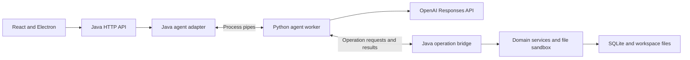

# Java to Python agent migration

[Developer guide](DEVELOPMENT.md) | [Backend standards](BACKEND_STANDARDS.md) | [Protocol contract](AGENT_PROTOCOL.md)

This tracker covers moving agent orchestration, OpenAI communication, and tool adapters from Java to Python while retaining Java's HTTP API, domain services, and persistence. It records the roadmap, completed changes, verification, and remaining decisions so work can resume one step at a time.

**Direction:** Java to Python, confirmed on 2026-10-16.

**Current state (refreshed 2026-10-19):** Committed baseline `b029ce5` contains Steps 2–9 and the Windows launcher correction. [CI run 48](https://github.com/phanmi/tyler_agent/actions/runs/39290936729) passed both **Build and test** and **Windows packaged smoke** on that commit. The user confirmed clean-Windows acceptance and required checks on 2026-10-19; the report/configuration attachment is pending. The Step 1 inventory is reconciled below. The current Step 10 working-tree changes select Python by default and retain explicit Java rollback for one validated release. Step 10 is **partial**: rollout preparation and verification do not complete the release window or authorize legacy removal. See [rollout and recovery](AGENT_ROLLOUT.md).

## Current implementation baseline

| Area | Verified current state and source |
|---|---|
| Food validation | [FoodService](../src/main/java/org/tyler/service/food/FoodService.java) invokes the injected `IValidator<Food>` implemented by [FoodValidator](../src/main/java/org/tyler/validation/FoodValidator.java) before DAO insertion. Required fields, real calendar dates, and nonnegative amounts/nutrition are shared domain rules. The default [Python food adapter](../agent-python/src/tyler_agent/tools/builtin/food_record/adapter.py) parses tool input and requests `food.insert`; the bridge calls `IFoodService`. The Java tool remains only for explicit rollback. |
| Workout and plan validation | [WorkoutValidator](../src/main/java/org/tyler/validation/WorkoutValidator.java) enforces workout rules through the workout service. [WorkoutPlanService](../src/main/java/org/tyler/service/workout/WorkoutPlanService.java) owns plan date/goal/equipment validation, including the seven-representable-days guard. The default [Python plan adapter](../agent-python/src/tyler_agent/tools/builtin/workout_plan/adapter.py) requests `workout_plan.generate_save`; its bridge calls the same plan service. The Java tool remains only for explicit rollback. |
| HTTP validation | [GenericExceptionHandler](../src/main/java/org/tyler/exceptionHandler/GenericExceptionHandler.java) explicitly maps missing required parameters and argument type mismatches to HTTP 400. [DomainValidationContractTest](../src/test/java/org/tyler/service/DomainValidationContractTest.java) exercises real shared services behind HTTP and tool adapters. |
| Frontend checks | [package.json](../frontend/package.json) includes `typecheck`, `test:ui`, `test:startup`, and `test:version`. Tests/helpers live under [frontend/tests](../frontend/tests); [Vitest configuration](../frontend/vitest.config.ts) selects `tests/**/*.test.{ts,tsx}`. These changes are already merged. |
| CI | [Run 48](https://github.com/phanmi/tyler_agent/actions/runs/39290936729) passed both jobs and uploaded verified Windows artifacts on `b029ce5`. Required-check configuration is user-confirmed; attachment pending. The Step 10 changes are not yet committed or remotely verified. |
| Python execution | [Worker and development commands](../agent-python/README.md), [runtime](../agent-python/src/tyler_agent/runtime.py), [agent loop](../agent-python/src/tyler_agent/agent.py), [provider](../agent-python/src/tyler_agent/provider.py), and [adapters](../agent-python/src/tyler_agent/tools) implement Step 7. Readiness needs no key; a valid run uses its supplied credential snapshot and executes through the Java operation bridge. |
| Latest local verification | See the dated Step 10 record below for checks against `b029ce5` plus the current changes. Earlier launcher, backend, Python, frontend, and clean-environment observations remain historical evidence. |

The launcher correction is committed in `b029ce5`. Only the current Step 10 rollout changes are uncommitted. Release metadata remains 0.2.0; no release has been published by this task. Record the merged rollout commit, release artifact, and validated-release outcome before retiring Java.

## Progress

| Step | Work | Status | Completion evidence or remaining gate |
|---|---|---|---|
| 1 | Establish the migration baseline | Complete | `b029ce5`, CI run 48, and the contract/startup inventory in the Step 10 execution record reconcile the current baseline. |
| 2 | Characterize the Java agent | Complete | The 35 legacy agent and 14 factory cases pass in the Step 10 731-case backend run. Earlier CI/local results remain dated below. |
| 3 | Define the Java and Python protocol | Complete | Version 1 specification/schema; shared fixtures contain 100 message cases, 24 framing cases, and 38 sequence scenarios after the numeric simplification. |
| 4 | Create and package the Python worker skeleton | Complete | Locked Python environment, checks, Java/Python fixture conformance, and credential-free development/relocated Windows bundle smoke tests pass. See the Step 4 record. |
| 5 | Implement Java worker lifecycle and adapter | Complete | Opt-in wiring, queue/history ownership, fake-worker callbacks/failures, real readiness, and Windows process-exit checks pass; see the dated Step 5 evidence below. |
| 6 | Expose Java service operations | Complete | Six allowlisted handlers, shared validation, dependency/wiring checks, sandbox rejection, exact transport values, and real persistence tests pass; see the dated Step 6 record. |
| 7 | Port the agent loop and tool adapters | Complete | Fake-provider parity matrix, all six schemas/output contracts, real pipe execution/cancellation, SDK no-retry checks, and rebuilt bundle tests pass; see the dated Step 7 record. |
| 8 | Verify the complete persistence path | Complete | 17 real HTTP/Python/service integration cases cover persistence, actual rollback, failures/history, interrupted writes, concurrency, cancellation, late results, and shutdown. See the dated Step 8 record. |
| 9 | Integrate desktop packaging and CI | Complete (user-confirmed clean-machine gate) | CI run 48 passed both jobs. User confirmed clean-Windows acceptance and required checks; report/configuration attachment pending. |
| 10 | Roll out Python and retire the Java agent | Partially complete | Python default, rollback exercise, architecture checks, and retirement inventory implemented. One validated release and subsequent legacy removal remain pending. |

The roadmap includes completed and future work. Check the progress table and dated evidence before treating a configuration, component, or test as available.

Each step's definition of done is its acceptance checklist. Check an item only when the execution record identifies the supporting change or verification. A step is complete only when every item passes; deferred items keep it partial. Use the current implementation baseline for new work and the dated execution records for past results; test totals always identify the tested revision and local changes.

## Target architecture and boundaries

Java will own the Python child process and communicate over private standard input/output pipes. Python will have no additional listening port. Electron and the development launcher will continue starting Java.



| Responsibility | Target owner |
|---|---|
| Provider client, model requests, response chaining, and reply extraction | Python |
| Tool definitions, model-argument parsing, and tool orchestration | Python |
| Public chat and history HTTP contracts | Java |
| API-key storage, profile storage, and history persistence | Java |
| Shared domain validation, food/workout operations, and plan templates | Java services |
| Database transactions, DAOs, SQL resources, and sandbox restrictions | Java |
| Python startup, readiness, shutdown, and request correlation | Java process adapter, with worker cooperation |

Migration constraints:

- Preserve HTTP routes, JSON fields, status mappings, tool names, argument schemas, and tool result formats unless an explicit contract change is approved.
- Keep Python tools behind the shared Java service boundary. Do not give Python direct SQLite access or duplicate domain rules there.
- Preserve stable record IDs, existing data, plan duplicate policy, and non-overwriting behavior. Sequential repeat behavior does not imply concurrent deduplication.
- Keep each atomic service operation in its existing Java transaction. A conversation containing several tools is not one database transaction.
- Do not replay a conversation or write operation automatically after an uncertain result, or silently fall back to Java after tools may have run.
- Keep credentials out of process arguments and logs. Transfer the credential snapshot through the private pipe and refresh it for later requests after a key change.
- Use the existing global release-version source. A protocol compatibility version is a separate concept.
- All agent functionality must be implemented in Python under the [backend standards](BACKEND_STANDARDS.md#agent-implementation-language). Existing Java agent code is temporary migration/rollback code; the retained Java process adapter and operation bridge implement infrastructure and service access, not agent decisions.

## Executable roadmap

### Step 1 Establish the migration baseline

1. Use the recorded merged HEAD as the current reference; reconcile any subsequent merges and local changes before implementation.
2. Continue on the existing `python-agenticfeature` migration branch. Record a new branch/base if that changes.
3. Inventory current HTTP/tool contracts, validation, history behavior, and process startup.
4. Run backend and frontend baseline checks and record their results. Use temporary workspaces and databases for tests.

**Definition of done**

- [x] Record the intended source branch, base commit, migration branch, and disposition of existing working-tree changes. See the current implementation baseline and dated merged-HEAD refresh below.
- [x] Inventory the public chat/history HTTP contracts and all six tool names, schemas, outputs, validation, and side effects, with source references.
- [x] Record startup ownership, readiness, storage paths, release-version handling, and the target Java/Python responsibility split.
- [x] Reconcile earlier pending frontend work with the chosen baseline. `typecheck`, `test:ui`, and the dedicated `frontend/tests/` directory are included in the merged HEAD and wired into CI.
- [x] Run the selected baseline's backend and frontend checks successfully and record commands, runtime versions, and results. See the Step 9 local verification record for `a8f142e` plus the listed changes.

### Step 2 Characterize the Java agent

1. Exercise the real `AgentService` with deterministic provider responses and real SDK message objects.
2. Cover plain replies, tool rounds, ordered calls, function-call IDs, response chaining, and the five-round boundary.
3. Cover text, refusals, empty replies, unknown tools, invalid arguments, authentication, provider, tool/storage, and history failures.
4. Verify history is appended once after successful completion and that failures do not cause application-level replay.
5. Verify client caching, key rotation/removal, and current-client lookup for subsequent requests.
6. Record edge cases as current behavior; do not silently change them during characterization.

**Definition of done**

- [x] Deterministic tests execute the real Java agent with mocked provider responses and real SDK messages, without live requests or credentials.
- [x] Tests verify initial history/message/model inputs, complete tool definitions, ordered calls, unchanged arguments/results, call IDs, and response chaining.
- [x] Tests cover plain text, refusals, empty output, and both successful completion and unresolved calls at the five-round limit.
- [x] Tests assert exact exception behavior for unknown tools, malformed arguments, authentication/provider failures, tool validation/storage failures, and history failures, retaining causes or exception identity as applicable.
- [x] Tests verify one successful exchange append, no exchange on earlier failures, no application-level replay, and fresh client/history lookup on later requests.
- [x] Factory tests verify deferred key lookup, unchanged-key reuse, changed-key replacement, missing/removed keys, and key-read failures.
- [x] Focused and full backend suites pass; preserved edge cases and verification limitations are recorded below. Production behavior is unchanged.

### Step 3 Define the communication contract

1. Specify versioned UTF-8 newline-delimited JSON messages: `ready`, `run`, `operation_request`, `operation_result`, `completed`, `failed`, `cancel`, and `shutdown`.
2. Define request IDs, operation-call IDs, payload schemas, size limits, timeouts, and handling of unknown/stale messages.
3. Distinguish validation, authentication, provider, storage, and worker failures while preserving existing HTTP error behavior.
4. Define decimal/date/null serialization without losing precision or narrowing previously accepted values.
5. Reserve stdout for protocol messages and stderr for logs. Add shared valid and invalid message fixtures.

**Definition of done**

- [x] A versioned contract defines every message type, required/optional fields, direction, valid sequencing, and terminal outcomes.
- [x] Framing, encoding, message-size limits, request/operation correlation, and handling of unknown, duplicate, stale, and incompatible messages are specified.
- [x] Every failure category has a documented Java/HTTP mapping; cancellation, timeout, and lost-result behavior explicitly prohibit automatic write replay.
- [x] Decimal, date, null, escaping, and tool-result representations preserve the baseline contracts without precision loss or narrower accepted inputs.
- [x] Shared valid/invalid fixtures state the expected accepted value or rejection reason, including multiline/Unicode content and incompatible protocol versions.
- [x] Credential transfer, stdout/stderr separation, and redaction rules are specified. The contract identifies the executable fixture checks to be completed in Step 4 before lifecycle integration.

Step 3 defines the contract and fixture expectations in [agent protocol version 1](AGENT_PROTOCOL.md). Its completed checks are recorded in [the Step 3 execution entry](#2026-10-16-step-3-completed). Step 4 establishes the Python environment and proves both languages implement them, avoiding a dependency on a worker that does not exist yet.

### Step 4 Create the Python project and packaging prototype

1. Add `agent-python/` with `pyproject.toml`, application code under `src/tyler_agent/`, and all tests/helpers/fixtures under `tests/`.
2. Select and pin the Python runtime, the official OpenAI SDK, development tools, and a reproducible dependency lock.
3. Configure formatting, linting, type checking, and unit tests.
4. Implement a minimal worker that exchanges protocol messages without contacting a model provider.
5. Prove the worker can be packaged for Windows and started without a separately installed Python environment.

**Definition of done**

- [x] A fresh checkout can create the documented Python environment from pinned runtime/dependency specifications and the committed lock. A new isolated environment was installed and smoke-tested from the checked-in lockfile content; see the record below.
- [x] Python source lives under `agent-python/src/tyler_agent/`; tests and helpers live under `agent-python/tests/`. Language-neutral fixtures remain shared in `contracts/agent/v1/fixtures/`, as specified by Step 3.
- [x] Documented formatter, lint, type-check, and unit-test commands pass; no live credentials or paid provider calls are required.
- [x] Java and Python codec/validation tests pass the Step 3 fixtures, including rejection of malformed and incompatible messages.
- [x] Development and packaged worker prototypes complete the versioned readiness handshake without an API key or provider access, with protocol-only stdout.
- [x] The packaged worker launches on Windows without a separately installed Python runtime or startup dependency downloads; the build command and smoke-test environment are recorded.

### Step 5 Implement the Java adapter and process lifecycle

1. Add `PythonAgentService` behind the existing `IAgentService` interface. Keep Java responsible for loading credentials/history and appending the completed exchange.
2. Introduce explicit `agent.implementation=java|python` selection during migration; exactly one implementation serves requests.
3. Give Java sole ownership of worker startup and shutdown. Process callbacks independently while the original HTTP request waits, avoiding a deadlock.
4. Define a bounded request queue and correlation for the single persisted conversation so histories and tool results cannot mix.
5. Preserve the existing backend readiness nonce/port protocol; announce readiness after worker compatibility is confirmed, without requiring an API key.
6. Cover timeouts, cancellation, worker crash, normal shutdown, pipe closure, and Java termination. Verify Python exits even during a pending model request on Windows.

**Definition of done**

- [x] Configuration selects exactly one `IAgentService` implementation; the existing HTTP chat/history response contracts remain compatible and selection is tested.
- [x] Java is the sole worker process owner. Readiness preserves the existing nonce/port handshake and waits for worker compatibility without requiring a valid API key.
- [x] Tests prove operation callbacks are processed while the chat request waits, with no deadlock or cross-request result/history mixing.
- [x] Queue limits, request deadlines, and cancellation behavior are documented and tested, including rejection of late responses and prevention of further tool calls after cancellation.
- [x] Each request receives the current credential snapshot; missing/changed keys and provider/storage/worker errors retain the documented behavior without leaking credentials.
- [x] Fake-worker tests cover startup failure, protocol mismatch, crash, timeout, and lost results without conversation replay or silent fallback.
- [x] Normal shutdown, startup cancellation, pipe closure, and forceful Java exit terminate the worker on Windows, including during pending provider work; evidence includes process-exit checks.

### Step 6 Expose Java operations through an allowlisted bridge

1. Map the six existing tools to narrow handlers: `recordFood`, `generateWorkoutPlan`, `GetUserInfo`, `readFile`, `writeFile`, and `getCurrentTime`.
2. Delegate to existing services or sandbox abstractions. Do not expose arbitrary Java method calls, SQL execution, or unrestricted paths.
3. Preserve the existing service validation boundary when bypassing Java tools: `FoodService` invokes `FoodValidator`; workout and plan services enforce their domain rules. Inventory adapter parsing/coercion and output formatting separately. Do not relocate or duplicate shared domain rules in Python or bridge handlers.
4. Preserve tool-name capitalization, result formatting, date semantics, file restrictions, and exception distinctions.

**Definition of done**

- [x] Every existing tool has an explicit allowlisted operation mapping and service/sandbox destination; the bridge cannot invoke arbitrary methods, SQL, or paths.
- [x] Dependency/wiring checks prove handlers call the shared services or sandbox abstractions, without DAO/DAL access from agent adapters.
- [x] Existing adapter shape/parsing rules are inventoried and preserved when bypassing the legacy adapter. Bridge handlers call the existing services, including their shared validators; tests cover missing fields, malformed dates, negative values, and plan date bounds without duplicating those rules in Python.
- [x] Contract tests preserve tool-name capitalization, argument/result formats, decimal/date semantics, record IDs, and exception distinctions.
- [x] Tests reject malformed/unsupported operations before side effects and retain sandbox path restrictions and persistence safeguards.
- [x] Service tests still verify preview without writes, transactional plan saving, sequential duplicate handling, and preservation of pre-existing edits. No concurrent deduplication guarantee is added.

### Step 7 Port the agent loop and tool adapters

1. Build the initial model request from the supplied configuration, history, and message.
2. Execute returned calls in their existing order and route business operations through Java.
3. Submit outputs with their original call IDs and continue using the previous response ID, within the characterized round limit.
4. Preserve model selection, schemas, descriptions, text/refusal extraction, and failure behavior.
5. Configure SDK timeout/retry behavior explicitly. Avoid conversation/write replay after an uncertain outcome.

**Definition of done**

- [x] Model calls, context assembly, tool definitions/parsing/dispatch, response chaining, and reply extraction execute in Python; the Java bridge contains no agent decision logic.
- [x] A parity matrix maps each Step 2 behavior to an equivalent Python test or an explicitly documented contract change; all mapped tests pass with a fake provider.
- [x] All six tool adapters preserve their names, descriptions, complete schemas, argument handling, and result formats while calling Java operations for domain/storage work.
- [x] Tests prove ordered calls, original call-ID linkage, the round-limit behavior, text/refusal extraction, and correct success/failure completion messages.
- [x] Timeout/retry settings are explicit; failure after a completed operation does not replay tools, the conversation, or a fallback implementation.
- [x] Python keeps history and credential persistence in Java and does not open application databases or bypass the file sandbox.
- [x] Required Python checks and affected Java tests pass. Any side-effect comparisons use separate temporary data stores rather than user data.

### Step 8 Verify the complete persistence path

1. Exercise HTTP to Java to a real Python subprocess to Java services, using a fake model provider and temporary databases.
2. Check food append semantics and identity, plan repeat behavior, preserved user edits, and actual transaction rollback after an insert failure.
3. Check invalid inputs, provider/storage failures, and history completion behavior through the full boundary.
4. Simulate worker failure before a write and after a write but before its result returns; assert persisted state and no replay.
5. Cover cancellation, concurrent incoming requests, and shutdown during active work.

**Definition of done**

- [x] Integration tests execute the real HTTP/Java/Python/Java-service path with a real subprocess and temporary SQLite databases, mocking only the external model provider where needed.
- [x] Food insertion preserves older records and stable IDs; independently saved equal entries remain addressable through existing read/delete paths.
- [x] Successful and sequential repeated plan saves preserve the existing duplicate policy, IDs, and manual edits; preview remains read-only.
- [x] An injected failure after one or more plan inserts leaves no partial plan and preserves pre-existing workouts, verified by database queries after rollback.
- [x] Validation, authentication, provider, storage, and history failures retain their documented response/completion behavior; successful history exchanges are saved once.
- [x] Worker failure before a write and after a committed write but before its result returns produces the expected database state with no automatic replay.
- [x] Cancellation, concurrent incoming requests, late results, and shutdown tests show no cross-request contamination, subsequent cancelled tool execution, or orphan worker.
- [x] Integration commands, environments, outcomes, and remaining limitations are recorded; mocked delete/cleanup assertions are not accepted as rollback evidence.

### Step 9 Integrate desktop packaging and CI

1. Bundle the worker outside ASAR alongside the Java runtime and JAR. Java remains the worker's process owner.
2. Derive release metadata from `.mvn/maven.config`; install dependencies during development/build, never application startup.
3. Add Python static checks/tests and Java/Python integration checks while retaining backend/frontend verification.
4. Add a Windows packaged-app smoke gate. Test paths with spaces/non-ASCII characters, missing/incompatible workers, startup failure, active-request quit, and forceful Java exit.

**Definition of done**

- [x] Reproducible packaging includes the worker outside ASAR with the Java runtime/JAR, and release metadata derives from the existing global version source. The recorded build procedure and artifact hashes establish inputs/output identity, not byte-identical builds across hosts.
- [x] Required CI checks include locked dependency installation, Python formatting/lint/type checks/tests, Java verification, cross-process integration tests, and the selected frontend checks/build. CI run 48 passed; required-status settings user-confirmed on 2026-10-19 (attachment pending).
- [x] A Windows packaged-app smoke check runs successfully and is a required release/startup-change gate, with the tested artifact and environment recorded. CI run 48 passed and uploaded artifacts; required-status configuration user-confirmed.
- [x] A clean Windows environment runs the artifact without separately installed Java/Python or runtime dependency downloads; Java still owns worker lifecycle. User confirmed success on 2026-10-19; clean-machine report attachment pending.
- [x] Smoke tests cover spaces/non-ASCII paths, missing/corrupt/incompatible workers, startup timeout/failure, normal quit, quit during startup or an active request, and forceful Java exit.
- [x] Shutdown/failed-start checks verify no worker remains. Protocol output, credentials, and logs respect the documented boundaries in the recorded local smoke; clean-machine repetition is user-confirmed above.
- [x] Developer setup, build, troubleshooting, and release instructions match the locally verified commands and artifacts; CI and user-confirmed clean-machine evidence are distinguished.

### Step 10 Switch defaults and retire the legacy agent

1. Enable Python in development, then switch the default only after the preceding gates pass.
2. Retain Java as a configuration-and-restart rollback option for one validated release. Do not replay in-flight requests during rollback.
3. After the rollback window, remove obsolete Java orchestration/tools and the OpenAI Java dependency, following a caller inventory.
4. Update architecture checks to cover the bridge and Python persistence boundary. Remove obsolete references from tests and documentation.
5. Update installation, development, testing, logging, lifecycle, packaging, and recovery documentation and applicable standards.

**Definition of done**

- [x] Steps 1-9 have passed their acceptance criteria, and the rollout candidate is recorded: release 0.2.0, `b029ce5` plus these uncommitted changes. Record the eventual merged commit/artifact before deployment; prerequisite clean-machine/required-check evidence is user-confirmed.
- [x] Python is the tested default in development and packaged runs, preserving HTTP/tool contracts and existing persisted data. Step 10 checks below include restart compatibility and 10 packaged scenarios with the selector unset.
- [ ] During one validated release, switching configuration and restarting restores the legacy implementation without replaying in-flight requests; the rollback exercise and release are recorded. Automated restart/data-preservation exercise implemented; the actual validated-release window remains pending.
- [ ] After that window, a caller inventory precedes removal of obsolete Java agent/tool code, Java provider dependencies, and the temporary implementation selector. Remaining Java adapters implement infrastructure/service access only.
- [ ] Production code, tests, configuration, and active documentation contain no obsolete legacy-type references; dated historical records may retain them as history.
- [ ] Architecture checks enforce Python agent ownership and the shared service boundary; the full required test/build/package suite passes after removal.
- [ ] Standards, setup, operation, testing, and recovery documentation match the final architecture. The replacement recovery procedure uses a previously validated release after the legacy implementation is removed.


## Execution record

### 2026-10-16 Step 2 completed

Historical source: `f18aa42`, with characterization changes then uncommitted. This checkout preceded the merge recorded in the current baseline; it lacked the later frontend `typecheck`/`test:ui` suites and dedicated testing directory. At that time, required/nonnegative food checks were in the tool, the food service required only a nonblank date, and the plan service lacked the upper-date guard. These observations must not guide new bridge implementation. Migration work was subsequently committed in `b8355ac` and merged with `main` in `92290ae`.

The then-existing Java implementation was characterized before any migration of production code:

- Expanded [AgentServiceTest](../src/test/java/org/tyler/service/agent/AgentServiceTest.java) from 2 to 30 executed cases.
- Expanded [OpenAIClientFactoryTest](../src/test/java/org/tyler/service/agent/OpenAIClientFactoryTest.java) from 3 to 14 executed cases. Constructed SDK clients use synthetic keys and are closed during test cleanup.
- Added assertions for full overridden tool schemas using the real plan-tool adapter, alongside default no-argument schemas.
- Verified real plan-tool parsing failures without invoking its application service.
- Added exact exception-type and retained-cause/identity assertions, ordered call/output checks, history checks, and checks that completed tools are not replayed.
- Added a developer-guide entry for the baseline. The detailed record now lives in this tracker.

Tests use mocked provider and history boundaries. They establish agent orchestration behavior, not real database rollback, SDK transport retries, live model behavior, Python interoperability, or packaged lifecycle behavior. Those checks belong to later steps. Frontend checks were not run for this backend-test change.

### Preserved edge cases

These are observations from the Step 2 run above. Use the current merged characterization suite to verify parity; historical observations do not override later shared-service rules.

| Case | Behavior observed in that run |
|---|---|
| Five tool rounds complete but the last response requests another tool | That extra call is not executed. Text/refusals from the last response are returned and saved; a tool-only response produces an empty reply. There is no round-limit exception. |
| Empty response or message | An empty reply is returned and appended to history. |
| Multiple text/refusal parts | Final-response parts are concatenated in order without added separators. Intermediate response text is not included. |
| Provider authentication/permission failure | `OpenAIKeyException` retains the provider exception as its cause. Other provider failures propagate unchanged. |
| Tool/provider failure after an earlier tool completed | Processing stops without a history exchange or application-level retry. The agent performs no rollback of completed tool effects. |
| History saving fails after a reply | The failure propagates; provider requests and completed tools are not replayed. |
| Key changes or is removed | The next request re-reads the key. A changed key creates a replacement client; a missing key blocks chat despite a cached client. |

### Verification record

| Run on 2026-10-16 | Result | Follow-up |
|---|---|---|
| Initial focused run with Mockito self-attachment | Interrupted before a completed test result; local Windows JVM attachment failed to open its pipe. | Load Mockito explicitly through the test JVM's `-javaagent` option. |
| Focused run with explicit Mockito agent | 41 cases reported, 0 assertion failures, 1 fixture error. The SDK `InternalServerException` builder required a status code. | Corrected the test fixture to specify HTTP 500. |
| Final focused run | 44 tests passed: 30 agent and 14 factory cases; no failures/errors/skips. | Successful baseline at 14:04:05 EDT. |
| Full backend suite | 153 tests passed; no failures/errors/skips; `BUILD SUCCESS`. | Completed at 14:04:30 EDT. |
| Diff whitespace check | `git diff --check` passed. | No whitespace errors. |

The runs used Java 26, OpenAI Java SDK 4.54.0, and Mockito 5.23.0. The full-suite output was saved locally at `target/agent-baseline-full-test.log`; Surefire reports are under `target/surefire-reports/`. These generated files are not durable tracked evidence and can be replaced by a later build; this dated summary records their verified results.

Standard commands from the repository root:

```powershell
mvn "-Dtest=AgentServiceTest,OpenAIClientFactoryTest" test
mvn test
git diff --check
```

The successful local runs used offline Maven, the existing local dependency cache, forked compilation, and explicit Mockito agent loading. The following reproduces those options using paths derived from the local user profile:

```powershell
$testRepository = Join-Path $env:USERPROFILE '.m2/repository'
$mockitoAgent = Join-Path $testRepository 'org/mockito/mockito-core/5.23.0/mockito-core-5.23.0.jar'
$testJvmOptions = '-javaagent:"' + $mockitoAgent + '"'
$env:MAVEN_OPTS = '-Duser.home="' + $env:USERPROFILE + '"'

mvn -o "-Dmaven.repo.local=$testRepository" '-Dmaven.compiler.fork=true' "-DargLine=$testJvmOptions" '-Dtest=AgentServiceTest,OpenAIClientFactoryTest' test
mvn -o "-Dmaven.repo.local=$testRepository" '-Dmaven.compiler.fork=true' "-DargLine=$testJvmOptions" test
```

Offline execution requires dependencies to be cached already. The Mockito path reflects the tested dependency version; update it if that dependency changes. These runner options were supplied locally and did not change the project build configuration.

### 2026-10-16 Migration tracker established

Created this tracker and linked it from the developer guide. Moved the detailed baseline observations here to keep the roadmap and execution history together. Verified relative file links, the linked execution-record heading, PowerShell example syntax, and diff whitespace. The command examples were parsed without execution; the backend results above are from the completed Step 2 runs.

### 2026-10-16 Acceptance criteria and language ownership clarified

Added a definition-of-done checklist to every roadmap step, retaining Step 2's verified completion status and leaving future criteria unchecked. Separated protocol specification/fixtures in Step 3 from executable Java/Python conformance checks in Step 4. Updated the backend standards to require Python for agent functionality while preserving Java's HTTP, infrastructure, domain-service, and persistence responsibilities. This documentation change does not implement the Python worker or rerun the Step 2 suites.

Documentation verification passed: all ten steps have acceptance checklists, checked items match the recorded completion state, relative links and heading anchors resolve, and whitespace checks pass.

### 2026-10-16 Step 3 completed

**Changes**

- Added [the version 1 protocol specification](AGENT_PROTOCOL.md) and [closed JSON Schema](../contracts/agent/v1/message.schema.json) for all eight message types and six allowlisted Java operations.
- Added shared [message](../contracts/agent/v1/fixtures/messages.json), [framing](../contracts/agent/v1/fixtures/framing.json), and [sequence](../contracts/agent/v1/fixtures/sequences.json) fixtures. They define transport expectations for both future implementations; language-specific tests will consume these files rather than maintain separate copies.
- Defined private process pipes, session/request/operation correlation, directions, framing, deadlines, queue bounds, cancellation, shutdown, terminal/history sequencing, and handling of duplicate/stale/incompatible messages.
- Specified exact decimal strings and full-range ID strings, expanded date strings, explicit nulls, Unicode/escaping, and the existing model-visible result representations. No domain date/numeric rules were tightened. New frame/queue/deadline limits are explicitly documented operational limits for rollout.
- Recorded error categories and the current Java/HTTP mappings, credential snapshots and redaction, and Java's authoritative write-outcome ledger. A lost result or cancelled worker never authorizes automatic replay or proves that a Java write rolled back.
- Linked the contract from the developer guide and backend standards. Python retains agent decisions and model-facing adapters; Java retains process infrastructure, shared services, and storage. No production Java/Python code, HTTP API, schema, or user data changed in this step.

**Review corrections**

The source compatibility review preserved legacy file-argument HTTP 500 behavior and profile record-style text, and identified timing details that are now explicit: a Python timeout can occur while a Java write is pending, a request can cross cancellation without being dispatched, and the next chat waits for Java history persistence. Decimal wording now reflects Java's normalization of negative zero; malformed ID syntax and numeric overflow have distinct rejection stages. Sequence review corrected a forwarded error so its category/code/message remain unchanged and documented a worker claim that must not override Java's unresolved-write ledger.

**Verification on 2026-10-16**

| Check | Result and scope |
|---|---|
| Strict Ajv 2020-12 schema compilation and message cases | 90/90 expectations passed: 44 structurally valid, 46 invalid. Invalid-case rejection precedence also matched. Five valid shapes separately specify semantic `INVALID_VALUE` expectations for Step 4. |
| Independent PowerShell `Test-Json` check | 90/90 shape expectations passed with PowerShell 7.6.5 using the command published in the protocol document. |
| Raw framing fixture audit | 24/24 expectations passed: chunk boundaries, split UTF-8, escaping, exact decoded values, malformed/duplicate JSON, invalid bytes/surrogates, version rejection, and size limits. The boundary frames contain exactly 16,777,216 and 16,777,217 bytes before LF. |
| Sequence fixture integrity | 30 scenarios / 136 steps checked. All 121 wire messages pass the schema after resolving references and all 18 existing-field replacements; 15 local events are recognized. Directions and expected state/effect rules were reviewed. No application state machine was executed. |
| Documentation and whitespace | All 51 relative file links/heading anchors in the four affected documents resolve; Step 3's six checked acceptance items verified. New contract files have no trailing whitespace; `git diff --check` passed. |

Local static audits used Node `v24.20.0` and the already-installed Ajv `8.20.0`; no dependencies or lockfiles changed. Commands from the repository root were:

```powershell
# Reproducible message-shape check: run the PowerShell block in AGENT_PROTOCOL.md.
node target/protocol-review/message-sequence-audit.cjs
node target/protocol-review/framing-audit.cjs
node target/protocol-review/documentation-audit.cjs
git diff --check
```

The Node audit scripts are temporary review helpers under ignored `target/`, not committed test runners or durable evidence. Their checks are recorded here; future Java/Python suites must implement the conformance gates against the committed fixtures. The initial PowerShell example piped an empty-array fixture away; using `ConvertTo-Json -InputObject` fixed the example, and the published block passed all 90 cases. A local `python --version` probe found an inaccessible WindowsApps alias; the static audit used available Node instead. Python runtime selection remains Step 4.

**Limitations at Step 3 completion:** These checks established contract/fixture consistency. No Java/Python codec, subprocess supervisor, HTTP bridge, or database integration for the new protocol existed, so runtime acceptance, semantic validators, cancellation, history races, and transaction outcomes were not tested. Backend/frontend suites were not rerun for that specification-only step; the 153 backend passes above were the earlier Step 2 results. Steps 4–9 retained their executable gates. Step 1's baseline/branch decisions were still pending, and no migration commit or PR was created during that step. The subsequent merged-HEAD refresh below supersedes its checkout and test-baseline facts.

### 2026-10-16 Merged-HEAD baseline refreshed

Inspected HEAD `92290ae`, its merge parents, frontend scripts/test layout/CI, shared service validators, plan date guard, and HTTP binding advice. Updated current-state facts and Step 1/6 instructions in this tracker and corrected the protocol's food/date/plan boundary descriptions. Earlier observations remain in the dated Step 2/3 records. The protocol wire shapes and fixtures are unchanged: malformed domain values still pass transport shape validation and are rejected by Java services.

The agent-test fix separated shape rejection from shared-service validation. Reproducing the old test gave one failure for `{}` because the service mock did not validate missing fields. The corrected agent/tool/plan suites passed 46 cases. A full backend run against `92290ae` plus the then-uncommitted fix passed **261 tests**, zero failures/errors/skips; `BUILD SUCCESS` at 14:46:19 EDT. That fix was subsequently committed in `4ee8cbe`; this paragraph records the earlier local run, not an outstanding working-tree change. It superseded the historical 153-case local baseline. The earlier review's 256-case CI count was reported evidence, not a CI result fetched or rerun during that refresh.

The full run used Java 26, the existing local Maven cache, forked compilation, and Mockito 5.23.0 as an explicit test JVM agent, matching the runner options documented above:

```powershell
mvn -o "-Dmaven.repo.local=$testRepository" '-Dmaven.compiler.fork=true' "-DargLine=$testJvmOptions" test
```

Initialize `$testRepository`, `$testJvmOptions`, and `MAVEN_OPTS` with the earlier reproducible PowerShell block. Output is locally recorded in ignored `target/agent-merged-baseline-test.log`; it is not durable committed evidence. Documentation checks verified 64 relative links/heading anchors and `git diff --check` passed. No frontend execution, remote CI retrieval, Python conformance, packaging, or new migration implementation is claimed.

### 2026-10-16 Committed baseline and passing CI recorded

Verified locally that HEAD is `4ee8cbe71c53a9991c4a8437dbfc83a992f2f2f5`, that the commit contains the `AgentServiceTest` correction, and that the working tree was clean before this documentation update. Updated the current-state block, progress table, next-step guidance, and protocol baseline reference accordingly.

The review reports that [CI run 38950225490](https://github.com/phanmi/tyler_agent/actions/runs/38950225490) passed all **261 backend tests** on this committed revision. This is recorded separately from the 14:46:19 EDT local run above. The CI result was supplied by the reviewer; it was not independently fetched here because the local `gh` command is unavailable. No backend or frontend tests were rerun for this documentation-only correction. Relative links/anchors and diff whitespace were checked.

### 2026-10-16 Step 4 completed

**Source and scope:** Started from clean committed revision `2158f10`. Added the [Python project](../agent-python/README.md), locked dependencies, source/test layout, protocol infrastructure, and Windows packaging prototype. The existing Java agent remains the application implementation. This task did not commit or publish the changes.

**Implementation**

- Pinned CPython 3.12.14, uv 0.13.1, official OpenAI Python SDK 3.31.0, JSON Schema validation, formatter/linter/type checker/test tools, and PyInstaller. `uv.lock` records transitive versions and hashes. The SDK is installed for the later agent loop but is never instantiated by the prototype.
- Both codecs load the same Draft 2020-12 schema. They enforce strict UTF-8/LF framing, size limits, duplicate-key/surrogate rejection, version/shape checks, precise decimal and ID transport, and semantic bounds without domain validation. Maven packages the shared schema as a resource and the shared fixtures as test resources; Java uses `com.networknt:json-schema-validator:1.5.9`.
- Pure Java/Python sequence observers execute the shared correlation, cancellation, stale/duplicate-message, history-ordering, and uncertain-write scenarios. They have no persistence/process effects. Real process supervision and authoritative Java service outcomes remain later gates.
- Added an allowlisted Java failure translator and MockMvc tests using existing advice, preserving validation/authentication/SQL/file/provider/worker/timeout/cancellation/protocol HTTP response contracts. No public endpoint was added.
- The worker flushes `ready`, accepts shutdown/EOF, reports malformed input safely, and returns `WORKER_UNAVAILABLE` for runs. It never contacts a provider, dispatches an application operation, or claims chat success. Diagnostics use stderr and contain no raw frames/credentials.
- The PyInstaller one-folder bundle includes Python, imported runtime dependencies, the schema, and a copy of the global `.mvn/maven.config` release-version source. No independent release version was introduced. Build output and environments are ignored; source, configuration, lockfile, tests, and packaging spec are reviewable repository changes.

**Contract corrections discovered by executable checks**

The old decimal fixture incorrectly rejected `1E+2147483648`. Java 26 accepts that value, and `1.0E+2147483649`, because their resulting `BigDecimal` scale is representable. Corrected the rejected value to `1E+2147483649` and added three accepted scale-boundary fixtures. Python now checks the resulting Java scale rather than restricting the exponent independently. Also tightened token-regex end anchors to reject a final newline and added four rejection fixtures. These preserve the documented grammar/range; no operation, field, or domain rule changed. The shared message set is now **97 cases** (47 shape-valid, 50 shape-invalid); five shape-valid cases require semantic rejection.

**Verification on Windows x64, OS build 10.0.26200.0**

| Check | Result |
|---|---|
| Fresh locked environment | `uv sync --locked --offline` created `target/agent-fresh-env` using the populated cache and pinned interpreter; all seven development-worker smoke/version tests passed there. |
| Python format/lint/types | Ruff format check and lint passed; strict mypy passed for all nine source/test files. |
| Python conformance and subprocess suite | **166 passed**, no failures/skips: all shared messages, frames, sequences, parser redaction, and development plus packaged worker smoke tests. |
| Windows packaging | PyInstaller build succeeded; `dist/tyler-agent-worker/` includes `_internal/python312.dll`. Tests copied the bundle elsewhere and launched it with empty `PATH`, no `PYTHONHOME`/`PYTHONPATH`, no API key, and a different working directory. Readiness/shutdown, EOF, explicit unavailable runs, invalid sessions, and malformed frames passed. |
| Full Java suite | **428 passed**, zero failures/errors/skips; `BUILD SUCCESS` at 16:20:30 EDT. This includes **152** protocol fixture/redaction cases and **15** failure-mapping tests, plus the previous **261** backend tests. |
| Documentation and whitespace | All **75** relative links/heading anchors in the affected guides and standards resolve; all six Step 4 acceptance items have recorded evidence; `git diff --check` passed. |

Reproducible commands are in the [Python project guide](../agent-python/README.md). The local run used the existing offline Maven/Mockito options from the earlier execution record. Equivalent Python commands from `agent-python/` are:

```powershell
uv sync --locked
uv run --locked ruff format --check src tests
uv run --locked ruff check src tests
uv run --locked mypy
uv run --locked pyinstaller --noconfirm --distpath dist --workpath build worker.spec
uv run --locked pytest tests --worker-executable dist/tyler-agent-worker/tyler-agent-worker.exe
```

In this restricted workspace, uv was bootstrapped under `target/agent-bootstrap`, with workspace-local `UV_CACHE_DIR` / `UV_PYTHON_INSTALL_DIR`; pytest used disposable `--basetemp` directories under `target/`. Logs are locally available as `target/java-step4-full-tests.log`, `target/python-step4-package.log`, and `target/python-step4-packaged-tests.log`; generated logs/binaries are not committed evidence.

**Resolved verification issues:** Default sandbox network access prevented dependency downloads; approved downloads populated the workspace cache. uv's first global interpreter-location attempt failed, so the run used `target/python-managed`. The default pytest temporary-directory location was inaccessible, so tests used workspace-local disposable directories. Initial lint/type findings were corrected. The first Java run exposed the inaccurate decimal fixture described above. The new HTTP test harness initially registered catch-all advice first; registering the specific advice before it, as in the existing contract tests, produced the expected mappings. The packaged test command explicitly names `tests` so pytest loads its dedicated-directory command-line option.

**Remaining gates:** The skeleton is not wired into the application's startup or chat API. No actual Java operation/history dispatch, live model loop, real cross-process transaction rollback, parent-death cleanup, installer/clean-machine certification, Electron integration, or CI workflow expansion is claimed. Those remain Steps 5–9. Frontend code, storage data, and business rules were not changed. Step 4's bundle was tested on this Windows host with ambient interpreter lookup removed; it is not a signed production release.

### 2026-10-16 — Step 4 protocol review corrections

**Source:** Follow-up changes on committed `a85f482`. These correct the existing prototype; Step 5 process supervision and service integration remain unimplemented.

**Changes and regression evidence**

- `ProtocolFailures` now selects Java-owned exception messages by validated error code. It discards worker `error.message`, including from causes, so advice cannot echo or log secrets supplied by the worker. Existing exception types, HTTP statuses, and response shapes remain; remote validation/file detail uses the fixed messages documented in the protocol. Local service exception handling is unchanged.
- Both `MessageCodec.decode` implementations and frame readers now stop after framing/shape validation. The session observers and Python receiver check session, direction, semantics, then state/correlation. Outbound encoding still checks semantic values.
- Added eight shared sequence fixtures for overlapping session/direction/value failures and control cases. Both languages inject raw peer bytes through their readers; five applicable cases also run through real development and packaged-worker pipes. All rejected cases assert no dispatch/history write.
- Mapping tests inject synthetic API-key, prompt, history, and file-content text, then verify exception messages/causes, actual HTTP responses, and captured advice logs. Before the implementation fix, four of 15 Java mapping tests failed. The Python precedence run failed 11 of 13 cases before the fix, including three real-pipe misclassifications; both controls on real pipes already returned `INVALID_VALUE`.

**Verification on Windows x64**

| Command/check | Result |
|---|---|
| `uv sync --locked --offline` | Pinned environment synchronized from cached dependencies. |
| `uv run --locked --offline ruff format --check src tests`, `ruff check src tests`, and `mypy` through the same uv command | Formatting/lint passed; strict typing passed for all nine source/test files. |
| `uv run --locked --offline pytest tests` | **173 passed**, including five new development-worker pipe cases. |
| Focused Maven run with `-Dtest=ProtocolContractTest,ProtocolFailuresTest` | **175 passed**. |
| Full Maven `test` run | **436 passed**, zero failures/errors/skips; includes the final positive log-capture assertion. |
| `uv run --locked --offline pyinstaller --noconfirm --distpath dist --workpath build worker.spec` | Windows bundle rebuilt successfully. |
| `uv run --locked --offline pytest tests --worker-executable dist/tyler-agent-worker/tyler-agent-worker.exe` | **184 passed**, including all 11 smoke cases against the rebuilt, relocated bundle with empty `PATH` and no provider credentials. |

Maven used the previously documented offline cache, forked compilation, and explicit Mockito-agent options. uv used the workspace cache/interpreter directories; pytest used disposable `target/pytest-protocol-fix` and `target/pytest-protocol-fix-packaged` temporary directories. Local logs are `target/java-protocol-fix-full.log`, `target/python-protocol-fix.log`, `target/python-protocol-fix-package.log`, and `target/python-protocol-fix-packaged.log`. These are local results, not a new CI result or proof of the deferred supervisor/service/installer gates. No live provider or user database was used.

### 2026-10-17 — Simplify decimal validation

**Source:** `251dda9` plus this follow-up. At the user's request, removed Python's exponent parsing and Java scale-limit emulation. The shared schema accepts plain decimal strings only; Python uses `Decimal(item).copy_abs()` and a single comparison against `2_000_000_000`. Java applies the same absolute-value bound with `BigDecimal`. IDs retain their existing signed-long range; shared services still decide whether a negative domain value is valid.

This deliberately narrows the earlier prototype contract: scientific notation now fails shape validation, and magnitudes above two billion fail semantic validation. It does not change stored data or HTTP domain validation. The protocol guide documents plain-string serialization for future adapters. Prior scale-boundary observations remain historical below their original execution dates.

Replaced the old exponent/scale fixtures with ordinary decimal examples and exact boundary cases. Added rejection cases for a negative value just below the lower bound and positive/negative exponent notation. Both language suites cover the inclusive positive/negative limits, exact fractions, trailing zeros, negative zero, values just outside the bounds, and the existing session/direction rejection precedence.

**Verification:** Full Maven `test` passed **439 tests** with no failures/errors/skips, using the offline cache, forked compiler, and explicit Mockito agent documented earlier. `uv run --locked --offline ruff format --check src tests`, `ruff check src tests`, and `mypy` passed. `uv run --locked --offline pytest tests` passed **176 tests**. Rebuilt with `uv run --locked --offline pyinstaller --noconfirm --distpath dist --workpath build worker.spec`; running pytest with `--worker-executable dist/tyler-agent-worker/tyler-agent-worker.exe` passed **187 tests**, including the relocated Windows bundle. uv used workspace-local cache/interpreter directories, and pytest used disposable `target/pytest-decimal-simplification` / `target/pytest-decimal-packaged` directories. Local logs are `target/java-decimal-simplification.log`, `target/python-decimal-simplification.log`, `target/python-decimal-package.log`, and `target/python-decimal-packaged.log`. No new remote CI result or later migration gate is claimed.

### 2026-10-17 — Explain local Python protocol failures

Added required developer-facing `detail` to `ProtocolError`, keeping `code` unchanged. Decode errors now explain the framing/encoding/syntax failure, including safe JSON line/column positions. Numeric and run validation identify the field and violated limit. Schema diagnostics use schema rule paths and required-field names; worker stderr includes the safe explanation. Raw parser/schema messages and peer values are excluded, and Java public error mapping remains unchanged.

Added 22 diagnostic cases in the dedicated Python test folder, covering framing, serialization, missing/type-invalid fields, numeric/timeout/blank-value rules, incomplete frames, and private data exclusion from messages and formatted tracebacks. Updated existing worker smoke assertions for the richer stderr output. Existing shared fixtures still verify unchanged error codes and rejection order.

**Verification:** Ruff formatting/lint and strict mypy passed for ten files. Development tests passed **198 cases**; after rebuilding with the documented locked PyInstaller command, the full suite including the relocated Windows executable passed **209 cases**. Commands used `uv run --locked --offline`, the documented workspace cache/interpreter locations, and disposable `target/pytest-error-detail` / `target/pytest-error-detail-packaged` directories. Logs: `target/python-error-detail.log`, `target/python-error-detail-package.log`, and `target/python-error-detail-packaged.log`. An initial mypy schema-union typing error was corrected before final verification. No Java runtime change, new CI result, live model call, or later migration gate is claimed.

### 2026-10-17 — Split Python branching by responsibility

Reviewed all Python source and test scripts and the packaging specification. Refactored the functions combining independent decisions:

- `ProtocolSession.accept` now coordinates validation, shared inactive-request guards, and explicit message-handler dispatch. Separate handlers own readiness, shutdown, run, cancellation, operation request/result, completion, and failure. `observe` routes local events to focused handlers; write-outcome bookkeeping is shared without clearing earlier committed effects.
- The codec separates envelope checks, schema-error selection/formatting, run/numeric validation, frame checks, JSON parsing/serialization, and bounded buffer appends. Validation order, exact error codes/details, and limits remain unchanged.
- The worker loop delegates incoming-message validation, dispatch, request registration, and unavailable-run replies. Test fixture construction and semantic-failure assertions were also extracted into focused helpers. Already focused entry points, resource helpers, and packaging setup needed no structural changes.

The shared fixtures remain unchanged by this refactor. Added ten session cases for cancellation/completion ordering, failure status mappings, repeated terminal messages, invalid local events, and shutdown after EOF; added two malformed-type cases and two worker request-identity cases. Tests exercise public behavior rather than asserting private helper calls.

**Verification:** `uv run --locked --offline ruff format --check src tests`, `ruff check src tests`, and `mypy` passed. Development pytest passed **212 tests**. After the documented PyInstaller rebuild, pytest with `--worker-executable dist/tyler-agent-worker/tyler-agent-worker.exe` passed **225 tests**, including all 13 smoke cases against the relocated Windows executable. Full Maven `test` passed **439 tests**, with no failures/errors/skips, using the previously documented offline cache, forked compilation, and explicit Mockito-agent options. Local logs: `target/python-refactor-tests.log`, `target/python-refactor-package.log`, `target/python-refactor-packaged.log`, and `target/java-python-refactor.log`. pytest used disposable `target/pytest-python-refactor` and `target/pytest-python-refactor-packaged` directories. A mypy narrowing issue and a long test-helper docstring were corrected before final checks. No new protocol contract, runtime dependency, live provider call, remote CI result, or later migration gate is claimed.

## Next work and decisions

- Continue from `639dd25` plus the Step 8 integration work recorded below. Keep Step 1's remaining inventory/frontend evidence visible; this task does not certify rollout readiness.
- Next unimplemented roadmap step: Step 9, desktop packaging and CI/release integration. Preserve the passing Step 8 HTTP/Python/service tests, shared validation, history ownership, and conservative uncertain-write reporting.
- Steps 7–8 implement the Python loop and six adapters and verify the complete development persistence path. Keep Java selected by default until the remaining packaging and rollout gates pass; fake-provider integration does not establish live-provider or clean-machine installer behavior.
- Use the pinned Python/uv environment, shared conformance suites, and packaging commands. Run `uv sync --locked` before Maven: lifecycle tests launch real Python from the development environment.
- Preserve the tested queue, history-clear ordering, deadlines, parent watchdog, no-replay policy, and private-pipe ownership while adding handlers/model work.
- Keep installer, Electron packaging, clean-machine Windows, and release CI gates pending for Step 9. Local checks are not remote CI evidence.

## Maintaining this record

For each executed step, add a dated entry with the changed files, behavior/contract decisions, exact commands or reproducible options, results, limitations, and commit/PR reference when available. Record unsuccessful attempts and their resolution when they affect reproducibility. Mark a step complete only after its gate passes; keep deferred work explicit.

Keep the developer guide linked to this tracker rather than duplicating the execution history. Later implementation changes should update both this status and the relevant application documentation.


### 2026-10-17 — Centralize Python protocol validation

**Changes:** Added [validation.py](../agent-python/src/tyler_agent/protocol/validation.py) as the shared owner of schema, version, operation, numeric, session, direction, and frame validation. The codec delegates validation while retaining JSON serialization and framing. Both the worker and session observer use the same received-message validator, preserving shape → session → direction → semantics precedence. Complete and incremental frames share the size check. Existing codec validation entry points and exception imports remain compatible; lifecycle guards stay with their state owners. No domain rules or wire contracts changed.

**Verification:** Locked offline Ruff formatting/lint and strict mypy passed for 13 source/test files. Development pytest passed **218 tests**, including six new shared-validator cases for overlapping failures and both sender directions. Rebuilt the Windows worker with PyInstaller; pytest with `--worker-executable dist/tyler-agent-worker/tyler-agent-worker.exe` passed **231 tests**, including 13 relocated executable smoke cases. Full offline Maven `test` passed **439 tests**, with zero failures/errors/skips, using the previously documented forked compilation and explicit Mockito agent. Logs: `target/python-validation-package.log`, `target/python-validation-packaged.log`, and `target/java-shared-validation.log`. Temporary pytest data stayed under `target/`.

**Limits:** Local evidence only; no live provider, application database, frontend checks, or remote CI run. Step 5 remains next.


### 2026-10-17 — Group reusable Python utilities in a library package

**Changes:** Moved the codec/frame reader and shared validation into `tyler_agent/library/protocol.py` and `tyler_agent/library/validation.py`. Updated production/test imports and documentation links; the Python README now describes the source layout. Worker lifecycle, session state, and application resource lookup remain at the package root. Tests remain in `agent-python/tests/`. At this intermediate step, internal imports used `tyler_agent.library` (superseded by the protocol-package layout below); wire behavior and executable entry points are unchanged.

**Verification:** Locked offline Ruff lint/format checks and strict mypy passed for 14 files. Development pytest passed **218 tests**. Rebuilt the Windows worker with PyInstaller and ran pytest with `--worker-executable dist/tyler-agent-worker/tyler-agent-worker.exe`: **231 tests passed**, including the 13 relocated executable cases. Logs: `target/python-library-package.log` and `target/python-library-packaged.log`. Checked for old module imports and stale source links; none remain. Diff whitespace check passed. Java tests were not rerun for this module-only relocation; the preceding 439-test result remains the latest backend evidence. No live provider or application database was used.


### 2026-10-17 — Name the transport package by responsibility

**Changes:** Renamed the intermediate `library/` package to `protocol/` at the user's request. The codec and validator now live at `tyler_agent.protocol.protocol` and `tyler_agent.protocol.validation`. Updated production/test imports, README layout, and source links. Worker, session, resources, and the executable entry point remain at the root. No behavior or wire-contract changes.

**Verification:** Locked offline Ruff lint/format checks and strict mypy passed for 14 files; development pytest passed **218 tests**. After a PyInstaller rebuild, pytest including the relocated Windows executable passed **231 tests**. Logs: `target/python-protocol-package-build.log` and `target/python-protocol-package-tests.log`. No old library imports remain in production/tests; diff whitespace check passed. Java tests were not rerun for this Python package rename.


### 2026-10-17 — Include Python checks in CI

**Changes:** Added Python setup using `agent-python/.python-version`, pinned uv 0.13.1 installation, `uv sync --locked --group dev`, Ruff formatting/lint, strict mypy, and `uv run --locked pytest tests` to the existing Ubuntu **Build and test** job. The existing PR/push triggers for `main` apply; no path filter or ignored-failure option bypasses Python tests. Existing Java/frontend steps and the check name remain intact. Updated Python development and standards documentation. Windows bundle verification remains a separate check.

**Verification:** Locally ran the locked dependency sync and all four Python checks using the existing offline cache on Windows: formatting/lint and strict mypy passed, and **218 tests passed**. Diff whitespace check passed. This validates the commands locally, not GitHub-hosted Python installation or Ubuntu execution; the next pushed workflow run supplies that evidence. Repository branch-protection settings were not changed.


### 2026-10-18 — Document and simplify the Java/Python session model

**Scope:** The user clarified that one unit test class is required for each Java class in the agent protocol package. This work preserves the existing wire contract, error precedence, public codec/session entry points, and effect decisions. It does not implement the next migration step.

**Changes:** Added [the session guide](AGENT_SESSION.md), linked from the protocol and developer guides, with state/type tables, both sides' reactions, local events, decision fields, and diagrams. Added `MessageValidator` as the shared owner of schema/version/operation, received-message identity/direction, semantic, Unicode, and frame checks. The codec and frame reader delegate wire rules; failure translation uses the same validator. Split `ProtocolSession.accept` and `observe` into focused handlers and retained correlation/lifecycle guards with the session. Pure infrastructure returns safe decisions/errors; logging remains at the owning boundary.

**Tests:** Each of the six production protocol classes now has its own test class. Message and byte fixture coverage moved from `ProtocolContractTest` into `MessageCodecTest` and `FrameReaderTest`; the former still checks all shared sequences. Added direct `MessageValidatorTest`, `ProtocolSessionTest`, and `ProtocolExceptionTest` coverage, extended `ProtocolFailuresTest`, and centralized shared fixture loading under the dedicated Java test directory. Tests include overlapping validation failures, both directions for all eight message types, numeric boundaries, cancellation/completion ordering, invalid local events, late results, write settlement after EOF, history failures without replay, and safe exception mapping.

**Verification:** Focused Maven test selection for all seven protocol test classes passed **309 tests**. Full offline Maven `test` passed **570 tests**, with zero failures/errors/skips. Both runs used the documented cached repository, forked compiler, and explicit Mockito agent; logs are `target/java-protocol-refactor-focused.log` and `target/java-protocol-refactor-all.log`. Locked offline Python Ruff format/lint, strict mypy, and `pytest tests --basetemp ../target/pytest-java-protocol-refactor` passed (**218 tests**). Java and Python exercised the same unchanged contract fixtures. Documentation links, production-class/test-class correspondence, and diff whitespace were checked.

**Limits:** Local tests only; no remote CI result, live provider, or application database use is claimed. Python packaging was not rebuilt because its sources, imports, dependencies, and resources did not change. State observer tests do not establish real process supervision or database settlement; those remain later migration gates.


### 2026-10-18 — Fix Linux CI type checking of Windows pipe setup

**Failure:** The user-provided Ubuntu CI output passed formatting and lint, then reported four mypy `attr-defined` errors for `msvcrt.setmode` and `os.O_BINARY`. Reproduced all four locally with `uv run --locked --offline mypy --platform linux`; the previous Windows-native mypy run did not expose them.

**Changes:** Replaced the startup guard `os.name == "nt"` with `sys.platform == "win32"`, which mypy recognizes when selecting platform-specific branches. Windows still enables binary stdin/stdout; other platforms skip those APIs. CI and developer commands now check `mypy --platform linux` and `mypy --platform win32` independently. No type suppressions or dependency changes were introduced.

**Verification:** Locked offline Ruff formatting/lint and both mypy targets passed for 14 files. Development pytest passed **218 tests**. Rebuilt the Windows worker and ran pytest with its executable: **231 tests passed**, including relocated startup/pipe smoke cases. Logs: `target/python-platform-guard-build.log` and `target/python-platform-guard-tests.log`. Diff whitespace passed. These are local Windows checks with both static targets, not a claim of Linux runtime or remote CI success; the next GitHub run must establish that. Java/frontend tests were not rerun for this focused Python startup fix.


### 2026-10-18 — Step 5 completed: Java adapter and worker lifecycle

**Baseline and scope:** Implemented on committed `4e8be42`, following the backend and Python standards. Java owns infrastructure, configuration, keys/history, and operation coordination; no Java model orchestration or new business rules were added. `java` remains the default. `python` is an explicit migration opt-in and still receives `WORKER_UNAVAILABLE` from the real prototype until Steps 6–7. No automatic conversation replay or Java fallback occurs.

**Implementation:**

- `PythonAgentService` implements the existing `IAgentService`; conditional wiring selects exactly one implementation. Unknown selection fails startup. `PythonWorker` initializes before the existing backend nonce/port readiness event without accessing the API key.
- `ConversationLane` bounds the single persisted conversation to one active action and 16 queued actions. Queued actions expire after 30 seconds without executing. Key/history snapshots are loaded after dequeue; the history decorator serializes clear/read/append with chat and avoids recursive queue deadlock.
- Separate stdout, stdin, stderr, callback, and timer execution keeps callbacks responsive while HTTP waits. Protocol/session acceptance precedes dispatch. Outbound queue and inbound frames are bounded; raw stderr is drained without being forwarded. Logs omit credentials and chat/tool payloads.
- Run/operation deadlines, caller interruption, startup cancellation, shutdown grace, and process loss produce explicit failures. Pending callbacks are never interrupted merely because Python timed out; new runs are quarantined until actual settlement. Failed writes retain conservative unknown outcomes, and late results cannot resume tools. New requests can create a fresh worker after failure; failed requests are never replayed.
- `IOperationDispatcher` is the focused Step 6 seam. The production default rejects unavailable operations; test handlers demonstrate callbacks and effect accounting without claiming real persistence integration.
- Python `ParentMonitor` uses a Windows process handle (avoiding PID-reuse confusion), or direct-parent identity on POSIX. It runs independently of blocked provider work and releases its resources on normal EOF/shutdown.
- Specific file, SQL, and API-key advice now precedes generic exception advice, preserving intended HTTP responses. Raw chat/tool debug logging was removed from the shared controller/legacy path. Documentation includes opt-in commands, exact bounds, test prerequisites, and cancellation semantics.

**Acceptance evidence:**

| Step 5 criterion | Evidence |
|---|---|
| Exactly one implementation; compatible HTTP/history | `PythonAgentConfigurationTest` covers default Java, explicit Java/Python, unknown selection, and failed compatibility; `PythonAgentServiceTest` exercises the real adapter through MockMvc. |
| Java process ownership; nonce/port readiness without key | `BackendReadinessIntegrationTest` launches a real Spring backend and Python subprocess in a temporary workspace, matches `TYLER_READY <nonce> <port>`, reads empty history, and verifies chat without a key returns 401. |
| Callbacks while waiting; no cross-request history mixing | `PythonWorkerTest` holds a callback with latches while the caller waits; service tests verify current keys/history after dequeue and history-clear ordering. |
| Queue/deadlines/cancellation/late-response policy | `ConversationLaneTest` verifies saturation, expiry without execution, interruption, and reentrant history access. Worker tests cover run and operation deadlines, interrupt cancellation, and late tool/completion rejection. |
| Credentials and error categories | Missing-key requests never launch work or append history; queued requests observe changed keys. Provider/authentication/storage/crash cases retain types; `WorkerMessagesTest` covers safe mapped errors and conservative write outcomes. Hostile stderr is drained without leaking synthetic secrets. |
| Fake-worker startup/crash/lost-result coverage; no replay | Real child JVM fixtures cover startup exit, incompatible versions, no readiness, crash, duplicate operation, ignored cancellation/shutdown, and lost write results. Pending work blocks another run; dispatch counts remain unchanged by recovery. |
| Windows exit/cleanup, including pending provider work | `ParentExitIntegrationTest` runs a real Python worker fixture with the production watchdog while its main thread is blocked. Both normal supervisor shutdown and forceful Java termination confirm Python process exit. Startup cancellation and bounded shutdown have process-exit assertions; Python development and packaged tests cover EOF/truncated input. |

**Verification:**

- Full offline Maven `test`: **612 passed**, zero failures/errors/skips. The suite includes 42 new Step 5 cases plus all 570 existing backend tests. Used the documented offline repository, forked compiler, and explicit Mockito agent; final log: `target/step5-final-tests.log`.
- Locked offline Python development pytest: **224 passed**. Rebuilt the Windows bundle with `uv run --locked --offline pyinstaller --noconfirm --distpath dist --workpath build worker.spec`, then ran `pytest tests --worker-executable dist/tyler-agent-worker/tyler-agent-worker.exe`: **237 passed**, including all 13 relocated executable cases. Build/final logs: `target/step5-python-build.log` and `target/step5-python-final.log`.
- Ruff formatting/lint and strict mypy for both `--platform linux` and `--platform win32` passed for **17 files**. Checks used the pinned uv/Python environment and workspace-local cache. Tests used disposable `target/pytest-step5*` and JUnit temporary directories.
- Final diff whitespace and local documentation links checked. No live provider, real API key, or application data was used. SQLite files created by the full-backend readiness test were isolated under its temporary workspace.

**Failures resolved during verification:** The initial focused run exposed a MockMvc/real-advice ordering risk where generic exception advice could capture the missing-key exception; explicit precedence fixed it. The filesystem/network sandbox initially denied Tomcat's loopback connection; the same readiness tests and full suite passed with approved local loopback execution. Initial focused, readiness-recheck, and intermediate full-suite logs remain under `target/step5-*.log`.

**Limits and next step:** This is local Windows process evidence; Linux/Windows static targets pass, but remote Ubuntu CI was not executed here. Pending provider work is simulated without network calls. Real model cancellation and service/database outcomes remain Steps 6–8; clean-machine installer/process-tree behavior and distribution remain Step 9. No HTTP cancellation endpoint was added, and browser disconnect is not assumed to interrupt a servlet automatically. Step 6 should replace the rejecting dispatcher with explicit service handlers while preserving these lifecycle and no-replay guarantees.


### 2026-10-18 — Step 5 review: local causes, cleanup, and maintainability

**Baseline:** Committed `d69837d` contains the original Step 5 implementation. This follow-up preserves the protocol, public response contracts, Java default, and deferred Steps 6–7.

**Changes:**

- The Java run ledger retains the original dispatcher exception before sending its sanitized operation result. Terminal failure mapping attaches that exception to a Java-owned wrapper, preserving identity, stack, and nested causes. Locally detected transport/cancellation failures also attach an already-known local cause. No throwable or original message is serialized to Python or returned in HTTP error bodies; another request starts with no retained failure.
- The parent monitor now defines named constants for polling, process limits/access, wait values, and environment lookup. Its thread releases the process handle in `finally`; `close()` signals the event and joins to confirmed termination instead of assuming a one-second wait stopped it. Thread-start failure also releases the handle. Production probes remain nonblocking and independent of model work.
- `ConversationLane.call` delegates task creation, submission, expiry scheduling, result waiting, and cancellation to focused methods. Existing queue limits, interruption behavior, and nested-call behavior remain unchanged.
- Confirmed that `ChatHistoryService.get()` already applies `chat.max-messages` (default 20) before the Python adapter obtains its snapshot. Documented that contract and added tests using the real history service with 30 stored messages and configured limits of 0, 3, and 20. The tests verify newest-message order, leading-assistant removal, and the actual payload passed to Python. No competing history configuration was added.
- `WorkerPipe` uses one `WORKER_UNAVAILABLE` constant. Updated the session guide and surrounding ownership comments.

**Verification:**

- Focused Java tests (`PythonWorkerTest,PythonAgentServiceTest,ConversationLaneTest,WorkerMessagesTest`): **41 passed**. Four new subprocess cases retain SQL/file causes, keep response text safe, and verify that a subsequent remote-only error has no inherited cause; existing serializer tests verify exception text is absent from wire payloads. Log: `target/step5-review-focused.log`.
- Full offline Maven `test`: **619 passed**, zero failures/errors/skips, including real Spring/Python readiness and parent-exit integration. Used the documented cached repository, forked compiler, explicit Mockito agent, and approved local loopback access. Log: `target/step5-review-all.log`.
- Locked offline Python development pytest: **226 passed**. New lifecycle tests hold a probe beyond the previous join timeout and assert no early handle release, then verify shutdown completes; thread-start failure releases its handle once.
- Ruff formatting/lint and strict mypy for both Linux and Windows passed for **17 files**. The initial check identified one overlong test signature; Ruff formatting corrected it before the final checks.
- Rebuilt the Windows worker with `uv run --locked --offline pyinstaller --noconfirm --distpath dist --workpath build worker.spec`; `pytest tests --worker-executable dist/tyler-agent-worker/tyler-agent-worker.exe --basetemp ../target/pytest-step5-review-packaged` passed **239 tests**, including 13 relocated executable cases. Logs: `target/step5-review-build.log`, `target/step5-review-python.log`.
- Diff whitespace and local documentation links checked. Tests used synthetic failures, temporary data, and no live provider or credentials. Frontend checks and remote CI were not run for this backend/Python follow-up.


### 2026-10-18 — Step 6 completed: allowlisted service operations

**Baseline and scope:** Started from committed `5cf84f0`, including the Step 5 cause-retention and lifecycle review fixes. Implemented Java service access only, following the backend and Python ownership standards. No new Java model/tool orchestration, Python model loop, UI behavior, schema, or storage engine was introduced. Java remains the default.

**Implementation:** Added `ServiceOperationDispatcher` under `service/agent/bridge`, with six explicit operation handlers. Production Python wiring replaces the rejecting placeholder with this dispatcher. Handlers inject only shared service interfaces, sandbox capabilities, and a clock; no DAO/DAL, legacy tool, JDBC, or provider dependency is permitted. `MessageValidator.validateOperationInput` reuses the shared operation schema definitions and numeric/Unicode rules for standalone callers; supervisor session/direction/correlation checks still precede runtime dispatch. Decimal conversion uses `BigDecimal` and plain strings; IDs use lossless decimal strings. Shared service validation, transaction boundaries, original local causes, conservative write outcomes, and no-replay behavior are retained.

**Contract inventory:** [Agent operation bridge](AGENT_OPERATIONS.md) records all six private operations and case-sensitive public names, service/sandbox destinations, raw-adapter parsing/coercion, domain-validation ownership, result rendering, date/decimal/ID rules, sandbox behavior, and Step 7 parity requirements. Updated the protocol/session/developer/Python guides to distinguish completed service access from the unimplemented Python loop.

**Acceptance evidence:**

| Step 6 criterion | Evidence |
|---|---|
| Six explicit allowlisted mappings | `ServiceOperationDispatcherTest` checks all six shared request/result fixtures and public tool names. Unsupported public-tool/private-operation names are rejected without dependency calls. |
| Shared services; no storage bypass | `PythonAgentConfigurationTest` verifies exactly one real dispatcher and its injected sandbox destination; compiled `ServiceBoundaryTest` includes the bridge and rejects DAO/DAL, JDBC, legacy-tool, and provider references. Integration tests use production services/validators. |
| Parsing inventory and shared domain rules | `AGENT_OPERATIONS.md` inventories existing adapter behavior; `BridgeValidationTest` compares real service errors behind legacy adapters and the bridge for null/blank required values, malformed dates, negative numbers, and plan upper-date bounds. Expanded ISO dates and the last representable week pass. |
| Result/value/exception compatibility | Tests check decimal scale/fractions, negative zero, maximum signed-long IDs, nullable profile/day components, output field names, server-local time, legacy food/profile formatting, exact thrown storage exceptions, and original cause retention in the existing supervisor suite. |
| Rejection before side effects; sandbox safety | Direct bridge tests reject malformed types, missing/extra fields, unknown operations, unsupported decimal syntax/range, and invalid Unicode before dependencies. Real sandbox tests reject traversal/absolute paths outside the workspace and blank paths, while preserving text and file-read failures. |
| Preview, transaction, repeat, and edit behavior | The full existing plan service suite retains read-only preview and actual SQLite rollback tests. `BridgePersistenceTest` additionally forces failure after two plan inserts, verifies the pre-existing snapshot remains intact, then verifies successful/repeated saving preserves edited rows and IDs. A real child-JVM callback inserts food through the bridge into temporary SQLite; equal records have independent IDs and calendar deletion remains correct. |

**Verification:**

- Initial focused selection ran **179 tests**, with one failing assertion: the new test expected SQLite to retain `100.00` scale, but existing `NUMERIC` affinity reads `100`. Corrected the persistence assertion to compare numeric value; separate transport tests continue requiring exact scale. No persistence implementation/schema was changed to accommodate the test.
- Final full offline Maven `test`: **684 passed**, zero failures/errors/skips. This includes 65 new cases, all prior 619 backend cases, shared protocol fixtures, real Spring/Python readiness, and process-exit coverage. Used the documented cached repository, forked compilation, explicit Mockito agent, and approved local loopback access. Logs: `target/step6-focused.log` (initial result) and `target/step6-all.log` (final pass).
- Locked offline `ruff format --check src tests`, `ruff check src tests`, `mypy --platform linux`, and `mypy --platform win32` passed for **17 files**. `pytest tests --basetemp ../target/pytest-step6` passed **226 Python tests**, including the unchanged shared message/byte/sequence fixtures and actual worker subprocess checks. Log: `target/step6-python.log`.
- Local documentation links and diff whitespace checked. All data and forced failures were synthetic or under JUnit/pytest temporary workspaces. No application database, credentials, or live provider was used.

**Limits and next step:** Local Windows evidence only; remote CI and frontend checks were not run. The Python package/resources did not change, so its bundle was not rebuilt; the previous 239-case packaged result remains historical evidence. The Step 6 service callback uses a deterministic JVM worker fixture, not a Python model loop. Step 7 ports model-facing adapters, formatting, provider requests, and orchestration with a fake provider; Step 8 proves the complete HTTP/Python/service path and interrupted-write behavior. No concurrent deduplication or stronger blanket rollback-outcome classification is claimed.

### 2026-10-18 — Step 6 review: independent operation handlers

**Baseline and scope:** Committed `78462b5` contains Step 6. This follow-up implements the approved dispatcher refactor as local working-tree changes, following the backend standards and Python ownership boundary. Protocol fixtures, service rules, transaction behavior, SQL, Python sources, and frontend behavior are unchanged. Java remains the default; Step 7 remains unimplemented.

**Changes:** Introduced `IOperationHandler` and six independently injected handler components. `ServiceOperationDispatcher` now validates input and routes through an immutable map, without a switch or feature-service fields. `OperationBridgeConfiguration` discovers handlers only in Python mode. Construction rejects blank, unsupported, duplicate, or missing registrations; `MessageValidator` reads supported names from the existing shared schema rather than a second Java name list. `OperationPayloadMapper` centralizes domain-object decoding and plain-decimal serialization, preserving conversion failure causes. Service exceptions still propagate unchanged into the supervisor's existing cause ledger.

The [operation guide](AGENT_OPERATIONS.md#adding-an-operation) documents extension through a handler and coordinated protocol changes, with no dispatcher routing edits. Adding a bean does not authorize an operation absent from the protocol. The session ownership guide now distinguishes routing, handler delegation, and shared conversion.

**Acceptance evidence:**

| Requirement | Verification |
|---|---|
| Dispatcher does not grow feature dependencies or switch branches | Production code holds only the validator and handler map; `ServiceBoundaryTest` rejects dispatcher feature-service, model, and sandbox dependencies and retains bridge storage/provider/legacy-tool restrictions. |
| Spring discovery and safe registration | `OperationBridgeConfigurationTest` verifies actual discovery, default-Java exclusion, and startup failure for blank, unapproved, duplicate, and missing names. `OperationRegistryTest` also covers a null handler, empty registration, defensive copying, and input rejection before handler execution. |
| Focused handlers and shared mapping | Dedicated tests for all six handlers verify destinations, output, and applicable failure propagation. `OperationPayloadMapperTest` covers exact decimals/nulls and original causes for decoding/encoding failures. |
| Existing contracts and persistence remain valid | Existing dispatcher fixture/compatibility and real-service validation tests pass. `BridgePersistenceTest` now uses production Spring discovery and still verifies actual SQLite rollback, independent food IDs/deletion, repeated plan saving/edit preservation, sandbox restrictions, and child-worker callbacks. |

**Commands and results:**

- Focused Maven selection: `*HandlerTest,OperationRegistryTest,OperationPayloadMapperTest,OperationBridgeConfigurationTest,ServiceOperationDispatcherTest,BridgeValidationTest,BridgePersistenceTest,PythonAgentConfigurationTest,ServiceBoundaryTest,MessageValidatorTest` — **216 passed**, zero failures/errors/skips. Log: `target/step6-handlers-focused.log`.
- Full backend `mvn -o -Dmaven.compiler.fork=true test` with the existing cached-repository and explicit Mockito-agent options — **708 passed**, zero failures/errors/skips; finished at 23:27:55 EDT. This adds 24 cases to the earlier 684-case Step 6 result. Local loopback access was approved for the existing lifecycle tests. Log: `target/step6-handlers-all.log`.
- In `agent-python`, `uv run --locked --offline ruff format --check src tests`, `uv run --locked --offline ruff check src tests`, `uv run --locked --offline mypy --platform linux`, and `uv run --locked --offline mypy --platform win32` passed for **17 files**.
- `uv run --locked --offline pytest tests --basetemp ../target/pytest-step6-handlers` — **226 passed**. Log: `target/step6-handlers-python.log`.

**Limits:** These are local Windows results, not a new CI result. Frontend checks and a new packaged-worker build were not run for this Java refactor; the previous packaged result remains historical. Tests use temporary data and synthetic failures, without a live provider or credentials. The full HTTP/Python model-loop persistence gate remains Step 8, and rollout remains gated by the later steps.

### 2026-10-19 — Step 7 completed: Python model loop and tool adapters

**Baseline and scope:** Started from clean committed `53b20c1`, containing Step 6 and the handler refactor. Implemented Python agent functionality under the backend and Python standards. Java production services, SQL, protocol schema, frontend, and the default implementation are unchanged. New Java code is limited to migration contract tests. The pinned OpenAI SDK and lockfile already contained the required runtime dependency; no dependency was added or upgraded.

**Implementation and ownership:**

- `agent.py` builds context from the supplied history/message/model and executes sequential tool calls with original call IDs and previous-response chaining. It retains the five-round stopping behavior and final-response text/refusal extraction, including empty successful replies.
- `provider.py` isolates the Responses SDK and validates provider output. Each run owns a fresh async client, explicit endpoint, zero retries, and a timeout of at most 60 seconds, bounded by the overall run deadline. Provider authentication/permission failures retain their classification. Raw exception text, credentials, arguments, and results are excluded from logs and failure payloads; local SDK causes remain chained.
- `tools/` contains all six definitions, adapters, parsing, and rendering. Java still owns domain validation, plan generation, transactions, sandbox access, credentials, and history. `PythonToolContractTest` verifies complete schema/description parity and Java formatting against new shared `tool-output.json` goldens; Python tests read the same goldens.
- `runtime.py` owns one active run and one pending operation on an asyncio loop. The main pipe reader remains available during provider/operation waits. Request/operation correlation, duplicate rejection, late-result handling, cancellation, deadlines, and committed/unknown write outcomes are tested. Shutdown and EOF cancel/await the owned task, then stop/join the loop thread. Java's existing termination grace remains the hard boundary for an uncooperative dependency.
- Worker readiness creates no client and reads no key. Java supplies a fresh credential/history snapshot for each run and alone persists the successful exchange. No production fake-provider flag, application database access, secondary history store, or file-sandbox bypass was added.
- Updated the worker bundle to include tool-definition resources, and refreshed the operation, protocol, session, and Python development guides.

**Explicit compatibility decisions:**

1. Python uses a new client per run instead of caching a client by key. Key refresh/removal and public behavior remain owned by Java; this avoids retaining an old run's credentials in a worker cache.
2. Provider output is bounded to 100 function calls and 1,000 items per response. The five-round, frame/text-size, run-timeout, and operation-timeout bounds also apply. Oversized output fails before that response's calls execute. These new resource limits are documented for the opt-in Python path.
3. Model arguments must contain one complete JSON value. Trailing tokens are rejected instead of using Jackson's permissive first-value parsing. Numeric file path/content coercion uses exact decimal text rather than binary-floating-point rounding. Advertised file schemas still require strings; normal string/boolean/container coercion, empty content, unknown-property handling, domain validation, and public output formats remain covered.
4. Provider exception objects cannot cross a process boundary. Python retains local causes and sends established safe codes; Java's existing translation preserves HTTP classification. Java-operation failures retain their validated error payload and original local Java cause through the existing supervisor ledger.

#### Step 2 parity matrix

The left column names every characterization method in the current `AgentServiceTest` and `OpenAIClientFactoryTest`. Parameterized rows retain their invalid-shape, failure-category, round-limit, and key-absence variants. Tests listed as Java-owned remain in the passing backend suite; Python must not take over those responsibilities.

| Java characterization | Equivalent Step 7 evidence or explicit ownership decision |
|---|---|
| `sendsHistoryCurrentMessageConfiguredModelAndToolDefinitions` | `test_initial_context_model_and_fresh_tool_definitions`; `PythonToolContractTest.allSixPythonDefinitionsMatchCompleteJavaSchemasAndDescriptions`. |
| `extractsReplyAndSavesExactlyOneExchange` | `test_text_refusal_empty_and_nonmessage_output`; `test_completed_and_each_run_uses_new_key_history_and_client_scope`. Java's `PythonAgentServiceTest` retains history append/HTTP checks. |
| `executesOneToolWithUnmodifiedArgumentsAndLinksItsOutputToTheCall` | `test_ordered_calls_original_ids_and_response_chaining`; `test_all_six_adapters_use_private_operations`. |
| `executesMultipleCallsInResponseOrderAndChainsEachRound` | `test_ordered_calls_original_ids_and_response_chaining`. |
| `stopsAfterFiveToolRoundsAndSavesTheLastResponseText` | `test_exactly_five_rounds_returns_last_text_without_sixth_tool`, with empty/nonempty final text. |
| `rejectsUnknownToolWithoutContinuingOrSavingHistory` | `test_unknown_tool_does_not_use_java_or_continue`; a failed terminal causes no Java history append. |
| `propagatesRealToolShapeValidationWithoutCallingItsService` | `test_adapter_shape_failure_does_not_call_java_or_continue`; parameterized food/file shape tests. |
| `propagatesSharedPlanValidationWithoutContinuingOrAccessingStorage` | `test_java_failure_stops_later_calls_and_retains_classification`, `test_plan_ignores_extra_fields_and_preserves_missing_invalid_domain_values`, and unchanged real-service `BridgeValidationTest`. Full Python-to-service validation remains Step 8 integration evidence. |
| `translatesAuthenticationFailuresAndRetainsTheirCause` | `test_sdk_failure_classification_cause_and_no_retries` (401/403), `test_provider_failure_never_replays` before/after a tool, and existing Java `ProtocolFailuresTest`. |
| `propagatesOtherProviderFailuresWithoutApplicationRetry` | The same provider parity tests for 408/429/500; `test_transport_failure_no_retry` checks actual SDK transport behavior. |
| `propagatesToolFailuresWithoutReplayingCompletedToolsOrRunningLaterCalls` | `test_java_failure_stops_later_calls_and_retains_classification`, `test_java_failure_forwarded_without_later_tools`, `test_failure_after_write_reports_commit_without_replay`. |
| `propagatesFactoryFailureBeforeReadingHistoryOrCallingProvider` | Java retains key loading; `PythonAgentServiceTest.missingKeyAndHistoryFailureDoNotAppendOrReplay` and the unchanged characterization test pass. No client is created during Python readiness. |
| `propagatesHistoryReadFailureBeforeCallingProvider` | Java-owned: the same `PythonAgentServiceTest` plus the unchanged characterization test. Python consumes only the supplied snapshot. |
| `propagatesHistoryWriteFailureWithoutRetryingTheReplyOrCompletedTool` | Java-owned: existing history/lane tests and the unchanged characterization test pass; Python emits one terminal and has no history persistence API. |
| `obtainsCurrentClientAndFreshHistoryForEachConversationRequest` | `test_completed_and_each_run_uses_new_key_history_and_client_scope`; Java's queued snapshot/key/history ordering tests remain valid. |
| Factory `constructionDoesNotReadTheApiKey` | `test_ready_without_credentials_then_shutdown` on development and relocated bundle; Java configuration startup tests. |
| Factory `missingKeyThrowsOpenAIKeyException` | Java's missing-key check/HTTP 401 remains before dispatch, covered by `PythonAgentServiceTest`; no Python key store. |
| Factory `sameKeyReturnsCachedClient` | Explicit internal lifecycle change: new request-owned client each run. `test_production_factory_explicit_settings_cleanup_and_sdk_log_redaction` and runtime client-scope test cover construction/close. |
| Factory `changedKeyRebuildsClientAndCachesTheReplacement` | Runtime fresh-snapshot test proves the new key is supplied to the next client; Java's key ordering tests remain unchanged. No Python cache to invalidate. |
| Factory `removingKeyPreventsUseOfTheCachedClient` | Java's missing-key tests still prevent worker execution; per-run Python client cleanup eliminates cached credentials. |
| Factory `keyReadFailurePropagatesWithoutReturningTheCachedClient` | Java continues owning key reads; existing Java failure/ordering tests pass. Python has no fallback key lookup. |

**Additional acceptance evidence:** Runtime tests control cancellation before coroutine startup, provider waits, pending writes, operation/run deadlines, duplicate/wrong operation IDs, a second active run, repeated cancellation, and late results after navigation to a new request. Real-pipe tests exercise callback success, failure after a committed write, duplicate request IDs, late cancellation, and shutdown. SDK tests use an in-memory HTTP transport and synthetic keys. Bundle smoke tests validate imported runtime dependencies and identical tool definitions from a relocated directory with empty `PATH` and no provider credentials.

**Verification and corrections:**

- `uv sync --locked --offline` succeeded against the existing pinned environment.
- Initial focused Python run: 104 passed and one failure exposed `Decimal.__abs__` applying its arithmetic context to an extreme exponent. Replaced it with exact `copy_abs()` and added a high-precision bound regression. An initial Java golden comparison exposed workout property ordering; rendering now follows record component order rather than arbitrary wire order. Both regressions pass.
- The first full Python run had 333 passes and one test-helper exit-code failure: the fake-worker script bypassed the production `main` error handler. It now injects the fake provider into the real entry point, preserving safe protocol diagnostics and exit code 2.
- Final `uv run --locked --offline ruff format --check src tests`, `ruff check src tests`, `mypy --platform linux`, and `mypy --platform win32` passed for **32 source/test files**.
- `uv run --locked --offline pyinstaller --noconfirm --distpath dist --workpath build worker.spec` rebuilt the Windows bundle. `uv run --locked --offline pytest tests --worker-executable dist/tyler-agent-worker/tyler-agent-worker.exe --basetemp ../target/pytest-step7-packaged -q` passed **351 cases**: all 340 development cases and 11 additional relocated-bundle cases. Logs: `target/step7-build.log`, `target/step7-python-packaged.log`.
- Full backend `mvn -o -Dmaven.compiler.fork=true test`, using the recorded local Maven cache and explicit Mockito-agent options, passed **710 tests**, zero failures/errors/skips. Log: `target/step7-backend-all.log`; focused Java contract log: `target/step7-contract.log`. Windows asyncio/backend readiness tests required approved local loopback access. No live provider call, real key, or user database was used.

**Remaining gates:** These are local Windows results, not a new CI result or live-provider certification. Frontend checks were not rerun. The rebuilt one-folder worker is not a clean-machine Electron installer test. Step 8 must still verify the complete HTTP/Java/Python/Java-service path with temporary databases, history, and interrupted writes; isolated callback and Java database tests do not establish that combined gate. Keep Java as the default until the later rollout criteria pass.


### 2026-10-19 — Step 7 review: individual tool packages and validated discovery

**Baseline:** Started from clean committed `acf063e`, containing Step 7. This follow-up changes tool organization and registration, preserving existing agent, protocol, service, and output behavior.

**Changes:** Replaced the central handler map and combined definition file with six packages under `tools/builtin/`. Each package owns `adapter.py` and `definition.json`. `tools/__init__.py` now exports only the public facade. Trusted package discovery loads adapters in deterministic folder order; the worker constructs a validated `ToolCatalog` before readiness and reuses it for subsequent runs. Each `ToolAdapters` instance binds only that run's Java operation capability. Definitions are copied on registration and export; shared handlers do not retain request state. Empty/duplicate catalogs, invalid definitions/schema/signatures, and missing resources/adapters fail before model execution.

PyInstaller collects the builtin modules and individual JSON resources automatically. The real relocated-worker readiness checks therefore exercise dynamic imports as well as file inclusion. The Java parity test reads individual definition files and still compares all six complete schemas/descriptions and shared output goldens. The Python standards and [tool extension guide](AGENT_OPERATIONS.md#adding-a-python-tool) now describe focused tool packages, validated registration, and packaged discovery. Future tools need a package and tests, without dispatcher/map/catalog-list edits. New Java operations still require explicit protocol and service-side support.

**Verification:**

- `uv run --locked --offline ruff format --check src tests`, `ruff check src tests`, and strict `mypy --platform linux` / `--platform win32`: passed for **49 files**.
- Initial development regression run: **361 passed**. After adding startup-registration coverage and catalog reuse, rebuilt with `uv run --locked --offline pyinstaller --noconfirm --distpath dist --workpath build worker.spec`.
- Final `uv run --locked --offline pytest tests --worker-executable dist/tyler-agent-worker/tyler-agent-worker.exe --basetemp ../target/pytest-tool-registry-packaged -q`: **373 passed**, comprising 362 development cases and 11 additional relocated-bundle cases. The 22 new registry cases cover adding independently discovered tools, deterministic order, broken packages, invalid/duplicate registration, copied definitions, shared-catalog request isolation, and startup failure.
- Offline Maven `test` with `-Dtest=PythonToolContractTest,BackendReadinessIntegrationTest` and the previously recorded cached-repository/forked-compiler/Mockito-agent options: **3 passed**, zero failures/errors/skips. The earlier focused contract-only run also passed both cases. These checks preserve the exact legacy contracts and verify the actual Java-to-Python readiness handshake after startup discovery changed.
- Logs: `target/tool-registry-python.log`, `target/tool-registry-build.log`, `target/tool-registry-packaged.log`, `target/tool-registry-contract.log`, and `target/tool-registry-java.log`. Local loopback was approved for Windows asyncio/readiness checks. Providers remain fake and no application data or real credentials were used.

**Limits:** Local Windows verification only; no remote CI, frontend checks, or repeat full backend suite. Java production code and persistence are unchanged. Step 8 and later integration/rollout gates remain pending, with Java still the default.


### 2026-10-19 — Step 7 review: retain run-wide outcomes after an operation failure

**Baseline and correction:** On `acf063e` with the preceding tool-package refactor in the working tree, two new regressions reproduced a terminal `none` outcome after a confirmed write followed by a failed read. `OperationFailure.payload` now copies the validated operation error and replaces only `writeOutcome` with the run aggregate supplied by the runtime. Category, code, and safe message are preserved; the original error is not mutated. Java's original-cause ledger and exception translation are unchanged. This corrects the terminal contract; it does not establish a replay defect or introduce new deduplication guarantees.

**Coverage:** The runtime regression completes `writeFile`, fails `readFile` with `FILE_READ / none`, and verifies terminal `committed`, retained failure details, cleanup, and no later tool execution. The subprocess regression runs the production worker entry point and pipe protocol with an injected fake provider, completing the write and failing the read in separate model rounds before checking the terminal and shutdown. The existing failure-classification test also verifies that generating a terminal payload leaves the original operation error unchanged. The protocol and operation guides distinguish per-operation and run-wide outcomes explicitly.

**Verification:**

- Before the fix: the two new runtime/pipe regressions both failed with actual `none` versus expected `committed`. Log: `target/write-outcome-before.log`.
- `uv run --locked --offline ruff format --check src tests`, `ruff check src tests`, and strict `mypy --platform linux` / `--platform win32`: passed for **49 source/test files** after formatting the new test.
- `uv run --locked --offline pyinstaller --noconfirm --distpath dist --workpath build worker.spec`: rebuilt the Windows worker successfully. Log: `target/write-outcome-build.log`.
- `uv run --locked --offline pytest tests --worker-executable dist/tyler-agent-worker/tyler-agent-worker.exe --basetemp ../target/pytest-write-outcome-packaged -q`: **375 passed**, comprising 364 development cases and 11 additional relocated-bundle cases. Log: `target/write-outcome-packaged.log`.

**Limits:** Local Windows results, with approved loopback access for asyncio and fake providers only. Java, frontend, remote CI, and live-provider checks were not rerun for this Python-only correction. The new operation-failure regressions use simulated Java replies over the runtime and real pipes; they do not claim complete service/database integration, which remains Step 8. Java remains the default.


### 2026-10-19 — Step 8 completed: full HTTP/Python/service persistence integration

**Baseline and scope:** Started from clean committed `639dd25`, including the preceding Step 7 review corrections. Added integration tests and documentation under the backend and Python standards. No production service, model, protocol, schema, frontend, dependency, or default implementation change was needed. All agent/model simulation stays in Python test support.

**Execution boundary:** `AgentPersistenceIntegrationTest` starts the actual Spring application on an ephemeral loopback HTTP port with `agent.implementation=python`. Each case uses its own temporary sandbox, real food/workout SQLite databases, key/history files, HTTP client, and Python subprocess. `PersistenceTestApplication` selects the test-only `agent-python/tests/support/persistence_worker.py` entry point, which injects a fake model through the production worker's existing provider factory. It checks the exact history/current-message context seen by the model. The production runtime, tool adapters, pipe protocol, Java supervisor/handler registry, shared services/validators, DAOs, and transaction manager all execute. The fixture is not a production switch or endpoint, and no live API request is made.

`IntegrationOperationGate` wraps the real dispatcher only to count food operations and pause after a selected real operation returns but before its result reaches Python. Bounded latches control worker-death, cancellation, concurrent-request, and shutdown timing without arbitrary sleeps. A SQLite trigger in `src/test/resources/agent-integration/fail-plan.sql` raises an actual database failure once two plan rows have been inserted alongside an existing record. History write/read faults use real temporary filesystem state. None of these fault controls replaces application service or persistence results with mocks. Every application closes its context/client and verifies worker exit, with forceful cleanup if an assertion fails.

**Acceptance evidence:**

| Criterion | Integration evidence |
|---|---|
| Food append, identity, date lookup/deletion | `equalFoodEntriesAppendHaveStableIdsAndSupportCalendarDeletion` saves two equal entries through HTTP/Python, compares the tool output with the persisted food, retains the first ID, verifies distinct IDs, then deletes each independently through the existing ID/date HTTP routes. |
| Preview and repeat plans preserve IDs/edits | `planPreviewIsReadOnlyAndRepeatedSavePreservesIdsAndManualEdits` compares the saved tool plan with HTTP preview, checks zero rows before saving, changes a saved record through HTTP, repeats the plan, and compares all database rows including IDs and the edited values. A later preview leaves the snapshot unchanged. |
| Real atomic rollback | `planInsertFailureRollsBackEarlierInsertsAndPreservesPreexistingWorkouts` trips the SQLite trigger after two inserts, checks the SQL HTTP 500 response and empty history, then queries the database through a separate connection and compares every row with the pre-request snapshot. Removing the test trigger permits a successful save that retains the original record. No compensating delete is used or asserted. |
| Failure classification and completion | Seven `failuresKeepHttpClassificationAndDoNotSaveHistory` cases cover missing food/plan fields, negative food quantities, invalid dates, provider authentication/failure, and real sandbox file-read failure. They check exact HTTP error bodies/statuses, unchanged storage, no failed exchange, and subsequent successful use. `missingKeyAndProviderFailureAfterWriteNeverReplayOrAppendFailedHistory` checks missing-key 401 before dispatch and a committed food write retained after provider failure. |
| History once/recovery/failure | Successful exchanges are compared with the real history file. `historyWriteFailureKeepsCommittedFoodAndHistoryReadFailureKeepsLegacyRecovery` makes the history target a directory, verifies HTTP 500 without repeating a committed insert, then verifies the existing service's deliberate empty-history recovery for malformed JSON. This documents existing recovery rather than changing it to a new error policy. |
| Worker failure before/after a write | Two `workerDeathBeforeWriteOrAfterCommitDoesNotReplay` cases kill the real Python PID while a nonwriting clock result or committed food result is held. They verify zero/one persisted food rows, no later food call, no failed history, old-worker exit, and a clean new request after settlement. |
| Concurrent requests and late results | `concurrentHttpRequestsUseOrderedHistoryWithoutCrossRequestResults` queues a second HTTP request behind the held first result and checks exact model context, ordered history, and one insert. `deadlineCancelsRemainingToolsAndLateCommitResultCannotContaminateNextRun` cancels a two-write request while its first committed result is held, rejects new work until the pending operation settles, releases the late result, and verifies a new run has clean history with no second insert. |
| Shutdown and process ownership | `shutdownDuringCommittedOperationStopsWorkerAndRemainingTools` closes the production supervisor while a committed result is held, checks HTTP failure, worker exit, durable food, empty history, and no remaining tool execution. Test teardown also verifies worker exit for every normal/failure case. |

**Commands and results:**

- Initial focused Maven `test` with `-Dtest=AgentPersistenceIntegrationTest`: **17 passed**, no failures/errors/skips. Log: `target/step8-integration.log`.
- Full backend `mvn -o -Dmaven.compiler.fork=true test`, using the previously documented local Maven repository and explicit Mockito-agent options: **727 passed**, no failures/errors/skips. This includes the 17 new cases. Log: `target/step8-backend-all.log`.
- Final focused Maven selection after adding exact provider-context assertions: **17 passed**, no failures/errors/skips. Log: `target/step8-integration-final.log`.
- From `agent-python/`, `uv run --locked --offline ruff format --check src tests`, `ruff check src tests`, `mypy --platform linux`, and `mypy --platform win32`: passed for **50 source/test files**.
- `uv run --locked --offline pytest tests --basetemp ../target/pytest-step8 -q`: **364 passed**. The new cross-language cases are executed by Maven, not pytest. Log: `target/step8-python.log`.

**CI and limits:** `AgentPersistenceIntegrationTest` matches Maven's default test discovery and therefore runs in the existing CI `mvn --batch-mode clean verify` step, after the workflow installs the locked Python environment. No CI bypass or optional skip was added. These are local Windows/Java 26/Python 3.12 results with approved loopback access; no new remote CI or Linux runtime result is claimed. Frontend checks, a new worker bundle, live-provider tests, and clean-machine/Electron installer checks were not run for test/documentation-only changes. The earlier packaged-worker results remain historical. No concurrent deduplication, exactly-once delivery, or safe automatic replay is claimed. Java remains the default; Step 9 is next, with Step 1's remaining baseline evidence and later rollout gates still pending.

### 2026-10-19 — Step 9 desktop packaging implemented; clean-Windows acceptance pending

**Baseline and scope:** Started from clean committed `a8f142e`, which includes Step 8. The following are uncommitted Step 9 changes. Java remains the default and the legacy rollback implementation remains present. No application schema, tool contract, provider algorithm, or user data was changed.

**Changes made:**

- Forge's packaging hook creates a Java 26 runtime with `jlink` and bundles it with the versioned JAR, production Python worker, and a build manifest outside ASAR. The global Maven revision remains the version source. Worker version mismatches fail packaging. Development dependencies are installed only at build time; packaged startup uses explicit bundled paths and has no host-runtime fallback.
- Electron supplies the worker executable path to Java; Java retains process ownership. Startup tracks the Java child before readiness, supports cancellation, and suppresses late windows/error dialogs during intentional quit. The development launcher also cancels pending startup. Squirrel maintenance events run before ordinary application startup.
- Added startup/path/installer tests under `frontend/tests/electron/`, plus a real packaged smoke runner. The separate `agent-python/tests/desktop-worker.spec` fixture exercises incompatible readiness, early failure, timeouts, and a blocked fake-provider request after a real Java sandbox write. It is excluded from production resources.
- The smoke runner relocates the complete app to a path containing spaces and Chinese characters, strips runtime/provider environment configuration, checks readiness and real HTTP history, and verifies owned-process exit and safe diagnostics. Explicit file traversal preserves Unicode directory names with the supported Node 22 runtime. The portable Electron runner disables ASAR virtualization while copying/hashing the archive as an ordinary file.
- Added the **Windows packaged smoke** CI job after **Build and test**. It builds the workers/installer, runs relocated worker and desktop tests, preserves failure diagnostics, and uploads release artifacts only after success. Existing Python, Java, cross-process, and frontend gates remain enabled.
- Added the [desktop packaging/acceptance guide](DESKTOP_PACKAGING.md), refreshed the developer/Python guides and this tracker, and prepared an offline handoff with a portable Sandbox launcher, VM runner, installer, per-file SHA-256 list, and local baseline report. Windows Sandbox is absent on this host; the user explicitly chose **“Prepare bundle for me to run.”**

**Local environment:** Windows x64 build `10.0.26200`; OpenJDK `26.0.2.1`; pinned CPython `3.12.14` and uv `0.13.1`; final npm installation/build on Node `22.23.3` / npm `10.9.9`. Python and Java tests use temporary storage and deterministic providers. Desktop subprocess tests required local process/loopback access; no real provider key or external model request was used.

| Verification | Result and evidence |
|---|---|
| `uv run --locked --offline ruff format --check src tests`, `ruff check src tests`, and `mypy --platform linux` / `--platform win32` | Passed for 51 source/test files, including the new fixture. |
| Production `pyinstaller ... worker.spec` and fixture `pyinstaller ... tests/desktop-worker.spec` | Both built; `target/step9-worker-build.log`, `target/step9-fixture-build.log`. |
| `uv run --locked pytest tests --worker-executable dist/tyler-agent-worker/tyler-agent-worker.exe` | **375 passed**: 364 development cases plus 11 bundled-worker cases; `target/step9-python.log`. |
| Full backend `mvn -o -Dmaven.compiler.fork=true test` with the previously documented local Maven repository/Mockito-agent options | **727 passed**, zero failures/errors/skips; `target/step9-backend-all.log`. Includes the 17 Step 8 HTTP/Python/persistence cases. JAR packaging also passed; `target/step9-jar.log`. |
| Node 22/npm 10 clean `npm ci` | Passed; `target/step9-npm-ci.log`. Lockfile unchanged. npm reported 37 existing dependency advisories (3 low, 7 moderate, 26 high, 1 critical); no dependency upgrade/audit fix was included in this packaging change. |
| `npm run test:startup` (final direct Node invocation uses the same test glob), `npm run test:version` | **14 startup cases**, including updater launch error, and **3 version cases** passed; `target/step9-startup.log`. |
| `npm run typecheck`, `npm run test:ui`, `npm run build` | Type check/build passed, **42 UI cases** passed; `target/step9-ui.log`, `target/step9-frontend-build.log`. The repository still has no configured standalone frontend lint/formatter command. |
| `npm run make` with Node 22 and Java 26 | Passed; application plus Squirrel installer/nupkg/RELEASES generated; `target/step9-make-final.log`. |
| Packaged smoke via `node tests/electron/desktop-smoke.cjs` | **10 scenarios passed** against the final artifact; `target/step9-desktop-smoke-final.log`, `target/desktop-smoke-lxqorU/report.json`. |
| Offline handoff via `target/tyler-step9-offline/inputs/run.cmd` with bundled Electron as Node runner | **All 10 scenarios passed again**, exit code 0; `target/offline-handoff-final/smoke.log`, `target/offline-handoff-final/desktop-smoke-5Ztrki/report.json`. This verifies the handoff runner locally, not a clean Windows installation. |
| PowerShell script parsing and `git diff --check` | Passed. Documentation links and workflow changes reviewed locally. |

**Recorded artifact identity:** Release `0.2.0`, `frontend/out/Tyler-win32-x64/` and `frontend/out/make/squirrel.windows/x64/`. Full report includes runtime module/version metadata. SHA-256 values:

| Artifact | SHA-256 |
|---|---|
| Backend JAR | `58aef91f66b41d940ff3c833bc4969948aa48ba917d91cc30ee3caf1d7c7cb63` |
| Production worker executable | `3486b1e9df798488680a01f67abf0e259636e59339fbc9d8dcf826fa7ff2e16b` |
| Electron executable | `7fffe2ebe167227100226a7764e2eecf3d6984089a1afafea26ab57d968cb01f` |
| `app.asar` | `c265768ac54319ec7597cb14611a1c3e5d040a62c32aeb62d80ebc556ece4ec1` |
| `Tyler-0.2.0 Setup.exe` | `52fefabbea04b320dc059b02af60f3c7a097716f37505310142fb8652fb7e1b6` |

**Handoff:** `target/Tyler-step9-offline.zip` contains `tyler-step9-offline/`. Extract the entire folder. Run `Start-Sandbox.ps1` on a host with Windows Sandbox or `inputs/run.cmd` inside a clean offline Windows VM. No installed Node/Java/Python is needed. `local-evidence/` is the developer-host baseline; new clean-machine evidence belongs in `results/`. Require exit code 0, all 10 report cases, matching artifact hashes, and the host/environment record before checking off clean-Windows acceptance. The guide also describes a manual install/launch/quit/uninstall check; actual installer installation, upgrade, and uninstall were not exercised locally.

**Remaining gates:** Step 9 is partial. Obtain the user's clean-machine results and installer observations; run the new workflow remotely and confirm both **Build and test** and **Windows packaged smoke** are required in GitHub rules. Editing YAML does not configure branch protection. Local sanitized-path/process checks do not prove absence of installed development tools on a clean OS. The installer is unsigned; live-provider behavior, Linux desktop packaging, and automatic update behavior were not tested. Do not switch defaults or remove the Java agent until the documented rollout gates pass.

### 2026-10-19 — Correct Windows CI Python installation

The reported Windows 2025 job failed before dependency installation because `actions/setup-python` could not find CPython 3.12.14 x64. The [GitHub Python manifest](https://raw.githubusercontent.com/actions/python-versions/main/versions-manifest.json) lists Linux builds for that release but no Windows build. The accompanying `punycode` deprecation warning was not the fatal error.

On committed baseline `1a0e78a`, changed both CI jobs to bootstrap pinned uv 0.13.1 through the commit-pinned `astral-sh/setup-uv` v9.0.0 action, then run `uv python install` from `agent-python/`. This reads the existing `.python-version` and uses uv's managed runtime distribution. Removed the Python/pip dependency from uv bootstrap; retained exact Python/dependency pins, locked sync, and every existing test/package gate. The Python README now explains this [supported setup flow](https://docs.astral.sh/uv/guides/integration/github/).

**Verification:** Downloaded a fresh `cpython-3.12.14-windows-x86_64-none` installation into `target/ci-python-bootstrap/python/` with uv 0.13.1 (`--no-bin --no-registry` avoided modifying the developer's executable directory/registry). `uv sync --locked --group dev` installed 39 packages into a new isolated environment. An interpreter assertion confirmed Python 3.12.14 and AMD64. `uv run --locked pytest tests --basetemp ../target/ci-python-bootstrap/pytest -q` passed **364 tests**; log: `target/ci-python-bootstrap/pytest.log`. `git diff --check` passed. No runtime pin, lockfile, production source, or packaged artifact changed. This is local Windows bootstrap/runtime evidence; the new action itself, hosted Windows 2025/Linux runs, and remaining Step 9 gates still need remote verification.

### 2026-10-19 — Fix native Java startup from Unicode installation paths

**Observed failure:** Retrieved the `windows-smoke-evidence` artifact (ID `12204067416`) from [CI run 47](https://github.com/phanmi/tyler_agent/actions/runs/39287969367), head `eaa1899`. Its `production-ready-quit/desktop.log` shows `java.exe` exiting with code 2 and `Error: could not find java.dll`, followed by Electron's startup error dialog. Spring and Python never became ready. The harness continued polling and reported a misleading 45-second readiness timeout. The main CI job passed; Python installation, worker builds/tests, and installer creation also passed on Windows.

**Root cause and correction:** Java's Windows native launcher uses the active ANSI code page to find its runtime. The relocated `Tyler space 中文` directory is not representable in Windows-1252. A disposable local launcher with an `en-US` process-code-page manifest reproduced the identical DLL error; opting that executable into UTF-8 made it start successfully from the same directory. This uses [Windows' documented per-process UTF-8 manifest](https://learn.microsoft.com/en-us/windows/apps/design/globalizing/use-utf8-code-page), not a machine locale change or an increased timeout.

`frontend/scripts/java-launcher.cjs` now updates only the generated runtime's launcher manifest, preserving its privilege, DPI, compatibility, and unrelated PE resources. The exact `resedit` 2.0.3 package already used transitively by Forge is declared directly as a build dependency; npm regenerated the lockfile without changing resolved package versions. Forge awaits this step, the runtime cache key changes, and `desktop-build.json` records the launcher hash and UTF-8 policy. Modifying resources removes the generated launcher's vendor signature; it is unsigned and any future application signing must happen afterward. The developer's installed JDK remains unchanged.

**Regression and diagnostics:** Added cross-platform manifest/resource-preservation, idempotence, missing/ambiguous-manifest, and readiness-failure tests under `frontend/tests/electron/`. The Windows-only `test:runtime` reproduces legacy-code-page failure on a disposable copy, applies the production transformation, and verifies native UTF-8 startup. CI requires it before the existing desktop smoke. The latter saves its initial artifact report, verifies/runs Java directly from the Unicode path before Electron startup, and fails immediately on a startup dialog or process exit. Native preflight logs and regression evidence are uploaded on failure as well as success. All original 10 application scenarios remain required.

**Local verification on Windows 11 build 26200, OpenJDK 26.0.2.1, Node 22.23.3/npm 10.9.9:**

- `node --test tests/electron/*.test.cjs`: **18 passed**; `target/java-launcher-tests.log`.
- Clean `npm ci`, `npm run typecheck`, `npm run test:ui` (**42 passed**), and `npm run build`: passed. Installation/build logs: `target/java-launcher-npm-ci.log`, `target/java-launcher-frontend-build.log`. Existing npm audit findings remain unchanged.
- `npm run make`: passed; `target/java-launcher-make.log`. Launcher SHA-256: `d536977b67e4a8d67622984c1db054c6bec1c9fa851c231ce05235791bc80a9b`. Installer SHA-256: `0d4aa6eee175f962ff2fcf87bb8632993b696b8680543866d287eef813a82048`.
- `npm run test:runtime`: passed; legacy exit **2**, patched exit **0**, `native.encoding = UTF-8`; `target/java-runtime-regression.log`, `target/java-runtime-Wcd2si/result.json`.
- `npm run test:desktop`: native preflight and **all 10 application scenarios passed**; `target/java-launcher-desktop-smoke.log`, `target/desktop-smoke-tcAFJo/report.json`, and `runtime-preflight.log`.
- `git diff --check`: passed. No backend/Python behavior changed, so their earlier results remain separately dated rather than claimed as a new run.

**Updated handoff and limits:** `target/Tyler-step9-offline-utf8.zip` supersedes the original offline bundle, which lacks this fix. It includes the corrected artifact/installer and local evidence, with the same Sandbox/VM instructions. A hosted Windows 2025/Temurin rerun and the user's clean-Windows execution remain required; the local JDK/process-code-page regression is not a claimed hosted-run success. Keep Step 9 partial and Java as default until the remaining acceptance gates pass.


### 2026-10-19 — Step 10 default rollout; release window and retirement pending

**Baseline and prerequisite evidence:** Started from clean committed `b029ce5` on `python-agenticfeature`. GitHub CI run **48 / 39290936729** was inspected: both **Build and test** and **Windows packaged smoke** completed successfully, including the native-code-page regression, packaged smoke, and artifact upload. This supersedes the earlier run 47 failure; it is evidence for `b029ce5`, not for these uncommitted changes. The user confirmed successful clean-Windows acceptance and required checks in this task and will provide the report. No clean-machine report or branch-protection export has yet been independently inspected.

**Step 1 inventory reconciliation:** The branch/base and frontend baseline are now reconciled. The remaining contract/startup inventory is:

| Boundary | Current contract and source |
|---|---|
| Chat | [AgentController](../src/main/java/org/tyler/controller/agent/AgentController.java) accepts `POST /api/agent/chat` with `{"message":"..."}`, trims/rejects blank input, and returns `{"reply":"..."}`. Settings/history are Java-owned. [PythonAgentServiceTest](../src/test/java/org/tyler/service/agent/python/PythonAgentServiceTest.java) and the HTTP persistence suite cover response/status compatibility. |
| History | `GET /api/agent/history` returns role/content messages; `DELETE` returns the cleared list. [IChatHistoryService](../src/main/java/org/tyler/service/chatHistory/IChatHistoryService.java) bounds the newest messages using `chat.max-messages`; successful exchanges append once, failures do not append a successful exchange. Python mode serializes history with chat through the conversation lane. |
| Six tools | The [operation inventory](AGENT_OPERATIONS.md) records exact names, parsing, outputs, validation, and side effects for `recordFood`, `generateWorkoutPlan`, `GetUserInfo`, `readFile`, `writeFile`, and `getCurrentTime`. Each [Python builtin package](../agent-python/src/tyler_agent/tools/builtin) owns its adapter and complete schema. `PythonToolContractTest` compares all six definitions/output goldens against the retained Java contract; domain rules remain in shared Java services. |
| Startup/readiness | [Development launch](../frontend/scripts/dev.cjs) and [Electron](../frontend/electron/main.cjs) start Java; [PythonWorker](../src/main/java/org/tyler/service/agent/python/PythonWorker.java) owns the child and waits for its handshake before the existing nonce/port readiness event. Python has no listener. [Session ownership](AGENT_SESSION.md) records cleanup, deadlines, cancellation, and credential transfer. |
| Storage | [FileSandbox](../src/main/java/org/tyler/filesandbox/FileSandbox.java) owns the configured workspace (default `{user.home}/AppData/Local/tyler_agent`); [application.yml](../src/main/resources/application.yml) and [development storage settings](DEVELOPMENT.md#configuration-and-data-storage) define key/profile/history/database paths. The same services and SQLite data remain in use across implementation changes; no schema/data migration occurs. |
| Release and packaging | [.mvn/maven.config](../.mvn/maven.config) remains the single release source, currently 0.2.0. [Packaging](DESKTOP_PACKAGING.md) includes Java/JAR/worker outside ASAR and records hashes; target ownership is the Java/Python table above. |

**Changes:**

- Set Python as the YAML and missing-property Spring default. Explicit `java` selects the legacy service, tools, and provider factory; Python mode creates none of those legacy beans. Invalid selection or worker failure does not trigger fallback.
- Updated handler/configuration conditions together so the default creates the complete allowlisted dispatcher. Default wiring, credential-free readiness, and the full 17-case persistence suite now omit the implementation selector.
- Development browser/Electron launchers start Java from the repository root, allowing its default relative worker path to resolve even when npm runs in `frontend/`. Packaged worker paths remain absolute.
- Removed the Python override from desktop smoke, so its production readiness and child-count checks verify the actual shipped default.
- Added `AgentRollbackIntegrationTest`: Python → Java → Python restarts use the same temporary food/workout databases and history. Successful writes and a committed write followed by provider failure retain IDs/data/history; restart issues no provider request, and a new legacy request works without replaying the failed conversation. Existing Step 8 interruption/cancellation tests continue covering pending/uncertain write outcomes.
- Added a compiled Java provider-dependency check with a frozen rollback inventory, plus a Python AST check for direct database-driver imports. Existing bridge/service architecture checks remain. These are bounded dependency checks, not a claim to detect every dynamic import or persistence mechanism.
- Added [rollout/recovery instructions and retirement inventory](AGENT_ROLLOUT.md), refreshed active setup/operation/protocol/session/packaging documentation, and added generic default-selection/release-evidence requirements to backend/Python standards.

**Verification against `b029ce5` plus these changes:** Windows, OpenJDK 26.0.2.1, Maven via the configured IntelliJ distribution, Node 22.23.3/npm 10.9.9, uv 0.13.1, Python 3.12.14. No live model calls or user workspace data were used.

| Check | Result |
|---|---|
| Focused Maven wiring/persistence/rollback selection | **30 passed** before the final legacy-component isolation/architecture checks. |
| Full Maven `--batch-mode -o verify` with the existing local repository and Mockito agent settings | **731 passed, 0 failures/errors/skips**; backend JAR rebuilt. Used `verify` without `clean` to retain the prepared offline handoff under ignored `target/`. |
| Python `uv run --locked ruff format --check src tests`, `ruff check src tests`, `mypy --platform linux`, `mypy --platform win32` | Passed; **52 source/test files** checked. |
| Python `uv run --locked pytest tests` | **365 passed**. |
| Python `uv run --locked pytest tests --worker-executable dist/tyler-agent-worker/tyler-agent-worker.exe` | **376 passed**, including existing production bundle checks; Python production sources/dependencies did not change. |
| Node 22 `npm run test:startup`, `test:version`, `typecheck`, `test:ui`, `build` | **18 startup**, **3 version**, **42 UI** tests passed; types and production build passed. |
| Development JAR/worker smoke with selector unset and isolated workspace | Ready with Python, history HTTP 200 / `[]`, missing-key chat HTTP 401, and no orphan worker after Java exit. |

**Corrections during verification:** The first full backend run had one error because the legacy food wiring test relied on the old missing-property default. It now explicitly selects Java and the full rerun passes. The first architecture-test mypy run reported that base `AST` has no `lineno`; the test now captures the line only after narrowing to import nodes, and both platform reruns pass. No checks were disabled.

**Local evidence:** `target/step10-focused.log`, `target/step10-backend-verified.log`, `target/step10-python-verified.log`, `target/step10-python-bundle.log`, and `target/step10-development-hNpo4G/backend.log`. These ignored files are local evidence, not durable hosted artifacts. Preserve the eventual CI results and release hashes with the rollout record.

**Remaining gate:** The candidate is release **0.2.0**, based on `b029ce5` plus these uncommitted changes. This task has not published a release or completed a release observation window. Retain the Java implementation, SDK dependency, selector, characterization/parity tests, and explicit recovery path until one validated release and its rollback outcome are recorded. Then rerun the caller inventory and remove obsolete code/tests/configuration/documentation, rerun the full checks and packaging, and replace recovery with a previously validated compatible release. Step 10 stays partial until those acceptance items pass.


**Packaging completion:** `npm run make`, `npm run test:runtime`, and `npm run test:desktop` passed on Windows build **10.0.26200**. The default-selector smoke completed all **10** scenarios, including startup failures, active-request quit, and installer-obsolete; its environment has an empty runtime `PATH`, no provider key, and isolated data. Native regression evidence: `target/java-runtime-pMtO2F/result.json`; application report: `target/desktop-smoke-kZugft/report.json`; command logs: `target/step10-make.log`, `target/step10-runtime.log`, `target/step10-desktop.log`. This is local candidate evidence, distinct from CI run 48 and the user's baseline clean-machine confirmation. Installation/upgrade/uninstallation of the new candidate was not performed here.

| Candidate artifact | SHA-256 |
|---|---|
| `frontend/out/Tyler-win32-x64/resources/runtime/bin/java.exe` | `d536977b67e4a8d67622984c1db054c6bec1c9fa851c231ce05235791bc80a9b` |
| Backend JAR | `4b7e9ef9ee8bbef2cde1a4893753de3efcea15b8d5e7bb9c06d36ed8ad772d17` |
| Production worker executable | `3486b1e9df798488680a01f67abf0e259636e59339fbc9d8dcf826fa7ff2e16b` |
| `frontend/out/Tyler-win32-x64/resources/app.asar` | `65242454b0ed917e4bbcc86fdfd2ff01a6c6fdb57ded08751888d5a1efae1fd0` |
| `frontend/out/make/squirrel.windows/x64/Tyler-0.2.0 Setup.exe` | `e00925f77611f7a240265eb523e404d1b61faab8a36c6ae327d4212a28cb6e43` |

**Final review:** Simplified the explicit-Java wiring test and reran all four configuration cases successfully (target/step10-wiring-final.log). Reviewed affected comments and existing safe startup/operation diagnostics. All 183 local Markdown links/anchors in the changed guides resolve, and git diff --check passes. No remote CI run for these uncommitted changes is claimed.
