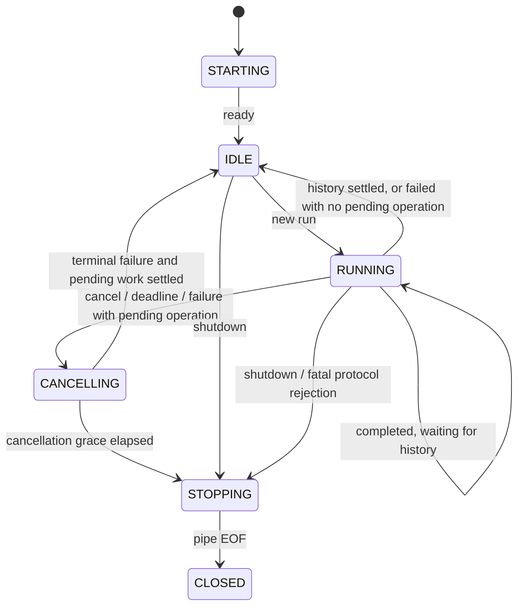

# Java and Python agent sessions

[Developer guide](DEVELOPMENT.md) | [Protocol contract](AGENT_PROTOCOL.md) | [Migration tracker](AGENT_MIGRATION.md)

This guide explains the session model, the meaning of each state and message type, and the responsibilities of Java and Python. The [version 1 protocol contract](AGENT_PROTOCOL.md) remains authoritative for exact fields, limits, and failure codes.

## What is implemented today?

Java's [ProtocolSession](../src/main/java/org/tyler/service/agent/protocol/ProtocolSession.java) and Python's [ProtocolSession](../agent-python/src/tyler_agent/session.py) are **pure state observers**. Given a message or local event, they return a decision and update an in-memory ledger. Shared fixtures test both implementations against the same expected decisions. The Java [PythonWorker](../src/main/java/org/tyler/service/agent/python/PythonWorker.java) now owns real processes and uses the Java observer under a lock; the observer itself still performs no I/O.

The runnable Python [worker](../agent-python/src/tyler_agent/worker.py) sends credential-free `ready` and executes valid runs through [WorkerRuntime](../agent-python/src/tyler_agent/runtime.py). The main thread reads and validates frames; one owned asyncio thread serializes run state, cancellable provider calls, operation futures, and stdout writes. Only one run and one Java operation can be active. Shutdown/EOF cancels and awaits owned tasks before stopping and joining the loop thread. Java's grace-period termination remains the hard boundary if library cleanup cannot finish. Malformed input or protocol violations produce a safe stderr diagnostic and exit code 2; normal shutdown/EOF exits with code 0.

The Python runtime tracks request tombstones, operation IDs, and observed write outcomes. It uses the shared validator but does not instantiate the pure observer: Java's history-settlement events are local to Java, so Python has no authority to settle history. Java sends the next run only after its own operation/history ledger settles. Late results for finished requests are ignored; mismatched or repeated active operation results fail the protocol. Cancellation stops further tools and continuations, closes the request-owned client, and reports a cancellation/deadline failure. A pending write remains uncertain; cancellation never implies rollback.

Application chat uses `PythonAgentService` by default behind the existing HTTP contract. Python is the only agent implementation. Step 6 adds the [allowlisted service operation bridge](AGENT_OPERATIONS.md), and Step 7 adds the Python model loop and adapters. Step 8 tests the complete HTTP/Python/service persistence path with a real loopback server and subprocess, a fake model provider, and temporary SQLite/history files. Step 9 packages the worker with Java; Step 10 retires Java agent orchestration after the validated release window.

## Configuration and lifecycle ownership

Python is the default. Before starting development, build the [Python bundle](../agent-python/README.md#build-and-smoke-test-the-windows-bundle) or configure an installed development interpreter. Example explicit configuration:

```yaml
agent:
  python:
    command:
      - E:/path/to/tyler-agent-worker/tyler-agent-worker.exe
    run-timeout: 5m
    operation-timeout: 1m
```

The default command resolves `agent-python/dist/tyler-agent-worker/tyler-agent-worker.exe` on Windows (no `.exe` on other platforms) relative to the backend working directory. Use an absolute path outside repository development. For an installed development environment, the command list can instead contain the absolute `.venv` Python executable followed by `-m` and `tyler_agent`. Each list entry is one argument; there is no shell parsing. Never put credentials in this list. Failed worker startup fails application startup, with no silent fallback. Recovery requires stopping the application and installing a validated compatible release; see the [rollout and recovery guide](AGENT_ROLLOUT.md).

The run and operation timeouts must be between 1,000 and 3,600,000 ms, with the operation timeout no longer than the run timeout. Production bounds remain 30 seconds for worker readiness, 16 queued actions, 30 seconds for queue wait, and 5 seconds of shutdown/cancellation grace. Worker readiness also remains subject to the desktop's existing overall startup deadline. Java recycles an idle worker after 10,000 runs.

| Owner | Implemented responsibility |
|---|---|
| `PythonAgentConfiguration` | Select exactly one `IAgentService`; create/start the worker before `ApplicationReadyEvent`. The existing `TYLER_READY <nonce> <port>` reporter is unchanged. Startup reads no API key. |
| `ConversationLane` | One FIFO lane for chat and history operations. Reject excess work with `WORKER_BUSY`; expire queued work without executing it. Nested history calls on the owner thread execute directly. |
| `PythonAgentService` | Read the current key and history after dequeue, send a per-request snapshot, and append exactly one successful exchange. Missing keys retain HTTP 401. History failure never replays tools. |
| `CoordinatedChatHistoryService` | Serialize clear/read/append with chat. A clear queued during a run executes after its history append, so that older run cannot later repopulate cleared history. History requests share the queue capacity/deadline. |
| `PythonWorker` | Own the process, session ledger, monotonic timers, callback execution, startup/shutdown, and cancellation. A new request can start a replacement worker after a failure, but the failed request is never retried. |
| `WorkerPipe` | Read stdout and write stdin independently; bound incomplete frames and the four-frame output queue. Drain stderr in fixed-size chunks and log only the byte count, never arbitrary worker text. |
| `ServiceOperationDispatcher` | Validate private operation input and route through an immutable handler map. Registration must exactly cover the schema's allowlist. |
| `OperationBridgeConfiguration` and `IOperationHandler` implementations | Discover handlers only for Python mode. Each handler calls its required shared service, sandbox capability, or server-local clock; domain rules remain in services. |
| `OperationPayloadMapper` | Share object decoding and plain-decimal result conversion, retaining causes on conversion failure without model-facing formatting or agent decisions. |
| Python `ParentMonitor` | Exit when the Java owner dies even if Python's main thread is blocked. Windows uses a held process handle; POSIX checks direct-parent identity. Normal worker EOF/shutdown closes the monitor. |

History snapshots use the shared `chat.max-messages` setting (`CHAT_MAX_MESSAGES`, default 20). The history service returns only the newest configured number of messages and removes leading assistant messages, so a snapshot may contain fewer than the limit. The Python adapter uses this same bounded service through the conversation lane; it does not introduce a separate history limit. Regression tests exercise the real history service with oversized stored history, including zero and odd limits.

The parent monitor polls through nonblocking OS probes. Closing it signals the interruptible polling wait and joins the thread to confirmed termination. The probe thread releases its handle in `finally` after its last use; repeated closes cannot release it twice. A thread-start failure releases the handle immediately. Poll timing, process access flags, wait status, and parent-identity configuration have named constants in `lifecycle.py`.

Cancellation currently comes from run/operation deadlines, interruption of a waiting Java caller, or application shutdown. The HTTP routes are unchanged: no new cancellation endpoint or promise that every browser disconnect interrupts the servlet thread is introduced. Once completion is accepted, history persistence owns the terminal outcome. This supervisor retires a cancelled worker after its acknowledgement or grace deadline; a later request uses a fresh process only after outstanding Java work has settled.

Callbacks use a separate executor from both the conversation lane and the pipe reader. A timed-out or disconnected write is never interrupted or assumed rolled back. New runs fail with `WORKER_UNAVAILABLE` while a previously dispatched callback remains unresolved. Its eventual outcome is recorded without delivering a late result to restart tools. Failure after dispatch is conservatively unknown for writes; an exception type alone does not prove rollback. Step 6 verifies real plan-service rollback and food persistence, while retaining that conservative transport classification.

An operation exception is retained in its Java run ledger before a safe operation result is sent. The protocol stops further dispatch after that failure. A later terminal failure (or locally detected transport/cancellation failure) uses a Java-owned public message and attaches the retained local exception as its cause, preserving its original stack and nested causes. Remote error text never becomes a Java cause, and a new run cannot inherit the previous run's local failure. The cause itself is never serialized to Python or included in HTTP error bodies.

Only OS runtime essentials (`SystemRoot`, temporary-directory variables, and the Linux loader path when configured) are inherited by the child. Java supplies non-secret session/parent identifiers and disables Python user-site packages. Credentials travel only in `run`, not environment variables or command arguments. Logs use safe identifiers/codes; the controller and Python adapter also avoid logging raw chat/tool content. Specific exception advice runs before generic advice to retain the existing error categories and response shapes.

## Session identity and ownership

A **session** represents one Python worker process generation. One session may handle several chat requests in sequence. It is different from persisted conversation history.

| Field | Owner | Meaning |
|---|---|---|
| `sessionId` | Java | A fresh 32-character lowercase hexadecimal identifier for each worker process. Python receives it through `TYLER_AGENT_SESSION_ID` and echoes it on every frame. It detects messages from a different process generation; it is not an authentication token. |
| `requestId` | Java | Identifies one chat run. Never reused within the session. Explicitly `null` for `ready` and `shutdown`. |
| `operationId` | Python | Identifies one service operation within a run. Never reused within that run. It is separate from a database record ID and a provider tool-call ID. |
| `protocolVersion` | Shared contract | Currently `1`; independent of the application's release version. |
| `type` | Message sender | Selects the message handler. Direction is fixed by the protocol. |
| `payload` | Message sender | The type-specific data, checked against the shared schema. |

Only one run is active and only one operation may be pending. Java owns the authoritative service outcomes and history writes. Python supplies model execution outcomes and consumes Java operation results. Request IDs remain remembered for the session; operation IDs and resolved-operation IDs are remembered for the current run. A new run resets the per-run ledger after the previous work has settled.

## States

These state names are local observer state, not extra fields sent on the wire. Both observers use the same names. Java local events can be replayed into Python's observer by tests; production Python does not write Java history or discover database settlement itself.

| State | Meaning in the observer | Java responsibility | Python responsibility in the full runtime |
|---|---|---|---|
| `STARTING` | A new session is waiting for its first `ready`. | Launch the worker and wait for matching readiness; do not send a run yet. | Initialize its private pipes/resources and send `ready` without requiring a provider key. |
| `IDLE` | Ready for a new, uniquely identified run; no operation is pending. | Select a queued request and send its current configuration/history snapshot. | Wait for `run`, or exit on `shutdown`. |
| `RUNNING` | A run is active. This also includes waiting for Java history after `completed`. | Dispatch accepted operations once; record results. After completion, persist history once before releasing the run. | Execute the model/tool loop, await operation results, then send one terminal message. After sending a terminal message, do not continue tools. |
| `CANCELLING` | New tool requests and completion are no longer accepted for this run. A Java operation may still be executing. | Retain pending work, send cancellation, and observe authoritative settlement. | Stop starting provider/tool work and acknowledge with `failed`; never assume an in-flight Java write was rolled back. |
| `STOPPING` | Shutdown, a fatal protocol rejection, or expired cancellation grace requires worker termination. | Stop admitting work, close/terminate the worker through the supervisor, and retain unresolved Java operations. | Release owned resources and exit when instructed; do not resume the run. |
| `CLOSED` | EOF/process disconnection has been observed. | Reject new work on that process generation. Continue tracking any outstanding Java operation locally. | The connection is gone; the process must finish cleanup. |

Typical transitions are:



The diagram shows common paths. EOF can be observed from any state; shutdown is accepted in any nonclosed state. A fatal rejection returns `STOPPING`, including rejection of a message delivered after `CLOSED`. Returning to `IDLE` requires settlement and must not reopen a stopping or closed session.

## Message types and reactions

All incoming messages pass validation before state or correlation checks. The sender must also avoid generating invalid local messages.

| Type and direction | Meaning and acceptance | Java reaction | Python reaction in the full runtime |
|---|---|---|---|
| `ready`: Python → Java | Worker is initialized; includes `workerVersion`. Accepted exactly once in `STARTING`. | Move to `IDLE`; a repeated ready is `INVALID_SEQUENCE`. | Send once before accepting runs. |
| `run`: Java → Python | Begin a chat with message, history, model, credential, round limit, and deadlines. Requires `IDLE` and a fresh request ID. | Reserve the run and reset its operation ledger. A reused ID is `DUPLICATE_MESSAGE`; another active run is `INVALID_SEQUENCE`. | Create the request-owned provider client and begin the bounded model/tool loop for this snapshot. |
| `operation_request`: Python → Java | Request an allowlisted service operation. Requires an active `RUNNING` request, new operation ID, no pending operation, no prior terminal/failure. | Register the pending operation before dispatch; return a `dispatch` decision. Mark a pending write's effect unknown. | Wait for its result before issuing another operation. Requests crossing cancellation are ignored without dispatch. |
| `operation_result`: Java → Python | Success or failure of the pending operation. Request ID, operation ID, and operation name must match. | Resolve the pending entry and record its write outcome. A duplicate result is rejected. | On success, continue the loop. On failure, send terminal `failed` and do not schedule more operations. A result arriving after cancellation must not restart tools. |
| `completed`: Python → Java | Model execution succeeded; contains the final `reply`. Requires `RUNNING`, no pending operation, no operation failure, and no prior terminal. | Mark terminal/awaiting-history and request exactly one history append. Remain `RUNNING` until history settles. | Finish this run; do not send another terminal or operation. |
| `failed`: Python → Java | Terminal unsuccessful execution; carries category, code, safe detail, and claimed write outcome. | Mark terminal, append no successful exchange, and retain the authoritative Java effect ledger. Return to `IDLE` only when pending work has settled. Model decision status is 400 for validation, 401 for authentication, otherwise 500. Actual HTTP mapping remains in the existing advice. | Stop the run. A pending operation normally requires cancellation first; `DEADLINE_EXCEEDED` may independently terminate while an operation is pending. |
| `cancel`: Java → Python | Cancel the active run; not a rollback instruction. | Record cancellation before disabling dispatch/sending the message. Repeated cancellation is idempotent; cancellation after accepted completion is ignored. | Stop new continuations and send a cancellation/deadline failure. Ignore a cancel crossing an already-sent terminal. |
| `shutdown`: Java → Python | Stop accepting work and exit. No reply frame is defined. | Move to `STOPPING` and wait for process exit within the grace period; keep pending service outcomes. | Clean up and exit. Repeated shutdown is allowed before closure. |

For an inactive/finished request, well-formed late messages are ignored. A repeated terminal for a finished request has reason `DUPLICATE_MESSAGE`; other inactive messages have reason `REQUEST_NOT_ACTIVE`. Validation still runs first: a malformed or wrong-session late message is not silently accepted.

## Local events: not wire messages

The observer's `observe(...)` method records events supplied by the Java owner. These events are never sent as message `type` values.

| Event | When it applies | Decision and effect |
|---|---|---|
| `deadline` | An active `RUNNING` request has not accepted a terminal message. | Enter `CANCELLING`, report status 500. If terminal handling already started, ignore the event. No operation is automatically rolled back. |
| `cancel_grace_elapsed` | `CANCELLING` has exceeded its allowed grace. | Enter `STOPPING` and return `terminateWorker: true`. An observation in another state is `INVALID_SEQUENCE`. |
| `pipe_eof` | The connection closes. | Enter `CLOSED`; the observer reports status 500 and retains unresolved work. The supervisor distinguishes normal shutdown from loss of an active request when resolving waiting calls. |
| `operation_settled` | Java learns the outcome of the matching pending operation after normal delivery is no longer appropriate. | Clear the pending operation; record `none`, `committed`, or `unknown`; return `sendResult: false`. Settle a terminal run when possible without reopening `CLOSED`/`STOPPING`. An unmatched ID is `OPERATION_NOT_PENDING`. |
| `history_settled` | Java's one history append after `completed` finishes. | Clear awaiting-history and settle the run. `failure` adds `HISTORY_FAILURE`/500; successful history permits success delivery. No tool replay occurs. Without a pending history append, reject `INVALID_SEQUENCE`. |

## Reading a decision

Both observers return the same decision shape. It is an internal result, not a wire envelope.

| Field | Meaning |
|---|---|
| `action` | `accept`, `ignore` (no applicable transition), or `reject` (fatal protocol transition to `STOPPING`). |
| `reason` | Present for ignored/rejected messages; a stable protocol code. |
| `state`, `activeRequestId` | Current observer state and last assigned active request. The ID may remain as a tombstone after completion; the state and finished-request set determine whether it is active. |
| `dispatch`, `dispatchCount` | Optional operation name authorized by this decision; cumulative dispatch count across the session. The pure observer does not execute it. |
| `historyAppend`, `awaitingHistory` | Number of append attempts requested by this step (0 or 1), and whether settlement is outstanding. |
| `failedOperation` | This run received a failed operation result; later operations/completion are forbidden. |
| `writeOutcome` | `unknown` if a dispatched write is unresolved; otherwise `committed` if any write was confirmed; otherwise `none`. Later failures must not erase prior confirmed writes. |
| `laneBlocked` | A pending operation remains while cancelling, stopping, or closed. Its settlement must be observed before replacing/reusing the conversation lane. |
| `replayCount` | Always zero: failures do not authorize replay. |
| `httpStatus`, `code` | Optional local failure outcome, including history failure. The observer does not produce an HTTP response. |
| `terminateWorker`, `sendResult` | Optional instructions for the supervisor: terminate after grace, or avoid sending a late operation result. |

## Example: successful run with one operation

```mermaid
sequenceDiagram
    participant J as Java supervisor
    participant P as Python worker
    participant S as Java domain service
    participant H as Java history service
    P->>J: ready(sessionId, workerVersion)
    Note over J,P: STARTING → IDLE
    J->>P: run(requestId, configuration, history)
    Note over J,P: IDLE → RUNNING
    P->>J: operation_request(requestId, operationId, operation, input)
    J->>J: Validate and register pending operation
    J->>S: Execute accepted service operation
    S-->>J: Authoritative result
    J->>P: operation_result(same IDs and operation)
    P->>J: completed(requestId, reply)
    Note over J: Still RUNNING; awaitingHistory = true
    J->>H: Append exchange once
    H-->>J: History settled
    Note over J: IDLE; deliver HTTP success
```

If cancellation or EOF occurs while `S` is executing a write, Java retains that pending operation. Killing Python does not cancel the Java transaction or prove rollback. A later confirmed commit remains recorded; an unconfirmed outcome stays unknown. A history failure after a commit reports failure without replaying the service operation.

## Validation and code map

The order is: byte limit → frame/UTF-8/JSON checks → version → operation allowlist → schema → session → direction → semantic values → state/correlation → domain service validation.

`decode` and `FrameReader` validate framing and shape only. A receiver then calls shared received-message validation so a wrong session is reported before a blank model or an out-of-range decimal. `encode` validates local semantic values before writing bytes. Domain dates and nonnegative quantities remain Java service rules.

| Responsibility | Java | Python |
|---|---|---|
| Codec and framing | `MessageCodec`, `FrameReader` | `protocol/protocol.py` |
| Shared wire validation | `MessageValidator` | `protocol/validation.py` |
| Session state and effect decisions | `ProtocolSession` | `session.py` |
| Safe errors | `ProtocolException`; `ProtocolFailures` maps validated error codes to Java-owned exception messages | `ProtocolError` with code-owned diagnostic detail |
| Process entry point | `PythonAgentService`, `PythonWorker` when selected | `__main__.py`, `worker.py`, `lifecycle.py` |

The Java validator has separate `validateShape`, `validateSemantics`, `validateMessage` (shape plus values), and `validateReceived` (shape, identity/direction, then values) entry points. The codec keeps its existing validation methods as delegates. Complete and incremental input share `validateFrameSize`. Lifecycle guards remain with the session because they depend on its mutable ledger.

These pure classes do not log payloads or perform side effects. Errors return safe codes to the owning boundary. Worker stderr diagnostics and Java exception advice own logging; arbitrary worker error detail must not be copied into public exceptions or logs.

## Tests

Each Java production class in the protocol package has a corresponding test class under `src/test/java/org/tyler/service/agent/protocol/`:

- `MessageCodecTest`: shared message cases, round trips, semantic rejection, and safe parser failures.
- `FrameReaderTest`: shared byte cases, fragmented input, Unicode, truncation, and frame-size boundaries.
- `MessageValidatorTest`: shared valid/invalid values, precedence, every message direction, numeric boundaries through shared fixtures, and Unicode checks.
- `ProtocolSessionTest`: cancellation ordering, invalid events, late results, failure statuses, pending writes, and history failures.
- `ProtocolExceptionTest`: stable code/message and absence of raw parser causes.
- `ProtocolFailuresTest`: exception/HTTP mapping, worker-detail redaction, and invalid failure inputs.

`ProtocolContractTest` additionally runs every shared sequence against Java; Python runs the same fixture sequences. The pure tests establish state/decision compatibility. Step 5's tests under `src/test/java/org/tyler/service/agent/python/` additionally exercise real subprocess callbacks, timeouts, shutdown, key/history ordering, HTTP compatibility, the actual backend readiness handshake, and forceful Java exit during simulated blocked provider work. Python tests cover the watchdog and real pipe EOF. Step 6's tests under `src/test/java/org/tyler/service/agent/bridge/` cover real shared validation, database outcomes, and sandbox access. Step 7 tests cover the Python model loop, tool parity, actual SDK requests over a fake transport, and real pipe execution/cancellation with an injected provider. Step 8's `AgentPersistenceIntegrationTest` combines HTTP, Python execution, and Java services: it verifies durable state after rollback, death before a write or after a commit, deadline cancellation, late operation results, concurrent HTTP requests, history completion/failure, and shutdown without an orphan worker.
