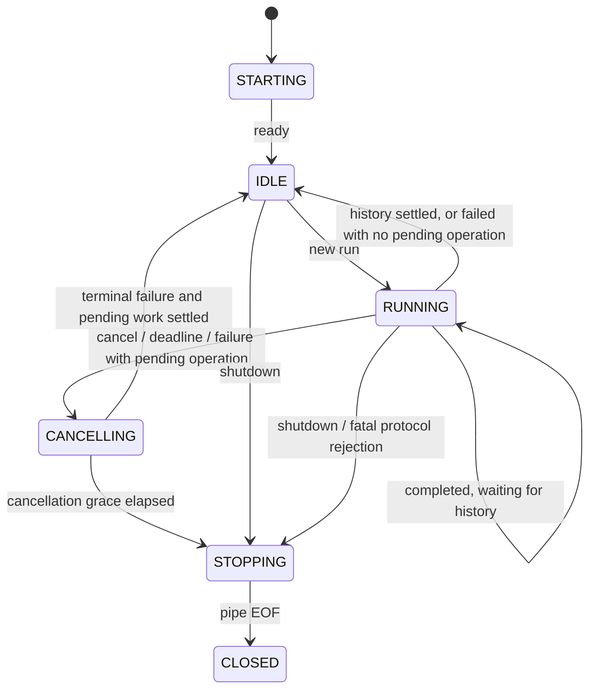

# Java and Python agent sessions

[Developer guide](DEVELOPMENT.md) | [Protocol contract](AGENT_PROTOCOL.md) | [Migration tracker](AGENT_MIGRATION.md)

This guide explains the session model, the meaning of each state and message type, and the responsibilities of Java and Python. The [version 1 protocol contract](AGENT_PROTOCOL.md) remains authoritative for exact fields, limits, and failure codes.

## What is implemented today?

Java's [ProtocolSession](../src/main/java/org/tyler/service/agent/protocol/ProtocolSession.java) and Python's [ProtocolSession](../agent-python/src/tyler_agent/session.py) are **pure state observers**. Given a message or local event, they return a decision and update an in-memory ledger. They do not start processes, call services, write history, cancel transactions, or send HTTP responses. Shared fixtures test both implementations against the same expected decisions.

The runnable Python [worker](../agent-python/src/tyler_agent/worker.py) currently sends `ready`, accepts `shutdown`, and responds to a valid `run` with `failed / WORKER_UNAVAILABLE`. It uses the shared validator, but does not instantiate the session observer or execute a model/tool loop. A cancel for an already registered run is ignored because its failure was already sent; unexpected operation results are rejected. Malformed input or protocol violations produce a safe stderr diagnostic and exit code 2. Normal shutdown or clean input EOF exits with code 0; truncated input is a protocol error.

Application chat still uses the legacy Java agent. The Java supervisor, operation bridge, and Python model loop belong to subsequent migration steps. The tables and successful-run diagram below describe the tested protocol model and the behavior those components must implement; they do not claim that the complete runtime is connected.

## Session identity and ownership

A **session** represents one Python worker process generation. One session may handle several chat requests in sequence. It is different from persisted conversation history.

| Field | Owner | Meaning |
|---|---|---|
| `sessionId` | Java | A fresh 32-character lowercase hexadecimal identifier for each worker process. Python receives it through `TYLER_AGENT_SESSION_ID` and echoes it on every frame. It detects messages from a different process generation; it is not an authentication token. |
| `requestId` | Java | Identifies one chat run. Never reused within the session. Explicitly `null` for `ready` and `shutdown`. |
| `operationId` | Python | Identifies one service operation within a run. Never reused within that run. It is separate from a database record ID and a provider tool-call ID. |
| `protocolVersion` | Shared contract | Currently `1`; independent of the application's release version. |
| `type` | Message sender | Selects the message handler. Direction is fixed by the protocol. |
| `payload` | Message sender | The type-specific data, checked against the shared schema. |

Only one run is active and only one operation may be pending. Java owns the authoritative service outcomes and history writes. Python supplies model execution outcomes and consumes Java operation results. Request IDs remain remembered for the session; operation IDs and resolved-operation IDs are remembered for the current run. A new run resets the per-run ledger after the previous work has settled.

## States

These state names are local observer state, not extra fields sent on the wire. Both observers use the same names. Java local events can be replayed into Python's observer by tests; production Python does not write Java history or discover database settlement itself.

| State | Meaning in the observer | Java responsibility | Python responsibility in the full runtime |
|---|---|---|---|
| `STARTING` | A new session is waiting for its first `ready`. | Launch the worker and wait for matching readiness; do not send a run yet. | Initialize its private pipes/resources and send `ready` without requiring a provider key. |
| `IDLE` | Ready for a new, uniquely identified run; no operation is pending. | Select a queued request and send its current configuration/history snapshot. | Wait for `run`, or exit on `shutdown`. |
| `RUNNING` | A run is active. This also includes waiting for Java history after `completed`. | Dispatch accepted operations once; record results. After completion, persist history once before releasing the run. | Execute the model/tool loop, await operation results, then send one terminal message. After sending a terminal message, do not continue tools. |
| `CANCELLING` | New tool requests and completion are no longer accepted for this run. A Java operation may still be executing. | Retain pending work, send cancellation, and observe authoritative settlement. | Stop starting provider/tool work and acknowledge with `failed`; never assume an in-flight Java write was rolled back. |
| `STOPPING` | Shutdown, a fatal protocol rejection, or expired cancellation grace requires worker termination. | Stop admitting work, close/terminate the worker through the supervisor, and retain unresolved Java operations. | Release owned resources and exit when instructed; do not resume the run. |
| `CLOSED` | EOF/process disconnection has been observed. | Reject new work on that process generation. Continue tracking any outstanding Java operation locally. | The connection is gone; the process must finish cleanup. |

Typical transitions are:



The diagram shows common paths. EOF can be observed from any state; shutdown is accepted in any nonclosed state. A fatal rejection returns `STOPPING`, including rejection of a message delivered after `CLOSED`. Returning to `IDLE` requires settlement and must not reopen a stopping or closed session.

## Message types and reactions

All incoming messages pass validation before state or correlation checks. The sender must also avoid generating invalid local messages.

| Type and direction | Meaning and acceptance | Java reaction | Python reaction in the full runtime |
|---|---|---|---|
| `ready`: Python → Java | Worker is initialized; includes `workerVersion`. Accepted exactly once in `STARTING`. | Move to `IDLE`; a repeated ready is `INVALID_SEQUENCE`. | Send once before accepting runs. |
| `run`: Java → Python | Begin a chat with message, history, model, credential, round limit, and deadlines. Requires `IDLE` and a fresh request ID. | Reserve the run and reset its operation ledger. A reused ID is `DUPLICATE_MESSAGE`; another active run is `INVALID_SEQUENCE`. | Begin model execution for this snapshot. The current prototype instead sends `WORKER_UNAVAILABLE`. |
| `operation_request`: Python → Java | Request an allowlisted service operation. Requires an active `RUNNING` request, new operation ID, no pending operation, no prior terminal/failure. | Register the pending operation before dispatch; return a `dispatch` decision. Mark a pending write's effect unknown. | Wait for its result before issuing another operation. Requests crossing cancellation are ignored without dispatch. |
| `operation_result`: Java → Python | Success or failure of the pending operation. Request ID, operation ID, and operation name must match. | Resolve the pending entry and record its write outcome. A duplicate result is rejected. | On success, continue the loop. On failure, send terminal `failed` and do not schedule more operations. A result arriving after cancellation must not restart tools. |
| `completed`: Python → Java | Model execution succeeded; contains the final `reply`. Requires `RUNNING`, no pending operation, no operation failure, and no prior terminal. | Mark terminal/awaiting-history and request exactly one history append. Remain `RUNNING` until history settles. | Finish this run; do not send another terminal or operation. |
| `failed`: Python → Java | Terminal unsuccessful execution; carries category, code, safe detail, and claimed write outcome. | Mark terminal, append no successful exchange, and retain the authoritative Java effect ledger. Return to `IDLE` only when pending work has settled. Model decision status is 400 for validation, 401 for authentication, otherwise 500. Actual HTTP mapping remains in the existing advice. | Stop the run. A pending operation normally requires cancellation first; `DEADLINE_EXCEEDED` may independently terminate while an operation is pending. |
| `cancel`: Java → Python | Cancel the active run; not a rollback instruction. | Record cancellation before disabling dispatch/sending the message. Repeated cancellation is idempotent; cancellation after accepted completion is ignored. | Stop new continuations and send a cancellation/deadline failure. Ignore a cancel crossing an already-sent terminal. |
| `shutdown`: Java → Python | Stop accepting work and exit. No reply frame is defined. | Move to `STOPPING` and wait for process exit within the grace period; keep pending service outcomes. | Clean up and exit. Repeated shutdown is allowed before closure. |

For an inactive/finished request, well-formed late messages are ignored. A repeated terminal for a finished request has reason `DUPLICATE_MESSAGE`; other inactive messages have reason `REQUEST_NOT_ACTIVE`. Validation still runs first: a malformed or wrong-session late message is not silently accepted.

## Local events: not wire messages

The observer's `observe(...)` method records events supplied by the Java owner. These events are never sent as message `type` values.

| Event | When it applies | Decision and effect |
|---|---|---|
| `deadline` | An active `RUNNING` request has not accepted a terminal message. | Enter `CANCELLING`, report status 500. If terminal handling already started, ignore the event. No operation is automatically rolled back. |
| `cancel_grace_elapsed` | `CANCELLING` has exceeded its allowed grace. | Enter `STOPPING` and return `terminateWorker: true`. An observation in another state is `INVALID_SEQUENCE`. |
| `pipe_eof` | The connection closes. | Enter `CLOSED`; the observer reports status 500 and retains unresolved work. The future supervisor must distinguish normal shutdown from loss of an active request when resolving HTTP calls. |
| `operation_settled` | Java learns the outcome of the matching pending operation after normal delivery is no longer appropriate. | Clear the pending operation; record `none`, `committed`, or `unknown`; return `sendResult: false`. Settle a terminal run when possible without reopening `CLOSED`/`STOPPING`. An unmatched ID is `OPERATION_NOT_PENDING`. |
| `history_settled` | Java's one history append after `completed` finishes. | Clear awaiting-history and settle the run. `failure` adds `HISTORY_FAILURE`/500; successful history permits success delivery. No tool replay occurs. Without a pending history append, reject `INVALID_SEQUENCE`. |

## Reading a decision

Both observers return the same decision shape. It is an internal result, not a wire envelope.

| Field | Meaning |
|---|---|
| `action` | `accept`, `ignore` (no applicable transition), or `reject` (fatal protocol transition to `STOPPING`). |
| `reason` | Present for ignored/rejected messages; a stable protocol code. |
| `state`, `activeRequestId` | Current observer state and last assigned active request. The ID may remain as a tombstone after completion; the state and finished-request set determine whether it is active. |
| `dispatch`, `dispatchCount` | Optional operation name authorized by this decision; cumulative dispatch count across the session. The pure observer does not execute it. |
| `historyAppend`, `awaitingHistory` | Number of append attempts requested by this step (0 or 1), and whether settlement is outstanding. |
| `failedOperation` | This run received a failed operation result; later operations/completion are forbidden. |
| `writeOutcome` | `unknown` if a dispatched write is unresolved; otherwise `committed` if any write was confirmed; otherwise `none`. Later failures must not erase prior confirmed writes. |
| `laneBlocked` | A pending operation remains while cancelling, stopping, or closed. Its settlement must be observed before replacing/reusing the conversation lane. |
| `replayCount` | Always zero: failures do not authorize replay. |
| `httpStatus`, `code` | Optional local failure outcome, including history failure. The observer does not produce an HTTP response. |
| `terminateWorker`, `sendResult` | Optional instructions for the future owner: terminate after grace, or avoid sending a late operation result. |

## Example: successful run with one operation

```mermaid
sequenceDiagram
    participant J as Java supervisor (planned)
    participant P as Python worker
    participant S as Java domain service
    participant H as Java history service
    P->>J: ready(sessionId, workerVersion)
    Note over J,P: STARTING → IDLE
    J->>P: run(requestId, configuration, history)
    Note over J,P: IDLE → RUNNING
    P->>J: operation_request(requestId, operationId, operation, input)
    J->>J: Validate and register pending operation
    J->>S: Execute accepted service operation
    S-->>J: Authoritative result
    J->>P: operation_result(same IDs and operation)
    P->>J: completed(requestId, reply)
    Note over J: Still RUNNING; awaitingHistory = true
    J->>H: Append exchange once
    H-->>J: History settled
    Note over J: IDLE; deliver HTTP success
```

If cancellation or EOF occurs while `S` is executing a write, Java retains that pending operation. Killing Python does not cancel the Java transaction or prove rollback. A later confirmed commit remains recorded; an unconfirmed outcome stays unknown. A history failure after a commit reports failure without replaying the service operation.

## Validation and code map

The order is: byte limit → frame/UTF-8/JSON checks → version → operation allowlist → schema → session → direction → semantic values → state/correlation → domain service validation.

`decode` and `FrameReader` validate framing and shape only. A receiver then calls shared received-message validation so a wrong session is reported before a blank model or an out-of-range decimal. `encode` validates local semantic values before writing bytes. Domain dates and nonnegative quantities remain Java service rules.

| Responsibility | Java | Python |
|---|---|---|
| Codec and framing | `MessageCodec`, `FrameReader` | `protocol/protocol.py` |
| Shared wire validation | `MessageValidator` | `protocol/validation.py` |
| Session state and effect decisions | `ProtocolSession` | `session.py` |
| Safe errors | `ProtocolException`; `ProtocolFailures` maps validated error codes to Java-owned exception messages | `ProtocolError` with code-owned diagnostic detail |
| Process entry point | Future supervisor | `__main__.py`, `worker.py` prototype |

The Java validator has separate `validateShape`, `validateSemantics`, `validateMessage` (shape plus values), and `validateReceived` (shape, identity/direction, then values) entry points. The codec keeps its existing validation methods as delegates. Complete and incremental input share `validateFrameSize`. Lifecycle guards remain with the session because they depend on its mutable ledger.

These pure classes do not log payloads or perform side effects. Errors return safe codes to the owning boundary. Worker stderr diagnostics and Java exception advice own logging; arbitrary worker error detail must not be copied into public exceptions or logs.

## Tests

Each Java production class in the protocol package has a corresponding test class under `src/test/java/org/tyler/service/agent/protocol/`:

- `MessageCodecTest`: shared message cases, round trips, semantic rejection, and safe parser failures.
- `FrameReaderTest`: shared byte cases, fragmented input, Unicode, truncation, and frame-size boundaries.
- `MessageValidatorTest`: shared valid/invalid values, precedence, every message direction, numeric boundaries through shared fixtures, and Unicode checks.
- `ProtocolSessionTest`: cancellation ordering, invalid events, late results, failure statuses, pending writes, and history failures.
- `ProtocolExceptionTest`: stable code/message and absence of raw parser causes.
- `ProtocolFailuresTest`: exception/HTTP mapping, worker-detail redaction, and invalid failure inputs.

`ProtocolContractTest` additionally runs every shared sequence against Java; Python runs the same fixture sequences. The pure tests establish state/decision compatibility. Real supervisor timing, database outcomes, process termination, and application integration still require the later migration tests.
