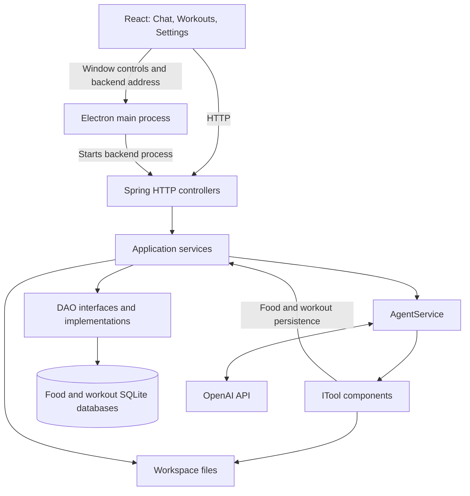

# Tyler Agent developer guide

[Back to the user guide](../README.md)

This page covers building, running, and maintaining Tyler. For the everyday app workflow, start with the [README](../README.md).

For implementation and review conventions, use the applicable standards:

- [Backend coding and design standards](BACKEND_STANDARDS.md)
- [Frontend coding and design standards](FRONTEND_STANDARDS.md), including required AI implementation and review workflows

## Contents

- [Install prerequisites (Windows)](#install-prerequisites-windows)
- [Run from source](#run-from-source)
- [Architecture](#architecture)
- [Repository layout](#repository-layout)
- [Agent tools and workout persistence](#agent-tools-and-workout-persistence)
- [HTTP API](#http-api)
- [Configuration and data storage](#configuration-and-data-storage)
- [Networking and desktop startup](#networking-and-desktop-startup)
- [Testing](#testing)
- [Release version and packaging](#release-version-and-packaging)
- [Troubleshooting](#troubleshooting)

## Install prerequisites (Windows)

New to the project? Follow the [prerequisite installation guide](SETUP.md) for Java, Maven, Node.js, and IntelliJ IDEA setup, version checks, and troubleshooting.

## Run from source

The desktop launcher and installer configuration target Windows. Build requirements are:

| Requirement | Repository setting |
|---|---|
| JDK | Java 26, configured in [pom.xml](../pom.xml). |
| Maven | Used to compile, test, and package the backend. |
| Node.js and npm | Node.js 22.12.0 or newer, required by the Electron dependency in [package-lock.json](../frontend/package-lock.json). |
| OpenAI API key | Required for chat; enter it in the app's Settings page. |

### Browser development

From the repository root:

```powershell
mvn package
cd frontend
npm ci
npm run dev
```

Open the Vite address printed in the terminal. The development command starts the backend JAR and Vite together, then connects the frontend proxy to that backend's assigned port. Rebuild the JAR and restart this command after backend changes; Vite reloads frontend source changes during development.

To preview the built frontend, run these commands from `frontend/`:

```powershell
npm run build
npm run preview
```

The preview command also starts its own backend process.

### Desktop development

From the repository root:

```powershell
mvn package
cd frontend
npm ci
npm run build
npm run electron
```

Electron loads the built frontend and starts the backend automatically. Rebuild the frontend after changing its source before launching Electron again. Closing the application terminates its backend child process.

### Backend only

From the repository root:

```powershell
mvn spring-boot:run
```

The backend uses an available loopback port by default. A saved API key is needed for chat, but the server can start without one. Use the combined development launcher above when working with the browser UI.

## Architecture

| Area | Technologies |
|---|---|
| Backend | Java 26, Spring Boot 4.1.1, OpenAI Java SDK 4.54.0, Spring JDBC, SQLite. |
| Frontend | React 18, TypeScript, Vite, react-calendar. |
| Desktop | Electron, Electron Forge, Squirrel.Windows. |
| Build | Maven and npm. |

Dependency declarations live in [pom.xml](../pom.xml) and [package.json](../frontend/package.json); the frontend lockfile records resolved npm versions.



For a chat request, `AgentService` loads retained history, adds the new message, and calls OpenAI with the registered tool definitions. It executes any requested tools and sends their results back to the model, up to five tool rounds. It then saves the user message and final reply and returns the reply to the frontend.

Controllers and services are grouped by feature. The food controller and recording tool share `IFoodService`; the workout CRUD controller and plan tool share `IWorkoutService` for persistence. Both services call their DAO interfaces directly. The sole food DAO is the SQLite implementation, selected without a primary-bean override. Controllers and tools do not depend on DAO or DAL types. SQLite implementations load parameterized SQL from resource files, validate input, and preserve decimal values as strings. SQL read failures use `SQLReadException`; write failures use `SQLPersistentException`. Exception handlers translate these failures into HTTP responses.

## Repository layout

```text
tyler_agent/
├─ .mvn/maven.config               # Shared release version
├─ docs/DEVELOPMENT.md             # This guide
├─ src/main/java/org/tyler/
│  ├─ config/                     # Startup and CORS configuration
│  ├─ controller/                 # HTTP routes grouped by feature
│  ├─ service/                    # Chat, history, settings, food, and workouts
│  ├─ tool/                       # Agent tools
│  ├─ dao/                        # SQLite persistence
│  ├─ model/                      # Application data records
│  ├─ filesandbox/                # Workspace file access
│  ├─ filter/                     # Request tracing
│  └─ exceptionHandler/           # HTTP error handling
├─ src/main/resources/
│  ├─ application.yml             # Application defaults
│  ├─ logback-spring.xml           # Logging configuration
│  └─ db/                         # Food and workout SQL files
├─ src/test/java/org/tyler/        # Backend tests
├─ frontend/
│  ├─ electron/                   # Main process, preload bridge, startup tests
│  ├─ scripts/                    # Development and version synchronization
│  ├─ src/components/
│  │  ├─ chat/                   # MessageBubble and MessageInput
│  │  ├─ food/                   # FoodCalendar
│  │  ├─ workout/                # WorkoutPage
│  │  ├─ settings/               # SettingsPage, ApiKeyForm, and UserInfoForm
│  │  ├─ layout/                 # Sidebar and TitleBar
│  │  └─ common/                 # Shared ConfirmDialog
│  ├─ src/styles/                 # Shared theme and page styles
│  ├─ src/api.ts                  # HTTP client
│  ├─ src/types.ts                # Frontend data contracts
│  └─ src/App.tsx                 # Application shell and view state
├─ resources/runtime/             # Local Java runtime for packaging; ignored by Git
└─ pom.xml
```

`App` owns navigation between Chat, Workouts, and Settings. Chat includes the collapsible food calendar. `WorkoutPage` owns date selection, plan previews, and the saved-exercise editor. `api.ts` handles HTTP requests. Electron uses a preload bridge for the backend address and custom window controls, with context isolation enabled and renderer Node integration disabled.

CSS lives in `frontend/src/styles/`: `tokens.css` defines shared design values; `theme.css` supplies base and component styles; `layout.css` arranges the application shell; `chat.css` and `workout.css` style their respective pages.

## Agent tools and workout persistence

Spring discovers components implementing [`ITool`](../src/main/java/org/tyler/tool/ITool.java). `AgentService` receives them as a list and exposes their function definitions to OpenAI.

| Tool | Behavior |
|---|---|
| `getCurrentTime` | Returns the server's current local date and time. |
| `GetUserInfo` | Reads the saved profile. |
| `readFile` | Reads a text file within the workspace. |
| `writeFile` | Writes a text file within the workspace, creating parent directories as needed. |
| `recordFood` | Validates food arguments and saves the record through the food service. |
| `generateWorkoutPlan` | Generates seven dated days and saves the planned exercises through the workout service and DAO. |

The workout tool accepts `startDate` in `YYYY-MM-DD` format, `goal` (`general_fitness`, `strength`, or `muscle_gain`), and `equipment` (`bodyweight` or `gym`). Its templates produce strength, cardio, recovery, and rest days.

Executing the tool saves nine strength exercises and three timed activity entries for a new week. Timed activities include their duration in the exercise name and use `1X1` for one session. Rest days have no workout entry. New records use weight `0` as a placeholder. Existing records with the same date and exercise name are reused, preserving their saved reps and weights.

The controller and tool share a dedicated plan service and model-layer plan DTOs. The tool handles its schema, JSON parsing, and serialization; the service owns templates, preview, duplicate matching, and saving. Plan persistence uses a real transaction: the workout DAO's `JdbcTemplate` and its transaction manager share the same configured workout data source. A failed write rolls back all inserts from that request and preserves pre-existing records, without compensating deletes. Sequential repeats reuse date/name matches; concurrent deduplication is not guaranteed. If multiple matching records already exist, the last in ascending ID order is used in the returned plan without modifying any of them.

The calendar calls the plan service's `previewPlan` method through `GET /api/workouts/plan`. A preview does not access storage. **Add to calendar** creates an entry, while **Save exercise** creates or updates a saved entry. The preview week begins on Monday; an agent-generated plan begins on its supplied start date.

## HTTP API

All routes use the running backend's assigned address. JSON errors generally contain an `error` field. Invalid bodies and validation failures return HTTP 400; database failures return HTTP 500.

| Method | Route | Purpose |
|---|---|---|
| POST | `/api/agent/chat` | Send `{ "message": "..." }`; receive `{ "reply": "..." }`. |
| GET | `/api/agent/history` | Read retained conversation history. |
| DELETE | `/api/agent/history` | Clear conversation history. |
| GET / POST | `/api/userinfo` | Read or save the user profile. |
| GET | `/api/apikey/status` | Return whether a key is configured. |
| POST | `/api/apikey` | Save `{ "apiKey": "..." }`; return configuration status. |
| GET | `/api/food?date=YYYY-MM-DD` | List food entries with their database IDs. |
| DELETE | `/api/food/{id}` | Delete one food entry. |
| DELETE | `/api/food/date/{date}` | Delete all food entries for a date. |
| GET | `/api/workouts?date=YYYY-MM-DD` | List saved workout entries for a date. |
| GET | `/api/workouts/plan?startDate=YYYY-MM-DD&goal=general_fitness&equipment=bodyweight` | Preview a seven-day plan without saving it. |
| POST | `/api/workouts` | Save a workout; return its ID and data with HTTP 201. |
| PUT | `/api/workouts/{id}` | Update a workout; return HTTP 404 if it does not exist. |
| DELETE | `/api/workouts/{id}` | Delete a workout; return HTTP 204, or HTTP 404 if missing. |

Workout create and update requests use this shape:

```json
{
  "workoutName": "Squat",
  "rep": "4X12",
  "weight": 20,
  "workoutDate": "2026-10-05"
}
```

Saved workout responses wrap the record as `{ "id": 7, "workout": { ... } }`. Reps require positive sets and repetitions separated by uppercase `X`; weight must be nonnegative and the date must parse as an ISO date. The current model has no weight-unit field.

The workout date endpoint parses the requested date in the controller and passes a `LocalDate` through the service to the DAO. The DAO selects that date's records using a bound SQL parameter, ordered by ascending record ID; the controller maps them to the existing response shape. A valid date without records returns `[]`. Blank or malformed dates return HTTP 400 with a date-format error. Internal date-scoped service and DAO calls reject null dates. The all-records operation remains available for callers that need it.

### Shared domain validation

All food insertion callers use `FoodService`; HTTP food reads/deletes use that same service. There is no food HTTP insertion route, so this change does not add one. Workout HTTP CRUD uses `WorkoutService`; the plan Tool and HTTP preview share `WorkoutPlanService`, whose saves pass through `WorkoutService` inside the existing database transaction.

Focused validators under `org.tyler.validation` apply these rules before storage access:

`IValidator<T>` is the shared, stateless validation contract: `void validate(T value)` returns normally for valid input and throws `IllegalArgumentException` for invalid domain input. Validators must not mutate input or perform I/O. `FoodValidator` and `WorkoutValidator` are Spring components, injected into services as explicitly qualified `IValidator<Food>` and `IValidator<Workout>` dependencies. `DomainValidation` remains a utility for individual field checks and date parsing. Direct workout DAO calls retain the same validator implementation and persistence exception translation.

For a future service with several validators for the **same input type**, Spring can inject a map keyed by bean name:

```java
private final Map<String, IValidator<Food>> validators;

public ComplexFoodService(Map<String, IValidator<Food>> validators) {
    this.validators = Map.copyOf(validators);
}
```

The current food map contains `foodValidator`; a workout map contains `workoutValidator`. Select a required validator by an explicit key and fail clearly if it is absent; do not silently skip validation. If multiple rules must run in sequence, define that order explicitly rather than relying on map iteration. Use separate typed maps for different input types; `Map<String, IValidator<?>>` cannot safely validate arbitrary objects without recovering each validator's input type. No registry or map is needed in the current simple services.

| Input | Domain rule |
|---|---|
| Food | Food, generic info, and macro nutrients are required. Name and unit must be nonblank; amount, calories, protein, carbs, fat, and fiber must be present and nonnegative. Zero and arbitrary decimal precision remain accepted; no new unit vocabulary or upper limits are imposed. |
| Workout | Workout and nonblank name are required; weight must be present and nonnegative. Zero remains valid for generated plans. The model retains its existing positive `setsXrepetitions` invariant. |
| Dates | Insertion dates, food lookup/deletion dates, and plan dates must parse as real ISO calendar dates using `LocalDate.parse`. No whitespace trimming or timezone conversion is performed. Existing Java ISO extended-year support remains accepted. Workout query strings use the same parser before passing `LocalDate` to the service. |
| Plan options | Existing supported goal/equipment values are unchanged. Preview and save validate the same inputs; the start date must leave room for all seven days within `LocalDate`'s range. Preview remains read-only. |
| IDs | Service record IDs must be positive. Valid but absent IDs keep the existing empty/false/404 behavior appropriate to each endpoint. |

Domain failures use `IllegalArgumentException` and map to HTTP 400 with the existing `error` response field. Tools propagate the same service exceptions and messages for equivalent domain input. Malformed JSON, incompatible types, and missing required HTTP query parameters remain adapter binding errors (also HTTP 400); their parsing messages need not match domain messages. `GenericExceptionHandler` explicitly maps missing required parameters (`MissingServletRequestParameterException`) and argument conversion failures (`MethodArgumentTypeMismatchException`), including nonnumeric and overflowing record IDs, to HTTP 400 before services are invoked. MockMvc tests exercise these binding failures through the actual routes. Required-value validation for parsed plan arguments now belongs to the plan service.

Actual database read and write failures remain `SQLReadException` and `SQLPersistentException`, with HTTP 500 handling. DAO defensive validation remains: food checks required persistence fields, and workout reuses the shared validator while preserving `SQLDataValidationException` for direct DAO callers. That exception is an argument-validation subtype, not a storage outage. SQL `NOT NULL` constraints, the workout model invariant, and real transaction rollback remain intact.

**Compatibility decision:** Food domain dates previously only needed to be nonblank; malformed or impossible dates are now rejected for writes, lookup, and date deletion. Negative food values previously passed direct service calls but were rejected by the Tool; all service callers now follow the nonnegative rule. Nonpositive food deletion IDs now produce HTTP 400 instead of an absent-record result. Workout service validation now reports a domain exception before the DAO rather than relying on a SQL-named validation subtype. Plan dates too near the maximum calendar date now give a client validation error instead of overflowing during generation. No existing records are rewritten or deleted; legacy records can still be deleted by a positive ID, and direct DAO reads retain their compatibility behavior. Repairing legacy malformed dates is a separate data-maintenance task.

Parameterized contract tests use real services behind the adapters and assert that invalid input never reaches persistence. DAO tests independently verify defensive checks and unchanged rows after rejection; the existing plan integration tests continue to verify real atomic rollback.

## Configuration and data storage

Defaults are in [application.yml](../src/main/resources/application.yml). The workspace defaults to `{user.home}/AppData/Local/tyler_agent`; set `AGENT_WORKSPACE_DIR` to choose another directory. Data paths below are relative to that workspace.

| Property | Environment variable | Default |
|---|---|---|
| `server.address` | `SERVER_ADDRESS` | `127.0.0.1` |
| `server.port` | `SERVER_PORT` | `0` (assigned by the OS) |
| `openai.model` | `OPENAI_MODEL` | `gpt-5.6` |
| `openai.key-file-path` | `OPENAI_KEY_FILE_PATH` | `apikey.txt` |
| `agent.workspace-dir` | `AGENT_WORKSPACE_DIR` | Default workspace above |
| `userinfo.file-path` | `USERINFO_FILE_PATH` | `userinfo.json` |
| `chat.history-file-path` | `CHAT_HISTORY_FILE_PATH` | `chat-history.json` |
| `chat.max-messages` | `CHAT_MAX_MESSAGES` | `20` |
| `food.database-path` | `FOOD_DATABASE_PATH` | `food-record.sqlite` |
| `workout.database-path` | `WORKOUT_DATABASE_PATH` | `workout-record.sqlite` |

The workout database default is declared in its database configuration. `OPENAI_MODEL` and `WORKOUT_DATABASE_PATH` use Spring's environment property binding. App-managed startup explicitly sets the server address and port, so those two settings apply as overrides only when starting the backend independently.

The API key is stored as a local text file. The key status API returns only whether a key is configured. Conversation requests go to OpenAI and can include recent history, profile details, and tool results. Workspace storage is local; it does not make chat processing local.

SQLite tables and indexes are created by the DAOs from scripts under `src/main/resources/db/`. Food reads and writes use the sole `IFoodRecordDAO` implementation directly against SQLite.

Logging is configured in [logback-spring.xml](../src/main/resources/logback-spring.xml). Logs default to `logs/tyler-agent.log` relative to the process working directory, outside the workspace. Set `LOG_DIR` to change that location. Logs rotate daily and at 10 MB, with 14 days of retention and a 1 GB total cap. Application logging defaults to INFO; DEBUG includes chat and tool content.

### Food persistence decision

The in-memory food decorator was removed because no measured performance need justified maintaining a second state store. In the checkout reviewed for this change it was selected as the primary DAO, and its bulk-save cache replacement conflicted with the database append contract. All food reads now query SQLite, including reads with record IDs, and successful ID/date deletions are immediately visible through every read path. The wiring test scans the food DAO package, asserts exactly one implementation, and verifies that the service receives that same instance. Persisted food entries are addressed by stable IDs. The DAO exposes single-record insertion, ID-bearing date lookup, ID deletion, and date deletion. Insertion always appends and returns the generated ID; equal food values remain separate records. The embedded food date is the only insertion date source, so a second date argument cannot disagree. Service dates follow the shared domain validation rules above; the DAO retains its persistence-level presence checks. The service returns an ID-bearing entry, while the recording tool deliberately serializes only its food value to preserve its external response. The calendar retains its ID-bearing API DTO. Unused list-style reads, bulk saving, and structural-equality deletion were removed after a caller inventory found only test callers for those redundant operations. No schema migration or stored-data rewrite is needed.

## Networking and desktop startup

The backend binds to `127.0.0.1` and asks the OS for an available port. Vite also binds to loopback, prefers port 5173 during development, and selects another port when it is occupied. No backend process needs to claim port 8080.

Electron and the combined development launcher start their own backend child process. A startup message containing a per-process nonce identifies the child's assigned port. Browser development uses Vite's same-origin `/api` proxy; packaged Electron receives the backend address through the preload bridge before React mounts.

CORS allows the Electron file origin (`null`) for `/api/**` without credentials. Loopback binding limits network exposure, but neither loopback binding nor CORS authenticates other programs on the same computer.

The launcher searches for Java in packaged runtime locations, `resources/runtime/bin/java.exe`, `JAVA_HOME`, the user's `.jdks` directory, and finally `PATH`. Set `BACKEND_JAR_PATH` to override the backend JAR location.

## Testing

From the repository root:

```powershell
mvn test
```

From `frontend/`:

```powershell
npm run test:startup
npm run test:version
npx tsc --noEmit
npm run build
```

Backend tests cover controllers, services, tools, file access, and database operations, including workout plan persistence against a temporary SQLite database. The npm tests cover backend startup and release-version handling. TypeScript checking is a separate command because the Vite build does not run it.

### Frontend verification baseline

The [frontend standards](FRONTEND_STANDARDS.md) define the required checks. The following describes the tooling present when those standards were added (2026-10-15); update it when tooling changes.

| Check | Current repository support |
|---|---|
| Strict type checking | Enabled in [tsconfig.json](../frontend/tsconfig.json); run `npx tsc --noEmit` with installed dependencies. CI does not currently run this command. |
| Startup and version tests | `npm run test:startup` and `npm run test:version` run locally and in CI. They do not test rendered UI behavior. |
| Production frontend build | `npm run build` runs Vite locally and in CI. It does not perform TypeScript type checking. |
| Linting and formatting | No linter or formatter is configured. Their tools, rules, and scripts still need a focused setup change. |
| Component and browser tests | No React component or browser end-to-end runner is configured. Behavior and race-condition tests need appropriate tooling. |
| Packaged desktop smoke tests | No packaged-app smoke check is configured in CI. Desktop/release changes require recorded verification on the supported OS. |

Use `npm ci` in `frontend/` to install the locked dependencies before checks. Follow-up tooling work must add the missing type-check/lint/test gates to [CI](../.github/workflows/ci.yml), establish the formatter, and configure required status checks in repository settings. Current CI passing does not establish compliance with all frontend standards. Record unavailable checks as unverified; do not invent `npm run lint` or `npm test` scripts. This documentation change does not install tooling or certify the existing UI against every rule.

## Release version and packaging

Edit only the `-Drevision=` value in [.mvn/maven.config](../.mvn/maven.config) to set the release version. Maven uses it for the project version and `target/tyler-agent-<version>.jar`. Frontend npm lifecycle scripts synchronize `package.json` and `package-lock.json`; Electron and Forge use the resulting version to locate the JAR.

Run `npm run sync-version` from `frontend/` to synchronize metadata immediately. Rebuild the backend after changing the version so the expected JAR exists.

For a Windows installer, first place a compatible Java 26 runtime at `resources/runtime/`, with `bin/java.exe` inside it. This directory is ignored by Git and must be supplied locally. Then, from the repository root:

```powershell
mvn package
cd frontend
npm ci
npm run build
npm run make
```

[forge.config.cjs](../frontend/forge.config.cjs) bundles the Java runtime and backend JAR with the desktop app. Installer artifacts are written under `frontend/out/make/squirrel.windows/x64/`. The current Forge configuration does not configure code signing; unsigned builds may trigger a Windows publisher warning.

## Troubleshooting

| Symptom | What to check |
|---|---|
| Backend JAR not found | Run `mvn package` from the repository root. After a version change, rebuild the JAR and run `npm run sync-version` in `frontend/`. |
| Java missing or incompatible | Check `java -version` and `JAVA_HOME`. An older bundled runtime takes precedence over `PATH`. |
| `TYLER_BACKEND_URL` is missing | Use `npm run dev` or `npm run preview`, which start the backend and supply its address. |
| A familiar port is already occupied | Use the address printed by the launcher; the app selects available ports. |
| Chat reports an empty API key | Save the key on the Settings page. |
| A suggestion is absent from saved exercises | Use **Add to calendar**, or ask the agent to create and save the plan. Changing preview options alone does not save it. |
| Existing exercise values survive regeneration | The tool preserves records matching the same date and name. Edit the saved exercise to change those values. |
| Packaging cannot find the runtime | Supply `resources/runtime/bin/java.exe` and rebuild the frontend and backend before running Forge. |

[Back to the user guide](../README.md)
