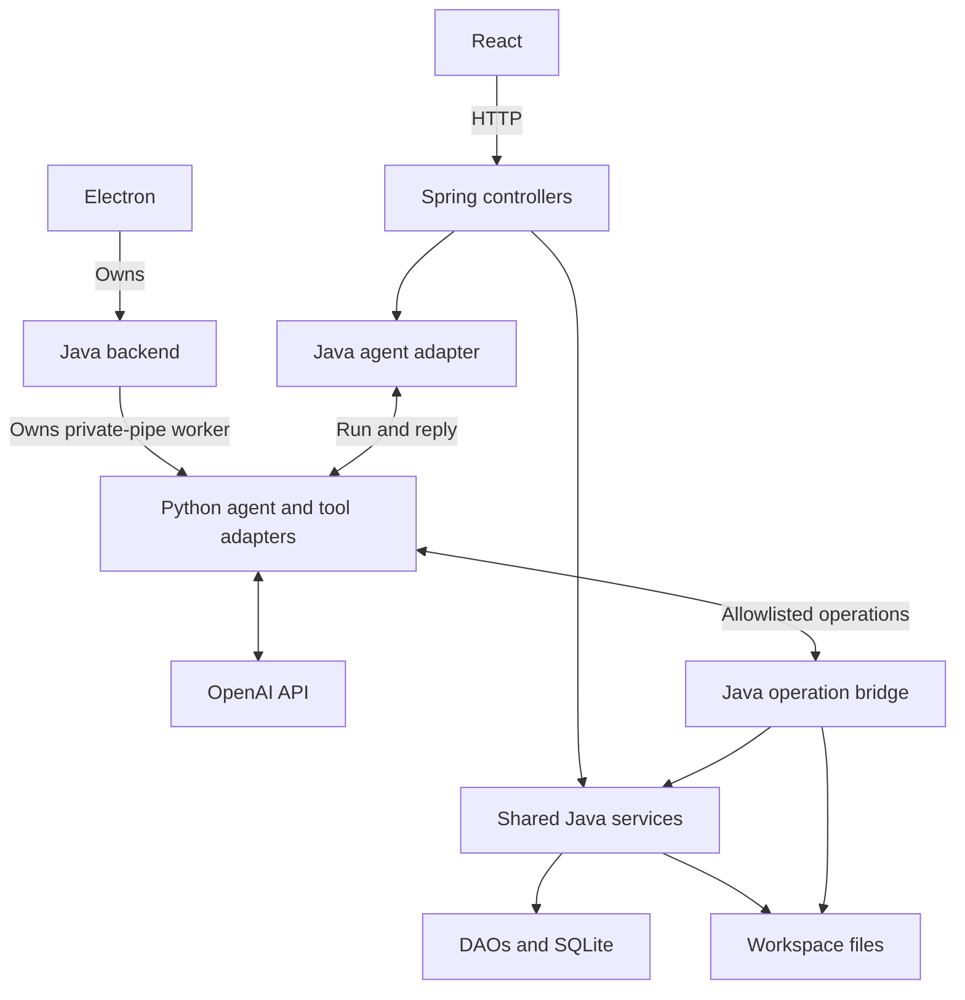

# Tyler Agent developer guide

[Back to the user guide](../README.md)

This page covers building, running, and maintaining Tyler. For the everyday app workflow, start with the [README](../README.md).

For backend implementation and review conventions, see the [backend coding and design standards](BACKEND_STANDARDS.md).

Python agent contributors and reviewers must also follow the [Python agent coding and design standards](PYTHON_AGENT_STANDARDS.md). Setup and verification commands are in the [Python development guide](../agent-python/README.md).

For the Java to Python agent roadmap, implementation progress, and verification history, see the [agent migration tracker](AGENT_MIGRATION.md). The [agent protocol contract](AGENT_PROTOCOL.md) defines private Java/Python communication and shared fixtures. The [session lifecycle guide](AGENT_SESSION.md) explains every state, message type, each side's reaction, and the worker supervisor configuration. The [service operation guide](AGENT_OPERATIONS.md) describes Step 6 handlers, shared validation, and preserved tool contracts. Python owns all model/tool execution. The [rollout guide](AGENT_ROLLOUT.md) documents recovery using the validated previous release. Run `uv sync --locked` in `agent-python/` before the full Maven suite, which now includes real Python subprocess and loopback readiness tests.

## Contents

- [Install prerequisites (Windows)](#install-prerequisites-windows)
- [Run from source](#run-from-source)
- [Architecture](#architecture)
- [Repository layout](#repository-layout)
- [Agent tools and workout persistence](#agent-tools-and-workout-persistence)
- [HTTP API](#http-api)
- [Configuration and data storage](#configuration-and-data-storage)
- [Networking and desktop startup](#networking-and-desktop-startup)
- [Testing](#testing)
- [Release version and packaging](#release-version-and-packaging)
- [Troubleshooting](#troubleshooting)

## Install prerequisites (Windows)

New to the project? Follow the [prerequisite installation guide](SETUP.md) for Java, Maven, Node.js, and IntelliJ IDEA setup, version checks, and troubleshooting.

## Run from source

The desktop launcher and installer configuration target Windows. Build requirements are:

| Requirement | Repository setting |
|---|---|
| JDK | Java 26, configured in [pom.xml](../pom.xml). |
| Maven | Used to compile, test, and package the backend. |
| Node.js and npm | Node.js 22.12.0 or newer, required by the Electron dependency in [package-lock.json](../frontend/package-lock.json). |
| OpenAI API key | Required for chat; enter it in the app's Settings page. |

Before either development launch below, prepare Python from the repository root:

```powershell
cd agent-python
uv sync --locked
uv run --locked pyinstaller --noconfirm --distpath dist --workpath build worker.spec
cd ..
```

Alternatively configure the interpreter command described in the [session guide](AGENT_SESSION.md#configuration-and-lifecycle-ownership). The browser and Electron development launchers start Java with the repository root as its working directory, so the default worker path resolves consistently. Before that change of directory, relative `BACKEND_JAR_PATH` and explicit `AGENT_WORKSPACE_DIR` overrides are resolved against the directory where the launcher was invoked. For example, launching from `frontend/` with `AGENT_WORKSPACE_DIR=./data` continues to use `frontend/data`. Startup does not download dependencies or silently switch to Java if the worker is missing.

### Browser development

From the repository root:

```powershell
mvn package
cd frontend
npm ci
npm run dev
```

Open the Vite address printed in the terminal. The development command starts the backend JAR and Vite together, then connects the frontend proxy to that backend's assigned port. Rebuild the JAR and restart this command after backend changes; Vite reloads frontend source changes during development.

To preview the built frontend, run these commands from `frontend/`:

```powershell
npm run build
npm run preview
```

The preview command also starts its own backend process.

### Desktop development

From the repository root:

```powershell
mvn package
cd frontend
npm ci
npm run build
npm run electron
```

Electron loads the built frontend and starts the backend automatically. Rebuild the frontend after changing its source before launching Electron again. Closing the application terminates its backend child process.

### Backend only

From the repository root:

```powershell
mvn spring-boot:run
```

The backend uses an available loopback port by default. A saved API key is needed for chat, but the server can start without one. Use the combined development launcher above when working with the browser UI.

## Architecture

| Area | Technologies |
|---|---|
| Backend | Java 26, Spring Boot 4.1.1, Spring JDBC, SQLite. |
| Agent | Python 3.12.14, OpenAI Python SDK 3.31.0, private Java/Python process protocol. |
| Frontend | React 18, TypeScript, Vite, react-calendar. |
| Desktop | Electron, Electron Forge, Squirrel.Windows. |
| Build | Maven, npm, uv, and PyInstaller. |

Dependency declarations live in [pom.xml](../pom.xml), [pyproject.toml](../agent-python/pyproject.toml), and [package.json](../frontend/package.json); the frontend lockfile records resolved npm versions.



For a chat request, the Java adapter reads the current key and bounded history and sends a request snapshot to Python. Python assembles model input, calls OpenAI, and executes up to five tool rounds through the Java operation bridge. Java saves one successful exchange and returns the unchanged reply response. There is no Java provider client or alternate agent implementation.

Controllers and services are grouped by feature. The food controller and Python recording tool share `IFoodService` through the bridge. Plan HTTP/tool operations share `IWorkoutPlanService`, which coordinates persistence through `IWorkoutService`; workout CRUD also uses `IWorkoutService`. The food and workout persistence services call their DAO interfaces directly. The sole food DAO is the SQLite implementation, selected without a primary-bean override. Controllers and tools do not depend on DAO or DAL types. SQLite implementations load parameterized SQL from resource files, validate input, and preserve decimal values as strings. SQL read failures use `SQLReadException`; write failures use `SQLPersistentException`. Exception handlers translate these failures into HTTP responses.

## Repository layout

```text
tyler_agent/
├─ .mvn/maven.config               # Shared release version
├─ docs/DEVELOPMENT.md             # This guide
├─ src/main/java/org/tyler/
│  ├─ config/                     # Startup and CORS configuration
│  ├─ controller/                 # HTTP routes grouped by feature
│  ├─ service/                    # Chat, history, settings, food, and workouts
│  ├─ dao/                        # SQLite persistence
│  ├─ model/                      # Application data records
│  ├─ filesandbox/                # Workspace file access
│  ├─ filter/                     # Request tracing
│  └─ exceptionHandler/           # HTTP error handling
├─ src/main/resources/
│  ├─ application.yml             # Application defaults
│  ├─ logback-spring.xml           # Logging configuration
│  └─ db/                         # Food and workout SQL files
├─ src/test/java/org/tyler/        # Backend tests
├─ agent-python/
│  ├─ src/tyler_agent/             # Python agent, provider, tools, and protocol
│  ├─ tests/                       # Python tests and helpers
│  └─ uv.lock                      # Locked Python dependencies
├─ frontend/
│  ├─ electron/                   # Main process and preload bridge
│  ├─ tests/                      # UI, Electron, and script tests
│  ├─ scripts/                    # Development and version synchronization
│  ├─ src/components/
│  │  ├─ chat/                   # MessageBubble and MessageInput
│  │  ├─ food/                   # FoodCalendar
│  │  ├─ workout/                # WorkoutPage
│  │  ├─ settings/               # SettingsPage, ApiKeyForm, and UserInfoForm
│  │  ├─ layout/                 # Sidebar and TitleBar
│  │  └─ common/                 # Shared ConfirmDialog
│  ├─ src/styles/                 # Shared theme and page styles
│  ├─ src/api.ts                  # HTTP client
│  ├─ src/types.ts                # Frontend data contracts
│  └─ src/App.tsx                 # Application shell and view state
├─ resources/runtime/             # Local Java runtime for packaging; ignored by Git
└─ pom.xml
```

`App` owns navigation between Chat, Workouts, and Settings. Chat includes the collapsible food calendar. `WorkoutPage` owns date selection, plan previews, and the saved-exercise editor. `api.ts` handles HTTP requests. Electron uses a preload bridge for the backend address and custom window controls, with context isolation enabled and renderer Node integration disabled.

CSS lives in `frontend/src/styles/`: `tokens.css` defines shared design values; `theme.css` supplies base and component styles; `layout.css` arranges the application shell; `chat.css` and `workout.css` style their respective pages.

## Agent tools and workout persistence

Python discovers trusted [builtin tool packages](../agent-python/src/tyler_agent/tools/builtin), each with an adapter and its own schema. Tools invoke allowlisted Java service operations; see [tool extension instructions](AGENT_OPERATIONS.md#adding-a-python-tool). Frozen release fixtures protect existing tool schemas and output formats.

| Tool | Behavior |
|---|---|
| `getCurrentTime` | Returns the server's current local date and time. |
| `GetUserInfo` | Reads the saved profile. |
| `readFile` | Reads a text file within the workspace. |
| `writeFile` | Writes a text file within the workspace, creating parent directories as needed. |
| `recordFood` | Validates food arguments and saves the record through the food service. |
| `generateWorkoutPlan` | Requests seven dated days and saves planned exercises through the Java plan service. |

The workout tool accepts `startDate` in `YYYY-MM-DD` format, `goal` (`general_fitness`, `strength`, or `muscle_gain`), and `equipment` (`bodyweight` or `gym`). Its templates produce strength, cardio, recovery, and rest days.

Executing the tool saves nine strength exercises and three timed activity entries for a new week. Timed activities include their duration in the exercise name and use `1X1` for one session. Rest days have no workout entry. New records use weight `0` as a placeholder. Existing records with the same date and exercise name are reused, preserving their saved reps and weights.

The controller and Python tool share a dedicated Java plan service, reached through the bridge for tool calls. Java owns the model-layer plan DTOs. The tool handles its schema, JSON parsing, and serialization; the service owns templates, preview, duplicate matching, and saving. Plan persistence uses a real transaction: the workout DAO's `JdbcTemplate` and its transaction manager share the same configured workout data source. A failed write rolls back all inserts from that request and preserves pre-existing records, without compensating deletes. Sequential repeats reuse date/name matches; concurrent deduplication is not guaranteed. If multiple matching records already exist, the last in ascending ID order is used in the returned plan without modifying any of them.

The calendar calls the plan service's `previewPlan` method through `GET /api/workouts/plan`. A preview does not access storage. **Add to calendar** creates an entry, while **Save exercise** creates or updates a saved entry. The preview week begins on Monday; an agent-generated plan begins on its supplied start date.

## HTTP API

All routes use the running backend's assigned address. JSON errors generally contain an `error` field. Invalid bodies and validation failures return HTTP 400; database failures return HTTP 500.

| Method | Route | Purpose |
|---|---|---|
| POST | `/api/agent/chat` | Send `{ "message": "..." }`; receive `{ "reply": "..." }`. |
| GET | `/api/agent/history` | Read retained conversation history. |
| DELETE | `/api/agent/history` | Clear conversation history. |
| GET / POST | `/api/userinfo` | Read or save the user profile. |
| GET | `/api/apikey/status` | Return whether a key is configured. |
| POST | `/api/apikey` | Save `{ "apiKey": "..." }`; return configuration status. |
| GET | `/api/food?date=YYYY-MM-DD` | List food entries with their database IDs. |
| DELETE | `/api/food/{id}` | Delete one food entry. |
| DELETE | `/api/food/date/{date}` | Delete all food entries for a date. |
| GET | `/api/workouts?date=YYYY-MM-DD` | List saved workout entries for a date. |
| GET | `/api/workouts/plan?startDate=YYYY-MM-DD&goal=general_fitness&equipment=bodyweight` | Preview a seven-day plan without saving it. |
| POST | `/api/workouts` | Save a workout; return its ID and data with HTTP 201. |
| PUT | `/api/workouts/{id}` | Update a workout; return HTTP 404 if it does not exist. |
| DELETE | `/api/workouts/{id}` | Delete a workout; return HTTP 204, or HTTP 404 if missing. |

Workout create and update requests use this shape:

```json
{
  "workoutName": "Squat",
  "rep": "4X12",
  "weight": 20,
  "workoutDate": "2026-10-05"
}
```

Saved workout responses wrap the record as `{ "id": 7, "workout": { ... } }`. Reps require positive sets and repetitions separated by uppercase `X`; weight must be nonnegative and the date must parse as an ISO date. The current model has no weight-unit field.

The workout date endpoint parses the requested date in the controller and passes a `LocalDate` through the service to the DAO. The DAO selects that date's records using a bound SQL parameter, ordered by ascending record ID; the controller maps them to the existing response shape. A valid date without records returns `[]`. Blank or malformed dates return HTTP 400 with a date-format error. Internal date-scoped service and DAO calls reject null dates. The all-records operation remains available for callers that need it.

## Configuration and data storage

Defaults are in [application.yml](../src/main/resources/application.yml). The workspace defaults to `{user.home}/AppData/Local/tyler_agent`; set `AGENT_WORKSPACE_DIR` to choose another directory. Data paths below are relative to that workspace.

| Property | Environment variable | Default |
|---|---|---|
| `server.address` | `SERVER_ADDRESS` | `127.0.0.1` |
| `server.port` | `SERVER_PORT` | `0` (assigned by the OS) |
| `openai.model` | `OPENAI_MODEL` | `gpt-5.6` |
| `openai.key-file-path` | `OPENAI_KEY_FILE_PATH` | `apikey.txt` |
| `agent.workspace-dir` | `AGENT_WORKSPACE_DIR` | Default workspace above |
| `userinfo.file-path` | `USERINFO_FILE_PATH` | `userinfo.json` |
| `chat.history-file-path` | `CHAT_HISTORY_FILE_PATH` | `chat-history.json` |
| `chat.max-messages` | `CHAT_MAX_MESSAGES` | `20` |
| `food.database-path` | `FOOD_DATABASE_PATH` | `food-record.sqlite` |
| `workout.database-path` | `WORKOUT_DATABASE_PATH` | `workout-record.sqlite` |

The workout database default is declared in its database configuration. `OPENAI_MODEL` and `WORKOUT_DATABASE_PATH` use Spring's environment property binding. App-managed startup explicitly sets the server address and port, so those two settings apply as overrides only when starting the backend independently.

The API key is stored as a local text file. The key status API returns only whether a key is configured. Conversation requests go to OpenAI and can include recent history, profile details, and tool results. Workspace storage is local; it does not make chat processing local.

SQLite tables and indexes are created by the DAOs from scripts under `src/main/resources/db/`. Food reads and writes use the sole `IFoodRecordDAO` implementation directly against SQLite.

Logging is configured in [logback-spring.xml](../src/main/resources/logback-spring.xml). Logs default to `logs/tyler-agent.log` relative to the process working directory, outside the workspace. Set `LOG_DIR` to change that location. Logs rotate daily and at 10 MB, with 14 days of retention and a 1 GB total cap. Application logging defaults to INFO; DEBUG includes chat and tool content.

### Food persistence decision

The in-memory food decorator was removed because no measured performance need justified maintaining a second state store. In the checkout reviewed for this change it was selected as the primary DAO, and its bulk-save cache replacement conflicted with the database append contract. All food reads now query SQLite, including reads with record IDs, and successful ID/date deletions are immediately visible through every read path. The wiring test scans the food DAO package, asserts exactly one implementation, and verifies that the service receives that same instance. Persisted food entries are addressed by stable IDs. The DAO exposes single-record insertion, ID-bearing date lookup, ID deletion, and date deletion. Insertion always appends and returns the generated ID; equal food values remain separate records. The embedded food date is the only insertion date source, so a second date argument cannot disagree. Date validation retains the existing nonblank requirement. The service returns an ID-bearing entry, while the recording tool deliberately serializes only its food value to preserve its external response. The calendar retains its ID-bearing API DTO. Unused list-style reads, bulk saving, and structural-equality deletion were removed after a caller inventory found only test callers for those redundant operations. No schema migration or stored-data rewrite is needed.

## Networking and desktop startup

The backend binds to `127.0.0.1` and asks the OS for an available port. Vite also binds to loopback, prefers port 5173 during development, and selects another port when it is occupied. No backend process needs to claim port 8080.

Electron and the combined development launcher start their own backend child process. A startup message containing a per-process nonce identifies the child's assigned port. Browser development uses Vite's same-origin `/api` proxy; packaged Electron receives the backend address through the preload bridge before React mounts.

CORS allows the Electron file origin (`null`) for `/api/**` without credentials. Loopback binding limits network exposure, but neither loopback binding nor CORS authenticates other programs on the same computer.

Packaged Electron uses only its bundled `resources/runtime/bin/java.exe`, versioned backend JAR, and Python worker. It does not fall back to an installed Java runtime or accept the development `BACKEND_JAR_PATH` override. Development launchers retain the local runtime, `JAVA_HOME`, `.jdks`, and `PATH` search and the JAR override. See [desktop packaging](DESKTOP_PACKAGING.md) for the resource layout and offline acceptance procedure.

## Testing

From the repository root:

```powershell
mvn test
```

From `frontend/`:

```powershell
npm run test:startup
npm run test:version
npm run typecheck
npm run test:ui
npm run build
```

Backend tests cover controllers, services, tools, file access, and database operations, including workout plan persistence against a temporary SQLite database. The npm tests cover startup, release-version handling, and UI workflows. TypeScript checking is a separate command because the Vite build does not run it. All frontend tests and helpers belong under `frontend/tests/`. After building the Windows artifact and separate fixture worker, run `npm run test:desktop`; follow the [packaging guide](DESKTOP_PACKAGING.md) for prerequisites, coverage, and clean-machine checks.

### Agent migration behavior baseline

The [Python worker development guide](../agent-python/README.md) covers the pinned environment, required checks, shared Java/Python protocol fixtures, and worker packaging. Steps 2–8 are complete, including the real HTTP/Python/service persistence path. Step 9 adds desktop packaging and CI gates, verified by CI run 48 and user-confirmed clean-Windows acceptance. Step 10 retires the Java agent after the user-confirmed v0.2.1 release window. Recovery uses the validated v0.2.1 installer. See the [rollout guide](AGENT_ROLLOUT.md).

Run the agent behavior and Java integration tests before changing their contracts:

```powershell
mvn "-Dtest=PythonAgentServiceTest,AgentPersistenceIntegrationTest,AgentRestartIntegrationTest,PythonToolContractTest" test
# From agent-python/:
uv run --locked pytest tests/test_agent.py tests/test_tools.py tests/test_tool_registry.py
```

The suites use deterministic provider mocks and synthetic credentials without network requests. See the [agent migration tracker](AGENT_MIGRATION.md#execution-record) for completed changes, preserved edge cases, test results, and local runner options. It also records the remaining migration steps and their completion gates.

## Release version and packaging

Edit only the `-Drevision=` value in [.mvn/maven.config](../.mvn/maven.config) to set the release version. Maven uses it for the project version and `target/tyler-agent-<version>.jar`. Frontend npm lifecycle scripts synchronize `package.json` and `package-lock.json`; Electron and Forge use the resulting version to locate the JAR.

Run `npm run sync-version` from `frontend/` to synchronize npm metadata immediately. From `agent-python/`, run `uv sync --locked --reinstall-package tyler-agent-worker` to refresh editable package metadata from the shared version. Rebuild the backend, production worker, desktop test worker, and installer so all artifacts use the same release. Follow the [packaging checks](DESKTOP_PACKAGING.md); the current candidate is described in the [0.2.1 release notes](releases/0.2.1.md).

Follow [Windows desktop packaging and offline acceptance](DESKTOP_PACKAGING.md) to build the backend JAR, production Python worker, and separate smoke fixture before running `npm run make`. Forge derives a runtime from the Java 26 `JAVA_HOME` JDK using `jlink` and includes the runtime, JAR, worker, and build manifest outside ASAR. No manually supplied `resources/runtime/` is needed for this build path.

Installer artifacts are written under `frontend/out/make/squirrel.windows/x64/`. Signing is not configured. CI uploads artifacts only after the Windows smoke succeeds; configure both documented job checks as required in GitHub branch protection. Clean-Windows acceptance remains a separate recorded gate.

## Troubleshooting

| Symptom | What to check |
|---|---|
| Backend JAR not found | Run `mvn package` from the repository root. After a version change, rebuild the JAR and run `npm run sync-version` in `frontend/`. |
| Java missing or incompatible | In development, check `java -version` and `JAVA_HOME`. For a packaged app, restore the complete artifact; host Java does not replace the bundled runtime. |
| `TYLER_BACKEND_URL` is missing | Use `npm run dev` or `npm run preview`, which start the backend and supply its address. |
| A familiar port is already occupied | Use the address printed by the launcher; the app selects available ports. |
| Chat reports an empty API key | Save the key on the Settings page. |
| A suggestion is absent from saved exercises | Use **Add to calendar**, or ask the agent to create and save the plan. Changing preview options alone does not save it. |
| Existing exercise values survive regeneration | The tool preserves records matching the same date and name. Edit the saved exercise to change those values. |
| Packaging cannot find the runtime or worker | Set `JAVA_HOME` to Java 26 and follow the packaging guide to build the worker/JAR before running Forge. |

[Back to the user guide](../README.md)
